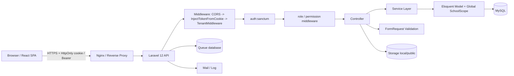
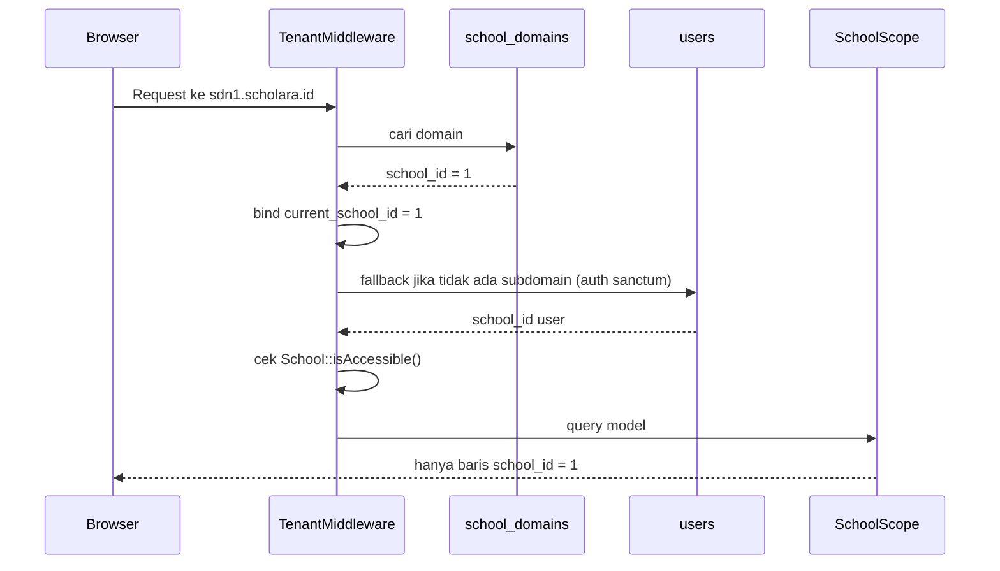
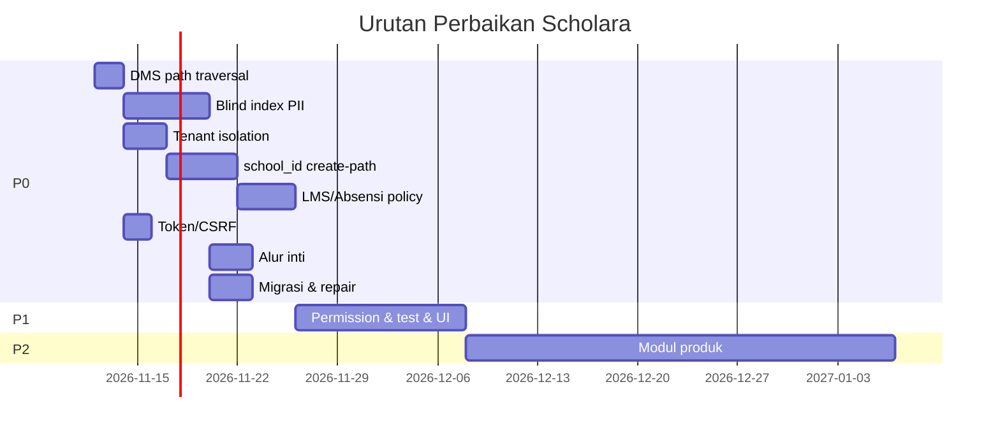

# LAPORAN AUDIT TEKNIS PROYEK SCHOLARA

**Versi laporan:** 1.0 (final)
**Tanggal audit:** 11 November 2026
**Objek audit:** Repositori `Scholara` — backend Laravel 12 + frontend React 19
**Branch / commit terakhir:** `main`, `00f4d4a` (11 November 2026 19:47)
**Mode audit:** Read-only static inspection + route listing
**Status runtime:** Database MySQL **tidak berjalan** — seluruh klaim yang membutuhkan eksekusi query, test suite, atau UI live ditandai **belum terverifikasi**

---

## 1. Ringkasan Eksekutif

Scholara adalah aplikasi SaaS manajemen sekolah multi-tenant dengan cakupan fitur yang sangat luas: 394 route (390 di antaranya API), 53 controller, 80 model, 83 migrasi, dan 144 halaman frontend. Secara arsitektur, fondasi yang dipilih sudah benar: Laravel 12, Sanctum, global scope tenant yang *fail-closed*, FormRequest untuk validasi, service layer untuk sebagian modul, serta React 19 + TanStack Query di frontend.

Namun, hasil audit menemukan bahwa **kualitas integrasi belum sejalan dengan luasnya cakupan**. Banyak modul hanya tersedia di backend tanpa UI yang terhubung, beberapa alur inti (detail/edit guru, detail/edit siswa, tambah anak oleh orang tua, DMS) **gagal secara desain** karena kolom PII terenkripsi dipakai sebagai kunci pencarian, dan terdapat **kerentanan kritis arbitrary file read** yang dapat membaca `backend/.env` (APP_KEY, kredensial database, dan mail) oleh pengguna dengan permission `dms.download`.

Dokumentasi proyek (`PROJECT_COMPLETION_MATRIX.md`, `PROGRESS.md`, `docs/audit/*` versi lama) **overstate** status penyelesaian. Matriks lama menandai mayoritas modul `✅ COMPLETED`, padahal audit statis menunjukkan banyak alur utama `BROKEN` atau `BACKEND ONLY`.

### 1.1 Skor akhir

**42 / 100 — TIDAK SIAP PRODUKSI (Not Production Ready)**

| Aspek | Skor | Catatan singkat |
|---|---:|---|
| Arsitektur & desain | 6,5 / 10 | Fondasi benar, tetapi tidak konsisten diterapkan |
| Kelengkapan fitur | 4,5 / 10 | Luas, banyak modul backend-only dan alur rusak |
| Kualitas backend | 5,5 / 10 | Validasi dan service layer baik; lookup PII dan tenant create-path bermasalah |
| Kualitas frontend | 5,0 / 10 | UI rapi, tetapi routing/role tidak sinkron dan banyak dead link |
| Multi-tenancy | 3,0 / 10 | Scope fail-closed benar, tetapi banyak kebocoran dan model tanpa scope |
| Keamanan | 2,0 / 10 | 2 kritis, 6 high; token tanpa expiry; tanpa CSRF API |
| Testing & QA | 1,5 / 10 | 107 test method, banyak test drift; tidak dapat dijalankan saat audit |
| Dokumentasi | 3,0 / 10 | Banyak dokumen, tetapi stale dan saling bertentangan |

### 1.2 Temuan paling kritis

1. **Arbitrary file read pada DMS** — `GET /api/operator/master-data/guru/{nuptk}/file-download?path=../../../.env` membaca file di luar direktori dokumen. Dapat mengekspos `APP_KEY` dan kredensial database.
2. **PII terenkripsi dipakai sebagai kunci query** — 124 pemanggilan `where('nuptk', ...)` / `where('nisn', ...)` tidak akan cocok dengan ciphertext. Detail/edit guru, detail/edit siswa, tambah anak, absensi, dan verifikasi guru gagal; aturan `unique` juga tidak efektif.
3. **Kebocoran lintas tenant melalui `orWhere` tanpa grouping** — pencarian di daftar user, daftar orang tua, dan daftar siswa dapat mengembalikan data sekolah lain.
4. **`pengaturans` global** — kode registrasi orang tua dibaca/ditulis hanya berdasarkan `key`, sehingga satu sekolah dapat mengubah kode untuk semua sekolah, dan sekolah tanpa baris gagal menyimpan.
5. **Galeri tanpa tenant scope** — endpoint publik mengembalikan galeri semua sekolah; `destroy` dapat menghapus data sekolah lain; `store` gagal karena `school_id` NOT NULL tidak diisi.
6. **`school_id` NOT NULL tetapi create-path tidak mengisinya** — puluhan model anak (`GuruDokumen`, `RiwayatKelas`, `OperatorProfile`, `UserBendahara`, dan lain-lain) menyebabkan HTTP 500 pada alur normal.
7. **Otorisasi object-level LMS dan Absensi tidak ada** — guru dapat mengubah/menghapus konten guru lain; siswa dapat mengakses materi/ujian kelas lain; absensi siapa pun dapat diedit.
8. **Token Sanctum tidak pernah kedaluwarsa** dan API cookie-auth tidak memiliki proteksi CSRF eksplisit.

### 1.3 Yang sudah baik

- Global scope tenant `SchoolScope` bersifat *fail-closed* (`whereRaw('1 = 0')`) ketika sekolah tidak ter-resolve.
- Login memiliki throttle 5 percobaan/menit, pesan anti-enumerasi, dan filter tenant.
- 108 FormRequest menunjukkan disiplin validasi yang tinggi.
- `RbacCatalog` + command `permissions:sync` memberi dasar RBAC yang bisa dioperasikan.
- Frontend menggunakan HttpOnly cookie (bukan `localStorage`), Axios `withCredentials`, dan TanStack Query.
- Tidak ditemukan `dangerouslySetInnerHTML`, `eval`, atau `new Function` di frontend.
- CORS memakai daftar origin eksplisit dari env, bukan wildcard.
- Modul Kurikulum (Wakasek) relatif paling matang: model, service, controller, route, dan UI konsisten.

### 1.4 Rekomendasi utama

**Jangan rilis ke produksi** sebelum 8 item P0 di Bagian 18 selesai. Perbaikan paling mendesak adalah menutup path traversal DMS, mengganti seluruh lookup PII dengan **blind index** (hash deterministik), dan menutup kebocoran tenant pada pencarian serta `pengaturans`/galeri. Setelah itu, perbaiki create-path `school_id`, tambahkan otorisasi object-level, dan jalankan ulang test suite di MySQL yang sehat.

---

## 2. Ruang Lingkup, Metodologi, dan Batasan

### 2.1 Ruang lingkup

| Area | Diperiksa | Tidak diperiksa |
|---|---|---|
| Backend | `app/`, `routes/`, `config/`, `database/migrations/`, `tests/`, `composer.json` | Eksekusi endpoint live, queue worker, scheduler |
| Frontend | `src/`, `package.json`, `vite.config.js`, `dist/` yang ada | Uji browser interaktif, Lighthouse, aksesibilitas manual |
| Database | Struktur migrasi, relasi model, index, constraint | Isi data, query plan, status migrasi aktual |
| Infrastruktur | Config deployment, filesystem, CORS, Sanctum | Docker/CI (tidak ditemukan), server produksi |
| Dokumentasi | Root docs, `docs/`, `docs/audit/` | Dokumen eksternal/Notion |

### 2.2 Metode

1. Inventarisasi repositori dan dependensi.
2. Pembacaan seluruh route API per domain dan pencocokan ke controller.
3. Pembacaan controller, FormRequest, service, model, trait, scope, dan middleware.
4. Pembacaan 83 migrasi untuk memahami skema, constraint, dan urutan perubahan.
5. Pembacaan frontend: `App.jsx`, layout, sidebar, context, axios, halaman per role.
6. Pencarian statis pola berisiko: `where('nuptk')`, `where('nisn')`, `orWhere`, `findOrFail`, `storage_path`, `school_id`, `ComingSoon`, dan sebagainya.
7. `php artisan route:list`, `php artisan about`, dan percobaan `php artisan db:show`.
8. Penilaian severity berdasarkan dampak nyata + kemudahan eksploitasi, bukan hanya pola kode.

### 2.3 Label bukti

| Label | Arti |
|---|---|
| **Terverifikasi statis** | Ditemukan langsung di file/baris kode, config, atau output route |
| **Belum terverifikasi** | Membutuhkan runtime, database, atau browser |
| **Tidak dapat diuji** | DB MySQL tidak berjalan pada saat audit |

### 2.4 Batasan

- **MySQL tidak berjalan.** `php artisan db:show` menghasilkan `SQLSTATE[HY000] [2002] Connection refused`. Akibatnya status migrasi, isi tabel, dan seluruh test suite tidak dapat diverifikasi.
- **Tidak ada Docker/CI/CD** di repositori, sehingga perilaku deployment tidak dapat diuji.
- **`frontend/dist`** yang dianalisis adalah build lokal 11 September 2026, bukan hasil build ulang.
- **Tidak ada perubahan kode aplikasi.** Audit ini hanya membaca dan menulis dokumen audit.
- **Kredensial tidak dicetak.** Lokasi secret disebutkan, nilainya tidak.

---

## 3. Technology Stack

### 3.1 Backend

| Komponen | Versi / Keputusan | Catatan |
|---|---|---|
| PHP | 8.2.30 | Sesuai `composer.json` (`^8.2`) |
| Framework | Laravel 12.62.0 | Struktur baru `bootstrap/app.php` |
| Autentikasi | Laravel Sanctum 4.3.2 | Token + HttpOnly cookie |
| Excel | PhpSpreadsheet 5.9.0 | Import/export guru, siswa, mapel |
| Testing | PHPUnit 11.5.50 | 14 file test |
| Queue | `database` (default) | Perlu worker; belum ada bukti deployment |
| Cache | `database` (default) | Tidak ada Redis terpasang |
| Filesystem | `local` (default) | `local.root = storage/app/private` |
| Database | MySQL | Client 9.6; server tidak berjalan saat audit |
| Predis | 3.6 | Terpasang, tetapi cache default database |

### 3.2 Frontend

| Komponen | Versi | Catatan |
|---|---|---|
| React | 19.2.7 | React 19, tanpa TypeScript |
| Vite | 8.1.0 | Build cepat; belum ada code splitting |
| Tailwind CSS | 4.3.2 | Konfigurasi via `@tailwindcss/vite` |
| React Router | 7.18.0 | 86 deklarasi `<Route>` di `App.jsx` |
| TanStack Query | 5.101.1 | Manajemen data server |
| TanStack Table | 8.21.3 | Tabel master data |
| Axios | 1.18.1 | `withCredentials: true` |
| Recharts | 3.9.0 | Grafik dashboard |
| jsPDF + autotable | 4.2.1 / 5.0.8 | Export PDF |
| xlsx | 0.18.5 | **Risiko dependensi** — versi npm ini punya CVE known |
| oxlint | 1.69.0 | Linter, bukan ESLint |
| Day.js | 1.11.21 | Format tanggal |

### 3.3 Infrastruktur & tooling

- Tidak ditemukan `Dockerfile`, `docker-compose.yml`, atau konfigurasi CI (GitHub Actions/GitLab CI).
- Tidak ditemukan konfigurasi monitoring/APM, log aggregation, atau backup otomatis.
- `backend/.env` dan `frontend/.env` ada secara lokal dan **gitignored**; `phpunit.xml` juga gitignored tetapi berisi kredensial DB lokal.
- `frontend/dist` gitignored; build terakhir 11 September 2026.

### 3.4 Kesesuaian dengan dokumentasi

`docs/02-architecture.md` dan `docs/04-api-standard.md` menyebut prefix `/api/v1/`, sedangkan kode memakai `/api/*` tanpa versi. Ini bukan sekadar dokumentasi stale: tidak ada strategi versioning API, sehingga perubahan breaking tidak punya jalur migrasi.

---

## 4. Arsitektur Sistem

### 4.1 Gambaran tingkat tinggi



### 4.2 Layer dan tanggung jawab

| Layer | Lokasi | Tanggung jawab | Catatan audit |
|---|---|---|---|
| Entry | `public/index.php`, `bootstrap/app.php` | Bootstrap, middleware global | CORS + inject token + tenant di-prepend ke API |
| Routing | `routes/api/*.php` (15 file) | Pemetaan endpoint per domain | 390 route API; `master-data.php` 194 route |
| Middleware | `app/Http/Middleware` | Tenant, role, permission, cookie token | `TenantMiddleware` tidak memakai header `X-School-ID` |
| Validasi | `app/Http/Requests` (108) | Validasi input | Konsisten, tetapi beberapa rule unique salah konteks |
| Controller | `app/Http/Controllers` (53) | Orkestrasi request/response | Banyak controller gemuk; sebagian memanggil service |
| Service | `app/Services` (14) | Logika domain kompleks | Dipakai di guru, DMS, kurikulum, import/export, mutasi |
| Model | `app/Models` (80) | Relasi, cast, scope | 36 model memakai `HasSchoolScope`; sisanya tidak |
| Scope | `app/Models/Scopes/SchoolScope.php` | Isolasi tenant | Fail-closed, tetapi dapat dilewati `withoutGlobalScope` |
| Cast | `app/Casts` | Enkripsi PII | Random IV; tidak bisa dipakai untuk WHERE |
| Observer | `app/Observers` | Activity log | Menulis PII terdekripsi ke log |
| Policy | `app/Policies` (7) | Otorisasi | Cakupan rendah dibanding jumlah controller |

### 4.3 Siklus hidup request

1. **CORS** menangani preflight dan memvalidasi origin dari `CORS_ALLOWED_ORIGINS`.
2. **`InjectTokenFromCookie`** membaca cookie `auth_token` jika tidak ada `Authorization: Bearer`, mencoba dekripsi, lalu fallback ke nilai mentah.
3. **`TenantMiddleware`** me-resolve sekolah dari subdomain (`school_domains`), lalu fallback ke `school_id` user Sanctum; memblokir sekolah suspended/trial yang tidak aktif.
4. **`auth:sanctum`** memvalidasi token.
5. **`role:` / `permission:`** memeriksa akses modul.
6. **Controller** memvalidasi via FormRequest, memanggil service/model.
7. **`SchoolScope`** menambahkan `school_id = ?` ke query model yang memakai trait.
8. **Response** memakai envelope `{success, message, data}` atau `{success, code, message, errors}`.

### 4.4 Peta modul

| Domain | Route file | Controller utama | Model inti | UI |
|---|---|---|---|---|
| Auth | `auth.php` | `AuthController`, `PasswordResetController` | `User`, `School` | Login, register, reset |
| Operator | `operator.php` | `OperatorController` | `User`, `OperatorProfile` | Dashboard, manajemen akun |
| Master data | `master-data.php` | 20+ controller | `Guru`, `Siswa`, `Kelas`, `Mapel`, `Jadwal` | Operator, Wakasek, Kepsek |
| Absensi | `absensi.php` | `AbsensiController` | `Absensi` | Guru, Ortu, Kepsek |
| LMS | `lms.php` | `AssignmentController`, `ExamController`, `CourseMaterialController` | `Assignment`, `Exam`, `CourseMaterial` | Guru saja |
| Keuangan | `keuangan.php` | `KeuanganController` dan terkait | `JenisTagihan`, `Tagihan`, `Pembayaran` | Tidak terdaftar |
| PPDB | `ppdb.php` | `PpdbController` dan terkait | `CalonSiswa`, `BerkasPendaftar` | Publik + admin (ComingSoon) |
| BK | `bk.php` | `BkController` | `BkCatatan`, `BkKonseling` | ComingSoon |
| Perpustakaan | `perpustakaan.php` | `PerpustakaanController` | `PerpustakaanBuku`, `PerpustakaanPeminjaman` | ComingSoon |
| Tata usaha | `tata-usaha.php` | `TataUsahaController` | `Surat`, `Legalisir` | ComingSoon |
| Portal guru | `guru.php` | `GuruProfileController`, `GuruDokumenController` | `Guru`, `GuruDokumen` | Guru |
| Portal kepsek | `kepsek.php` | `KepsekController` | read-only lintas modul | Kepsek |
| Portal wakasek | `wakasek.php` | `WakasekController`, kurikulum | `Kurikulum`, `KurikulumStruktur` | Wakasek |
| Portal ortu | `ortu.php` | `OrtuController` | `OrangTua`, `Siswa` | Ortu |
| Publik | `public.php` | `GaleriController`, `PengumumanController` | `Galeri`, `Pengumuman` | Landing, galeri, PPDB |

### 4.5 Kekuatan arsitektur

- Pemisahan route per domain membuat navigasi kode mudah.
- FormRequest memisahkan validasi dari controller.
- Service layer dipakai pada modul yang kompleks (import guru, DMS, kurikulum, mutasi).
- Global scope tenant adalah keputusan desain yang tepat untuk shared-database multi-tenant.
- Response envelope konsisten di mayoritas endpoint.

### 4.6 Kelemahan arsitektur

- **Tidak ada versioning API** dan dokumentasi kontrak tidak sinkron.
- **Dua implementasi DMS** (`MasterData\Guru\GuruDokumenController` dan `Guru\GuruDokumenController`) dengan perilaku keamanan berbeda; route aktif memakai yang rentan.
- **Model anak tidak mengikuti pola tenant** — 19+ model anak tidak memakai `HasSchoolScope` dan tidak mengisi `school_id`.
- **Fat controller** masih dominan di operator/master data; aturan bisnis tersebar antara controller, service, dan observer.
- **Tidak ada policy** untuk LMS, absensi, DMS, dan keuangan; otorisasi mengandalkan role/permission global, bukan kepemilikan objek.
- **Tidak ada queue job** untuk pekerjaan berat (import/export besar, enkripsi massal, email massal).
- **Tidak ada API resource/DTO**; model Eloquent dikirim langsung, sehingga field sensitif dan bentuk response sulit dikontrol.

---

## 5. Kesehatan Codebase

### 5.1 Metrik

| Metrik | Nilai | Interpretasi |
|---|---:|---|
| Controller backend | 53 | Cakupan luas |
| Model | 80 | Termasuk 36 dengan `HasSchoolScope` |
| Migrasi | 83 | Termasuk 123 deklarasi `Schema::create` unik |
| FormRequest | 108 | Disiplin validasi baik |
| Service | 14 | Service layer ada, belum merata |
| Policy | 7 | Rendah untuk 53 controller |
| Route total | 394 | 390 API + 4 web |
| Route API per domain | master-data 194; lms 32; operator 23; keuangan 20; kepsek 17; wakasek 17; ppdb 16; bk/perpustakaan/TU 12 each; guru 11; ortu 10; auth 7; absensi 5; public 2 | `master-data.php` sangat besar |
| LOC backend | ±45.400 | `app/` + `routes/` + `database/` |
| File frontend | 211 JS/JSX | 144 halaman, 25 komponen |
| LOC frontend | ±77.000 | Termasuk halaman |
| Deklarasi `<Route>` | 86 di `App.jsx` | Beberapa halaman tidak terdaftar |
| Test file / method | 14 / 107 | Cakupan tidak merata |

### 5.2 Kekuatan

1. **Validasi terpusat** — 108 FormRequest adalah sinyal positif; sebagian besar input tidak masuk mentah ke controller.
2. **Tenant scope fail-closed** — jika `current_school_id` tidak ter-bind, query mengembalikan nol baris, bukan seluruh data.
3. **Pemisahan route per domain** — memudahkan audit dan onboarding.
4. **Service untuk logika kompleks** — import/export guru, DMS, kurikulum, dan mutasi tidak sepenuhnya di controller.
5. **Konsistensi response** — mayoritas endpoint memakai `success/message/data`.
6. **Frontend modern** — React 19, TanStack Query, React Router 7, Tailwind 4.
7. **Tidak ada XSS sink berbahaya** — tidak ditemukan `dangerouslySetInnerHTML`, `eval`, atau `new Function`.

### 5.3 Kelemahan

1. **Duplikasi implementasi** — DMS punya dua controller; beberapa endpoint master data punya logika serupa di operator, wakasek, dan kepsek.
2. **Inkonsistensi tenant** — sebagian model memakai scope, sebagian hanya punya kolom `school_id`, sebagian tidak punya keduanya.
3. **Inkonsistensi status** — `getRoleSlug()` memprioritaskan `guru` di atas `wali_kelas`, sementara frontend memakai `user.role` tunggal.
4. **Dead code** — halaman keuangan tidak terdaftar, beberapa sidebar menuju route yang tidak ada, dan `getCookie` di axios tidak pernah mengembalikan token HttpOnly.
5. **Testing drift** — helper test masih mengirim `X-School-ID` yang sudah dihapus; assertion `pluck('nuptk')` membaca ciphertext.
6. **Dokumentasi tidak dapat dipercaya** — klaim completion 62% dan `✅` pada banyak modul tidak sesuai kode.
7. **Tidak ada quality gate** — tidak ada CI, tidak ada analisis statis PHP (PHPStan/Psalm), dan linter frontend hanya oxlint.

### 5.4 Indikasi technical debt struktural

- `master-data.php` dengan 194 route adalah *god route file*; sulit diuji dan mudah konflik.
- `OperatorController` menangani akun, profil, pengaturan, dan statistik dalam satu kelas besar.
- Banyak model anak tidak punya `school_id` di `$fillable` meskipun kolomnya NOT NULL.
- Cast `EncryptedString` dan kebutuhan pencarian PII tidak pernah didesain bersama; ini akar dari puluhan bug.
- Tidak ada pembatasan ukuran/tipe file yang konsisten antara upload dan download DMS.

---

## 6. Audit Backend

### 6.1 Distribusi route

| File | Jumlah route | Catatan |
|---|---:|---|
| `master-data.php` | 194 | Guru, siswa, kelas, mapel, jadwal, DMS, kurikulum, tahun ajaran |
| `lms.php` | 32 | Materi, tugas, ujian, submission, sesi ujian |
| `operator.php` | 23 | Akun, profil, pengaturan, approval ortu |
| `keuangan.php` | 20 | Jenis tagihan, tagihan, pembayaran |
| `kepsek.php` | 17 | Monitoring read-only |
| `wakasek.php` | 17 | Kurikulum, program, mapel, kelas, laporan |
| `ppdb.php` | 16 | Pendaftaran, berkas, verifikasi, konversi |
| `bk.php` | 12 | Catatan dan konseling |
| `perpustakaan.php` | 12 | Buku dan peminjaman |
| `tata-usaha.php` | 12 | Surat dan legalisir |
| `guru.php` | 11 | Profil, DMS, cuti, absensi |
| `ortu.php` | 10 | Anak, absensi, pengumuman, profil |
| `auth.php` | 7 | Login, logout, me, register, reset |
| `absensi.php` | 5 | Jadwal, kelas, store, update, rekap |
| `public.php` | 2 | Galeri dan pengumuman publik |

### 6.2 Pola controller

**Baik:**
- Sebagian besar method mengembalikan status code eksplisit (201 untuk create, 404 untuk not found).
- FormRequest dipakai untuk store/update.
- Transaksi database dipakai pada operasi multi-tabel (create user + profile, import, kenaikan kelas).
- Service digunakan untuk DMS, import/export, kurikulum, dan mutasi.

**Bermasalah:**
- **Lookup PII plaintext** — 124 occurrence `where('nuptk')`/`where('nisn')` di controller.
- **Otorisasi kepemilikan tidak ada** — `findOrFail($id)` pada LMS dan absensi tanpa cek `guru_id`/kelas.
- **Create-path tanpa `school_id`** — model anak dan profil dibuat tanpa tenant.
- **Query pencarian tanpa grouping** — `orWhere` bercampur dengan filter role/tenant.
- **Response model langsung** — field sensitif bisa ikut terkirim jika tidak disembunyikan.
- **Duplikasi controller DMS** — satu aman, satu rentan; route memakai yang rentan.

### 6.3 Validasi

Kekuatan:
- 108 FormRequest, banyak dengan `authorize()`.
- Pesan error Bahasa Indonesia.
- Validasi ukuran file/foto di beberapa request.

Kelemahan:
- **`unique` tanpa scope tenant** — `unique:users,username`, `unique:siswas,nisn`, `unique:gurus,nuptk` bertentangan dengan index komposit `(school_id, ...)`.
- **`unique` pada kolom terenkripsi tidak pernah cocok** — plaintext dibandingkan dengan ciphertext.
- **Tidak ada validasi path** pada `downloadFile` DMS.
- **Tidak ada validasi `school_id`** pada request yang menerima relasi (mis. `kelas_id`) sehingga objek lintas tenant bisa dirujuk jika scope model anak tidak ada.

### 6.4 Service layer

| Service | Fungsi | Catatan |
|---|---|---|
| `GuruImportService` | Import Excel guru | Deteksi duplikat berbasis NUPTK terenkripsi berisiko |
| `GuruExportService` | Export Excel | Perlu verifikasi kolom PII |
| `GuruDokumenService` | Upload/version/log DMS | Tidak mengisi `school_id`; simpan ke disk `local`, baca dari `public` |
| `GuruCutiService` | Pengajuan cuti | Model `GuruCuti` tanpa tenant scope |
| `MutasiGuruService` | Mutasi guru | Model anak tanpa tenant |
| `KurikulumService` | Struktur kurikulum | Paling matang; memakai `DomainException` |
| `SiswaImportService` | Import siswa | Risiko duplikat NISN |
| `NaikKelasService` | Kenaikan kelas massal | `RiwayatKelas::create` tanpa `school_id` |

### 6.5 Model dan relasi

- 80 model, 36 memakai `HasSchoolScope`.
- Model tanpa scope namun memiliki kolom `school_id`: `ActivityLog`, `GlobalUser`, `GlobalUserSchool`, `Kurikulum`, `KurikulumKomponenNilai`, `SaasCouponUsage`, `SaasInvoice`, `SaasPayment`, `SchoolDomain`, `SchoolSetting`, `SchoolSubscription`, `TenantUsageSnapshot`.
- Model anak guru (19+) tidak memakai scope dan tidak memiliki `school_id` di `$fillable`.
- `Kurikulum` sengaja tanpa scope karena `school_id` nullable (komentar di model), tetapi ini membuat query kurikulum global harus eksplisit.
- `Galeri` dan `Pengaturan` tidak memakai scope meskipun tabelnya memiliki `school_id` NOT NULL.

### 6.6 Error handling

- `bootstrap/app.php` memetakan `DomainException` → 422, `ValidationException` → 422, `ModelNotFoundException` → 404, `NotFoundHttpException` → 404, `AuthenticationException` → 401, `AuthorizationException` → 403, `ThrottleRequestsException` → 429.
- Ini konsisten dan ramah frontend.
- Namun error 500 dari pelanggaran NOT NULL / "Data too long" tidak ditangani secara domain, sehingga pengguna melihat error generik.

### 6.7 Ringkasan temuan backend

| Tingkat | Jumlah | Contoh |
|---|---:|---|
| Kritis | 2 | Path traversal DMS; lookup PII terenkripsi |
| Tinggi | 6 | Tenant OR leak; `pengaturans` global; galeri lintas tenant; create-path `school_id`; LMS authz; absensi authz |
| Sedang | 5 | Token tanpa expiry; CSRF; permission gap; PII di log; DMS storage mismatch |
| Rendah | 4 | Reset password senyap; unique global; role slug; dead code |

---

## 7. Audit Frontend

### 7.1 Struktur

```
frontend/src/
├── App.jsx                 # 86 deklarasi Route
├── contexts/AuthContext.jsx
├── routes/ProtectedRoute.jsx
├── lib/axios.js
├── components/             # 25 komponen
├── pages/                  # 144 halaman
│   ├── auth/
│   ├── operator/
│   ├── guru/
│   ├── kepsek/
│   ├── wakasek/
│   ├── ortu/
│   ├── siswa/
│   ├── bendahara/
│   ├── admin-keuangan/
│   ├── adminppdb/
│   ├── guru-bk/
│   ├── pustakawan/
│   ├── tata-usaha/
│   ├── superadmin/
│   └── public/
└── services/
```

### 7.2 Routing dan peran

- `ProtectedRoute` hanya memeriksa `user.role` tunggal (`roles.includes(user.role)`), bukan array `roles` dari backend.
- Backend `getRoleSlug()` memprioritaskan `guru` di atas `wali_kelas`. Akibatnya user yang memiliki kedua role tampil sebagai `guru` dan tidak bisa mengakses dashboard wali kelas.
- Route `/guru` hanya mengizinkan `guru`, sedangkan backend mengizinkan `guru,wali_kelas`.
- Dashboard `wali_kelas`, `guru_bk`, `pustakawan`, `tata_usaha`, `admin_keuangan`, `bendahara`, `siswa`, `superadmin`, dan `admin_ppdb` masih memakai `ComingSoonDashboard`.
- Halaman keuangan yang sudah berfungsi (`pages/bendahara/keuangan/*`) tidak terdaftar di `App.jsx`.

### 7.3 State dan API layer

- `AuthContext` memanggil `/auth/me`, menyimpan `user` di state, dan menangani loading.
- Axios memakai `withCredentials: true` dan response interceptor 401 → redirect `/login`, kecuali `/auth/me`.
- **Dead code:** `getCookie('auth_token')` tidak akan pernah membaca cookie karena cookie bersifat HttpOnly. Komentar di file bahkan mengakui hal ini. Tidak berbahaya, tetapi menyesatkan.
- **Fallback URL tidak konsisten:** `axios.js` memakai `http://127.0.0.1:8000`; beberapa komponen memakai `8001`; backend berjalan di `8001` pada environment audit.

### 7.4 UI dan bundle

| Artefak | Ukuran | Catatan |
|---|---:|---|
| `index-*.js` | 3,1 MB | Satu chunk utama, tidak ada `React.lazy` |
| `index-*.css` | 276 KB | Tailwind penuh |
| `background-*.jpg` | 1,1 MB | Aset landing page |
| `logo-*.png` | 412 KB | Tidak dioptimasi |
| `html2canvas` chunk | 195 KB | Dimuat terpisah |
| Total `dist` | ±5,3 MB | Terlalu berat untuk koneksi sekolah |

Tidak ada code splitting per route, lazy loading, atau kompresi gambar. Build tanggal 11 September 2026, sehingga ukuran bisa berbeda setelah perubahan terakhir.

### 7.5 Dead link dan halaman tidak terdaftar

| Lokasi | Link | Status |
|---|---|---|
| `OperatorSidebar` | `/operator/keuangan*` | Route tidak ada |
| `OperatorSidebar` | `/operator/approval-ortu` | Route aktual `ortu-pending` |
| `OperatorSidebar` | `/operator/manajemen-akun` | Halaman di-render di index `/operator`, route terpisah tidak ada |
| `OperatorSidebar` | `/operator/akademik/*` | Route tidak ada |
| `OperatorSidebar` | `/operator/kesiswaan/*` | Route tidak ada |
| `OperatorSidebar` | `/operator/ppdb/*` | Route tidak ada |
| `OperatorSidebar` | `/operator/laporan/*` | Route tidak ada |
| `OperatorSidebar` | `/operator/absensi`, `/operator/surat` | Route tidak ada |
| `BendaharaLayout` | `/bendahara/laporan`, `/bendahara/profil` | Route tidak ada |
| `App.jsx` | `pages/bendahara/keuangan/*` | Tidak diimpor/didaftarkan |

### 7.6 Ringkasan temuan frontend

| Tingkat | Temuan |
|---|---|
| Tinggi | Role/route mismatch; dashboard wali kelas & siswa tidak berfungsi |
| Sedang | Banyak dead link; halaman keuangan tidak terdaftar; bundle 3,1 MB |
| Rendah | Dead code `getCookie`; fallback URL tidak konsisten; aset besar |

---

## 8. Audit Database dan Migrasi

### 8.1 Skala skema

- 83 file migrasi.
- 123 deklarasi `Schema::create` unik (termasuk tabel SaaS, sekolah, dan operasional).
- 52 file migrasi menyebut `school_id`.
- Migrasi `2026_08_11_000001_fix_multitenant_critical_issues.php`:
  - Menambahkan `school_id` ke **9 tabel**.
  - Mengubah `school_id` menjadi **NOT NULL** pada **53 tabel**.
  - Mengganti **7 unique constraint** menjadi komposit `(school_id, kolom)`.

### 8.2 Domain tabel

| Domain | Contoh tabel | Catatan |
|---|---|---|
| SaaS / tenant | `schools`, `school_domains`, `school_settings`, `school_subscriptions`, `saas_plans`, `saas_invoices` | Model SaaS ada, controller/route tidak ada |
| Identitas | `users`, `roles`, `permissions`, `role_permissions`, `personal_access_tokens`, `sessions` | `personal_access_tokens` punya `school_id` |
| Akademik | `tahun_ajarans`, `semesters`, `kelas`, `mapels`, `jadwal_pelajarans`, `plot_guru_mapels` | Composite unique per sekolah |
| Siswa/Guru | `siswas`, `gurus`, `orang_tuas`, `orang_tua_siswa`, `riwayat_kelas` | Kolom PII terenkripsi |
| Absensi | `absensis` | Index tanggal/kelas |
| LMS | `course_materials`, `assignments`, `assignment_submissions`, `exams`, `exam_questions`, `exam_student_sessions` | Tidak ada cek kepemilikan di controller |
| Keuangan | `jenis_tagihans`, `tagihans`, `pembayarans` | UI belum terhubung |
| PPDB | `calon_siswas`, `berkas_pendaftars`, `pembayaran_ppdb` | Konversi ke siswa berisiko |
| BK/Perpus/TU | `bk_catatans`, `bk_konselings`, `perpustakaan_bukus`, `perpustakaan_peminjamans`, `surats`, `legalisirs` | UI ComingSoon |
| DMS | `guru_dokumens`, `guru_dokumen_versions`, `guru_dokumen_logs` | Tidak punya scope |
| Nilai/Rapor | `nilais`, `nilai_akhirs`, `rapors` | **Tabel ada**, model/API/UI tidak ada |

### 8.3 Enkripsi PII

**Desain:**
- `EncryptedString` memakai `Crypt::encryptString` (AES-256-CBC, random IV).
- Cast diterapkan pada `siswas.nisn/nik/no_kk`, `gurus.nuptk/nik/nip/no_kk`, `orang_tuas.nik/no_kk`.
- Dokumentasi cast sendiri menyatakan field ini **tidak bisa di-WHERE/filter** dan menyarankan hash terpisah.

**Masalah:**
1. **Lookup rusak** — 124 query `where('nuptk')`/`where('nisn')` membandingkan plaintext dengan ciphertext. Data lama yang masih plaintext dapat cocok, tetapi setelah backfill/enkripsi seluruh alur ini gagal untuk data baru.
2. **Unique tidak efektif** — rule `unique:siswas,nisn` dan `unique:gurus,nuptk` tidak pernah mendeteksi duplikat; composite unique index pada kolom terenkripsi juga tidak efektif karena IV acak.
3. **Urutan migrasi berbahaya** — migrasi enkripsi data lama (`2026_08_20_000005`) berjalan **sebelum** pelebaran kolom (`2026_10_14_000001`). Kolom awal 10–18 karakter tidak cukup untuk ciphertext ~230+ karakter, sehingga pada database yang dibangun dari nol, enkripsi data lama berpotensi gagal `Data too long`.
4. **Data lama tidak terenkripsi** — cast mengembalikan nilai asli jika dekripsi gagal (backward compatibility), sehingga data plaintext lama tetap bisa terbaca dan lolos dari enkripsi.
5. **PII di activity log** — observer menulis NUPTK/NISN terdekripsi ke `activity_logs.keterangan`, membatalkan manfaat enkripsi at-rest.

### 8.4 Index dan constraint

- Composite unique ditambahkan untuk `gurus` (email, nik, nip, nuptk), `mapels.kode`, `siswas.kode_anak`, `calon_siswas.no_pendaftaran`, dan `users.username`.
- **Tidak ada index pada kolom hash PII** karena kolom hash belum ada.
- Index `orang_tuas (school_id, nik)` ditambahkan, tetapi `nik` terenkripsi sehingga index tidak berguna untuk pencarian.
- Banyak `DB::statement` MySQL mentah (`ALTER TABLE`, `UPDATE JOIN`) membuat migrasi tidak portabel ke PostgreSQL/SQLite.

### 8.5 Integritas data

- `school_id` NOT NULL diberlakukan dengan menghapus baris orphan (`DELETE ... WHERE school_id IS NULL`) sebelum `ALTER TABLE`. Ini **destruktif** dan tidak memiliki backup otomatis.
- Kebijakan ini benar untuk integritas tenant, tetapi berisiko jika dijalankan pada data produksi tanpa audit orphan terlebih dahulu.
- `nilais`, `nilai_akhirs`, dan `rapors` memiliki tabel dan composite unique, tetapi tidak ada model sehingga tidak ada validasi aplikasi.

### 8.6 Status verifikasi database

| Klaim | Status |
|---|---|
| Jumlah migrasi dan struktur | Terverifikasi statis |
| Status migrasi aktual (`migrate:status`) | Tidak dapat diuji (DB down) |
| Isi data dan orphan | Tidak dapat diuji |
| Query plan/index usage | Tidak dapat diuji |
| Test suite | Tidak dapat diuji |
| Enkripsi data lama | Tidak dapat diuji; urutan migrasi menunjukkan risiko |

## 9. Multi-Tenancy

### 9.1 Model tenant yang dipakai

Scholara memakai **shared database, shared schema, discriminator `school_id`**. Setiap sekolah adalah baris di `schools`; domain sekolah dipetakan di `school_domains`; hampir semua tabel operasional memiliki `school_id`. Ini adalah model yang tepat untuk SaaS sekolah dengan jumlah tenant menengah, selama scope dan constraint konsisten.

### 9.2 Alur resolusi tenant



Catatan penting:
- Header `X-School-ID` **sudah dihapus** dan tidak lagi dipercaya. Ini keputusan keamanan yang benar.
- `TenantMiddleware` memakai `$request->user('sanctum')` sebagai fallback, sehingga request tanpa subdomain tetap bisa ter-resolve jika membawa token.
- Sekolah suspended/trial yang tidak aktif diblokir oleh `School::isAccessible()`.

### 9.3 Mekanisme scope

`SchoolScope`:
- Jika `current_school_id` ter-bind → `where school_id = ?`.
- Jika tidak ter-bind → `whereRaw('1 = 0')` (fail-closed).
- `HasSchoolScope` menambahkan scope saat boot dan mengisi `school_id` otomatis **hanya jika** `app('current_school_id')` ter-bind.

`PersonalAccessToken::tokenable()` sengaja melewati scope untuk menghindari rekursi saat autentikasi. Ini benar, tetapi berarti query token harus selalu dibatasi secara eksplisit.

### 9.4 Celah isolasi tenant

#### A. Pencarian dengan `orWhere` tanpa grouping

Global scope menambahkan `AND school_id = ?` **setelah** kondisi `OR`, sehingga presedensi SQL membuat filter tenant hanya mengikat salah satu cabang.

| File | Baris | Dampak |
|---|---:|---|
| `OperatorController::index` | 73–76 | User dari sekolah lain muncul pada pencarian nama/username/email; filter role juga bisa terlewati |
| `OperatorController::listOrtu` | 287–288 | Orang tua dari sekolah lain muncul |
| `MasterDataSiswaController::index` | 80–84 | Siswa dari sekolah lain muncul |

Pola yang benar: bungkus semua `orWhere` dalam satu closure `where(function ($q) { ... })`.

#### B. `pengaturans` global

- Tabel `pengaturans` memiliki `school_id` NOT NULL dan unique `(school_id, key)`.
- Model `Pengaturan` **tidak** memakai `HasSchoolScope` dan **tidak** memiliki `school_id` di `$fillable`.
- `OperatorController::getKodeRegistrasi` (baris 44) dan `updateKodeRegistrasi` (baris 53) query berdasarkan `key` saja.
- `AuthController::registerOrtu` (baris 190) juga membaca berdasarkan `key` saja.

Dampak:
1. Sekolah A dapat mengubah kode registrasi yang dibaca sekolah B.
2. `updateOrCreate(['key' => ...])` dapat menimpa baris sekolah lain atau gagal karena unique `(school_id, key)`.
3. Sekolah yang belum punya baris tidak bisa menyimpan kode.

#### C. Galeri lintas tenant

- `galeris.school_id` NOT NULL ditambahkan oleh migrasi 2026-08-11.
- Model `Galeri` tidak memakai `HasSchoolScope`, tidak memiliki `school_id` di `$fillable`.
- `GaleriController::index` mengembalikan **semua** galeri semua sekolah.
- `destroy` menghapus baris mana pun berdasarkan ID.
- `store` gagal karena `school_id` tidak diisi.

#### D. Model tanpa scope

36 dari 80 model memakai `HasSchoolScope`. Model berikut memiliki `school_id` tetapi tidak memakai scope:

`ActivityLog`, `GlobalUser`, `GlobalUserSchool`, `Kurikulum`, `KurikulumKomponenNilai`, `SaasCouponUsage`, `SaasInvoice`, `SaasPayment`, `SchoolDomain`, `SchoolSetting`, `SchoolSubscription`, `TenantUsageSnapshot`.

Model anak guru dan beberapa model operasional **tidak memiliki scope maupun `school_id` di `$fillable`**:

`GuruJabatan`, `GuruPendidikan`, `GuruSertifikasi`, `GuruInpassing`, `GuruDiklat`, `GuruMutasi`, `GuruKeluarga`, `GuruRekening`, `GuruDokumen`, `GuruAbsensi`, `GuruImportLog`, `GuruAnak`, `GuruKontakDarurat`, `GuruKompetensi`, `GuruCuti`, `GuruPkg`, `OperatorProfile`, `UserBendahara`, `UserWaliKelas`, `RiwayatKelas`, `Galeri`, `Pengaturan`, `KurikulumKomponenNilai`.

#### E. Create-path melanggar NOT NULL

Karena `school_id` sudah NOT NULL tetapi model tidak mengisinya, alur berikut berakhir HTTP 500:

| Alur | Lokasi | Bukti |
|---|---|---|
| Buat operator | `OperatorController:98` | `OperatorProfile::create(['user_id' => ...])` |
| Buat bendahara | `OperatorController:204` | `UserBendahara::create` tanpa `school_id` |
| Assign/riwayat kelas | `MasterDataKelasController:216`, `NaikKelasController:95`, `MasterDataSiswaController:549` | `RiwayatKelas::create` tanpa `school_id` |
| Upload dokumen guru | `GuruDokumenService` | `GuruDokumen`, `GuruDokumenVersion`, `GuruDokumenLog` tanpa `school_id` |
| Upload galeri | `GaleriController::store` | `Galeri::create` tanpa `school_id` |
| Cuti guru | `GuruCutiService` | `GuruCuti::create` tanpa `school_id` |
| Mutasi guru | `MutasiGuruService` | `GuruMutasi::create` tanpa `school_id` |

#### F. Test drift

Helper test masih mengirim header `X-School-ID` yang sudah tidak didukung middleware. `TenantIsolationTest` dan `GuruManagementTest` juga memakai `pluck('nuptk')` yang mengembalikan ciphertext karena cast tidak diterapkan pada `pluck`. Test suite kemungkinan besar gagal, tetapi tidak dapat dijalankan karena MySQL down.

### 9.5 Matriks isolasi per area

| Area | Isolasi | Status |
|---|---|---|
| Auth login | Filter `school_id` + `orWhereNull` untuk super_admin | Baik |
| Master guru/siswa (list) | Scope + pencarian OR | **Bocor** |
| Master guru/siswa (detail) | Scope + lookup PII | **Rusak** |
| Kelas/tahun ajaran/mapel | Scope + composite unique | Baik (statis) |
| Absensi | Scope model | Baik, tetapi otorisasi objek tidak ada |
| LMS | Scope model | Baik untuk tenant, buruk untuk kepemilikan |
| Keuangan | Scope model | Baik (statis) |
| PPDB | Scope model | Sebagian |
| Galeri | Tanpa scope | **Bocor** |
| Pengaturan | Tanpa scope | **Bocor** |
| DMS | Tanpa scope | **Rusak + kritis** |
| Activity log | Tanpa scope | Berpotensi bocor |
| SaaS | Tanpa scope (global) | Sesuai desain, belum ada API |

### 9.6 Rekomendasi multi-tenancy

1. Wajibkan `HasSchoolScope` pada **semua** model yang tabelnya memiliki `school_id`, kecuali model global yang didokumentasikan eksplisit.
2. Tambahkan `school_id` ke `$fillable` dan isi otomatis lewat trait; tambahkan test yang memastikan setiap create menghasilkan `school_id`.
3. Ganti seluruh pencarian `orWhere` dengan closure grouping.
4. Tambahkan `school_id` ke `Pengaturan`, `Galeri`, `RiwayatKelas`, `OperatorProfile`, dan seluruh model anak guru.
5. Tambahkan composite index `(school_id, ...)` untuk semua kolom yang sering difilter.
6. Tambahkan test isolasi tenant untuk setiap endpoint list/detail/download.
7. Pertimbangkan `stancl/tenancy` atau sekadar audit checklist otomatis; jangan mengandalkan disiplin manual.

---

## 10. Autentikasi, Otorisasi, dan RBAC

### 10.1 Login

Alur `AuthController::login`:
1. Cari user berdasarkan `username` **atau** `email`.
2. Filter `school_id = current` atau `school_id IS NULL` (super_admin).
3. Jika beberapa kandidat (username sama lintas sekolah), cocokkan password ke semua kandidat.
4. Jika lebih dari satu cocok, minta login dengan email/subdomain.
5. Cek `is_active`.
6. Hapus token lama, buat token Sanctum baru.
7. Set cookie `auth_token` (HttpOnly, SameSite=Lax, 7 hari, Secure hanya di produksi).
8. Kembalikan user, roles, permissions, profile, dan school.

Kekuatan:
- Throttle `5,1`.
- Anti-enumerasi: pesan error tidak membedakan user tidak ada vs password salah.
- Filter tenant mencegah login lintas sekolah.
- Password di-hash dengan `Hash::make`.

Kelemahan:
- Cookie 7 hari tetapi token **tidak pernah kedaluwarsa** (`config/sanctum.php:53`).
- Cookie tidak dienkripsi karena middleware API tidak memuat `EncryptCookies`; `InjectTokenFromCookie` melakukan fallback plaintext.
- Tidak ada rotasi token saat password berubah (hanya token saat login yang dihapus).
- Tidak ada 2FA aktif meskipun `global_users` memiliki kolom terkait.
- Tidak ada endpoint ubah password terpusat; hanya `OrtuController::updateProfil` yang menangani `password_lama/password_baru`.

### 10.2 Token dan sesi

| Aspek | Kondisi | Risiko |
|---|---|---|
| Expiry token | `null` (permanen) | Token bocor berlaku selamanya |
| Cookie expiry | 7 hari | Tidak sinkron dengan token |
| Cookie HttpOnly | Ya | Baik |
| Cookie Secure | Hanya production | Lokal tidak aman, wajar |
| Cookie SameSite | Lax | Mitigasi CSRF parsial |
| Enkripsi cookie | Tidak (API group) | Token terbaca jika cookie bocor |
| Revoke saat logout | Ya, current token | Baik |
| Revoke semua saat password berubah | Tidak | Sesi lama tetap aktif |
| Device/session management | Tidak ada | Tidak bisa logout semua perangkat |

### 10.3 Role dan permission

Role sistem (dari `SchoolSeeder`): `operator`, `kepsek`, `guru`, `wali_kelas`, `bendahara`, `ortu`, `siswa`, `admin_ppdb`, `wakasek`, `guru_bk`, `pustakawan`, `tata_usaha`, `admin_keuangan`, `super_admin`.

Permission didefinisikan di `database/seeders/Support/RbacCatalog.php` dan disinkronkan oleh command `permissions:sync`. Matriks role-permission sudah memisahkan domain operator, wakasek, dan kepsek dengan cukup baik.

### 10.4 Cakupan middleware permission

| Modul | Middleware | Status |
|---|---|---|
| Master data (sebagian) | `permission:...` per operasi | Baik |
| Operator | `permission:...` | Baik |
| Auth | `auth:sanctum` + throttle | Baik |
| **Keuangan** | `role:bendahara,admin_keuangan,...` | **Role-only** |
| **PPDB** | `role:admin_ppdb,...` | **Role-only** |
| **LMS (blok guru)** | `role:guru,wali_kelas` | **Role-only** |
| **BK** | `role:guru_bk` | **Role-only** |
| **Perpustakaan** | `role:pustakawan` | **Role-only** |
| **Tata usaha** | `role:tata_usaha` | **Role-only** |
| Absensi | `permission:absensi.input/edit` | Sebagian; update tanpa cek objek |

Konsekuensi: siapa pun yang memiliki role tersebut dapat melakukan **semua** aksi modul, termasuk menghapus data, tanpa peduli permission yang diberikan/dicabut.

### 10.5 Ketidaksesuaian role frontend/backend

- Backend `User::getRoleSlug()` memprioritaskan `guru` di atas `wali_kelas`.
- Frontend `ProtectedRoute` membandingkan `user.role` tunggal.
- Route `/guru` hanya mengizinkan `guru`; backend mengizinkan `guru,wali_kelas`.
- Dashboard wali kelas adalah `ComingSoon`, sehingga role `wali_kelas` tidak punya UI bermakna.
- Role `super_admin` tidak punya route backend khusus; aksesnya hanya menumpang master data.

### 10.6 Policy

Terdapat 7 policy. Tidak ditemukan policy untuk:
- LMS (materi, tugas, ujian)
- Absensi
- DMS
- Keuangan
- PPDB
- BK/Perpustakaan/TU

Akibatnya otorisasi object-level bergantung pada pengecekan manual yang sering tidak ada.

### 10.7 Reset password

- `PasswordResetController::resolveSchoolId()` mengembalikan `current_school_id` atau `null`.
- Tanpa subdomain (mis. akses via `localhost` atau domain pusat), `schoolId = null`.
- `forgotPassword` tetap mengembalikan respons generik sukses, tetapi tidak mengirim email karena tidak ada sekolah yang bisa di-resolve.
- Pengguna tidak mendapat indikasi kegagalan.

### 10.8 Ringkasan temuan auth/RBAC

| ID | Tingkat | Temuan |
|---|---|---|
| AUTH-01 | Tinggi | Token Sanctum tanpa expiry |
| AUTH-02 | Tinggi | Tidak ada CSRF pada API cookie-auth |
| AUTH-03 | Sedang | Permission tidak diterapkan di 6 modul (role-only) |
| AUTH-04 | Sedang | Role `wali_kelas` tidak bisa mengakses UI/route yang diizinkan backend |
| AUTH-05 | Rendah | Reset password senyap tanpa subdomain |
| AUTH-06 | Rendah | Tidak ada revoke semua token saat ganti password |
| AUTH-07 | Rendah | Register ortu memakai unique global |

---

## 11. Matriks Kelengkapan Fitur

### 11.1 Legenda

| Status | Arti |
|---|---|
| **COMPLETE** | UI, API, dan database tersedia dan saling terhubung secara statis |
| **PARTIALLY COMPLETE** | Ada sebagian alur, atau alur utama berfungsi tetapi ada bug/relasi yang belum lengkap |
| **UI ONLY** | Tampilan ada, tetapi API/logika belum tersedia atau masih placeholder |
| **BACKEND ONLY** | API/model ada, tetapi UI tidak terdaftar/tidak berfungsi |
| **NOT IMPLEMENTED** | Tidak ada implementasi yang dapat dipakai |
| **BROKEN** | Ada kode, tetapi alur utama gagal secara desain |
| **NEEDS VERIFICATION** | Secara statis tampak ada, tetapi perlu runtime untuk memastikan |

Kolom UI/API/Database: **Ada**, **Sebagian**, **Tidak**, **ComingSoon**.

> Catatan: status `COMPLETE` berarti lengkap secara statis, bukan jaminan lulus uji runtime. MySQL tidak berjalan saat audit.

### 11.2 Matriks

| No | Modul | Fitur | UI | API | Database | Status | Temuan |
|---:|---|---|---|---|---|---|---|
| 1 | Auth | Login multi-role | Ada | Ada | Ada | COMPLETE | Throttle 5/menit, anti-enumerasi, filter tenant |
| 2 | Auth | Logout / revoke token | Ada | Ada | Ada | COMPLETE | Menghapus token aktif |
| 3 | Auth | Session /me | Ada | Ada | Ada | COMPLETE | Profil per role |
| 4 | Auth | Register orang tua | Ada | Ada | Ada | PARTIALLY COMPLETE | Unique username/email global; kode registrasi global |
| 5 | Auth | Lupa password | Ada | Ada | Ada | BROKEN | Tanpa subdomain `school_id` null, email tidak terkirim |
| 6 | Auth | Reset password | Ada | Ada | Ada | BROKEN | Bergantung pada resolusi tenant yang sama |
| 7 | Auth | Ubah password mandiri | Sebagian | Sebagian | Ada | PARTIALLY COMPLETE | Hanya di profil ortu; role lain tidak punya endpoint |
| 8 | Operator | Dashboard | Ada | Ada | Ada | COMPLETE | Statistik agregat |
| 9 | Operator | Manajemen akun | Ada | Ada | Ada | PARTIALLY COMPLETE | `createOperator` tidak mengisi `school_id` → 500 |
| 10 | Operator | Approval orang tua | Ada | Ada | Ada | COMPLETE | Perlu verifikasi runtime |
| 11 | Operator | Master guru — list/tambah | Ada | Ada | Ada | PARTIALLY COMPLETE | Lookup/unique NUPTK terenkripsi |
| 12 | Operator | Master guru — detail/edit/hapus | Ada | Ada | Ada | BROKEN | `where('nuptk')` gagal; hapus punya fallback ID |
| 13 | Operator | Master guru — import Excel | Ada | Ada | Ada | PARTIALLY COMPLETE | Deteksi duplikat NUPTK tidak akurat |
| 14 | Operator | Master guru — export Excel | Ada | Ada | Ada | NEEDS VERIFICATION | Perlu uji kolom PII |
| 15 | Operator | Master guru — upload foto | Ada | Ada | Ada | BROKEN | Lookup NUPTK |
| 16 | Operator | DMS guru — upload/version | Ada | Ada | Ada | BROKEN | `school_id` tidak diisi; simpan `local`, baca `public` |
| 17 | Operator | DMS guru — download | Ada | Ada | Ada | BROKEN | Path traversal kritis + mismatch storage |
| 18 | Operator | Master siswa — list/cari | Ada | Ada | Ada | PARTIALLY COMPLETE | `orWhere` bocor lintas tenant; NISN terenkripsi |
| 19 | Operator | Master siswa — detail/edit | Ada | Ada | Ada | BROKEN | `where('nisn')` tidak cocok ciphertext |
| 20 | Operator | Master siswa — upload foto | Ada | Ada | Ada | BROKEN | Lookup NISN |
| 21 | Operator | Master siswa — import/export | Ada | Ada | Ada | NEEDS VERIFICATION | Risiko duplikat NISN |
| 22 | Operator | Mutasi siswa | Ada | Ada | Ada | PARTIALLY COMPLETE | `RiwayatKelas` tanpa `school_id` |
| 23 | Operator | Master kelas | Ada | Ada | Ada | PARTIALLY COMPLETE | Assign riwayat kelas gagal |
| 24 | Operator | Naik kelas massal | Ada | Ada | Ada | BROKEN | `RiwayatKelas::create` tanpa `school_id` |
| 25 | Operator | Tahun ajaran & semester | Ada | Ada | Ada | COMPLETE | Workflow draft/review/approve |
| 26 | Operator | Mata pelajaran | Ada | Ada | Ada | COMPLETE | Composite unique per sekolah |
| 27 | Operator | Jadwal pelajaran | Ada | Ada | Ada | COMPLETE | Perlu verifikasi bentrok jadwal |
| 28 | Operator | Pengumuman | Ada | Ada | Ada | COMPLETE | Scoped |
| 29 | Operator | Galeri | Ada | Ada | Ada | BROKEN | Tanpa scope; create gagal; delete lintas tenant |
| 30 | Operator | Pengaturan kode registrasi | Ada | Ada | Ada | BROKEN | Global per `key`, bukan per sekolah |
| 31 | Guru | Dashboard | Ada | Ada | Ada | COMPLETE | Statistik guru |
| 32 | Guru | Data siswa | Ada | Ada | Ada | PARTIALLY COMPLETE | Detail siswa terenkripsi |
| 33 | Guru | Input absensi | Ada | Ada | Ada | PARTIALLY COMPLETE | Cek kepemilikan hanya untuk role `guru` |
| 34 | Guru | Rekap & riwayat absensi | Ada | Ada | Ada | PARTIALLY COMPLETE | Tanpa cek kepemilikan kelas |
| 35 | Guru | Jadwal mengajar | Ada | Ada | Ada | COMPLETE | Read-only |
| 36 | Guru | Profil guru | Ada | Ada | Ada | BROKEN | `where('nuptk')` |
| 37 | Guru | LMS — materi | Ada | Ada | Ada | PARTIALLY COMPLETE | Guru lain dapat edit/hapus |
| 38 | Guru | LMS — tugas | Ada | Ada | Ada | PARTIALLY COMPLETE | Guru lain dapat edit/hapus/nilai |
| 39 | Guru | LMS — ujian | Ada | Ada | Ada | PARTIALLY COMPLETE | Guru lain dapat edit/hapus; siswa lintas kelas |
| 40 | Guru | DMS & cuti | Ada | Ada | Ada | BROKEN | Model anak tanpa `school_id` |
| 41 | Kepsek | Dashboard | Ada | Ada | Ada | COMPLETE | Read-only |
| 42 | Kepsek | Monitoring absensi | Ada | Ada | Ada | COMPLETE | Perlu verifikasi agregasi |
| 43 | Kepsek | Data guru/siswa | Ada | Ada | Ada | BROKEN | Detail memakai NUPTK/NISN terenkripsi |
| 44 | Kepsek | Tahun ajaran | Ada | Ada | Ada | COMPLETE | Approve/activate |
| 45 | Kepsek | Kalender akademik | Ada | Ada | Ada | COMPLETE | — |
| 46 | Kepsek | Pengumuman | Ada | Ada | Ada | COMPLETE | — |
| 47 | Wakasek | Dashboard | Ada | Ada | Ada | COMPLETE | — |
| 48 | Wakasek | Kurikulum | Ada | Ada | Ada | COMPLETE | Modul paling matang |
| 49 | Wakasek | Program pendidikan | Ada | Ada | Ada | COMPLETE | — |
| 50 | Wakasek | Mapel & kelas | Ada | Ada | Ada | COMPLETE | — |
| 51 | Wakasek | Data guru/siswa | Ada | Ada | Ada | BROKEN | Detail PII terenkripsi |
| 52 | Wakasek | Monitoring absensi | Ada | Ada | Ada | COMPLETE | Read-only |
| 53 | Wakasek | Laporan | Ada | Ada | Ada | NEEDS VERIFICATION | Perlu uji isi laporan |
| 54 | Bendahara | Jenis tagihan | Tidak | Ada | Ada | BACKEND ONLY | UI keuangan tidak terdaftar |
| 55 | Bendahara | Tagihan | Tidak | Ada | Ada | BACKEND ONLY | — |
| 56 | Bendahara | Pembayaran | Tidak | Ada | Ada | BACKEND ONLY | — |
| 57 | Bendahara | Laporan keuangan | Tidak | Ada | Ada | BACKEND ONLY | — |
| 58 | Bendahara | Halaman keuangan | Ada | Ada | Ada | UI ONLY | 4 halaman ada tetapi tidak di-route |
| 59 | Admin keuangan | Dashboard | ComingSoon | Ada | Ada | UI ONLY | Placeholder |
| 60 | PPDB | Pendaftaran publik | Ada | Ada | Ada | PARTIALLY COMPLETE | Perlu verifikasi upload berkas |
| 61 | PPDB | Verifikasi pendaftar | Tidak | Ada | Ada | BACKEND ONLY | UI admin PPDB ComingSoon |
| 62 | PPDB | Konversi calon → siswa | Tidak | Ada | Ada | PARTIALLY COMPLETE | Unique NISN plaintext |
| 63 | PPDB | Pembayaran PPDB | Tidak | Ada | Ada | BACKEND ONLY | — |
| 64 | BK | Catatan & sesi konseling | ComingSoon | Ada | Ada | BACKEND ONLY | Dashboard BK placeholder |
| 65 | Perpustakaan | Buku & peminjaman | ComingSoon | Ada | Ada | BACKEND ONLY | Dashboard pustakawan placeholder |
| 66 | Tata usaha | Surat & legalisir | ComingSoon | Ada | Ada | BACKEND ONLY | Dashboard TU placeholder |
| 67 | Ortu | Dashboard | Ada | Ada | Ada | COMPLETE | — |
| 68 | Ortu | Absensi anak | Ada | Ada | Ada | PARTIALLY COMPLETE | Filter NISN terenkripsi |
| 69 | Ortu | Data anak | Ada | Ada | Ada | PARTIALLY COMPLETE | Sebagian lookup NISN |
| 70 | Ortu | Tambah anak | Ada | Ada | Ada | BROKEN | `where('nisn')` tidak cocok |
| 71 | Ortu | Profil & ubah password | Ada | Ada | Ada | COMPLETE | — |
| 72 | Siswa | Dashboard | ComingSoon | Tidak | Ada | UI ONLY | Tidak ada API siswa |
| 73 | Siswa | LMS siswa | Tidak | Tidak | Ada | NOT IMPLEMENTED | Folder UI tidak ada; route tidak ada |
| 74 | Penilaian | Input nilai | Tidak | Tidak | Ada | NOT IMPLEMENTED | Tabel `nilais` ada, model/API/UI tidak |
| 75 | Rapor | Nilai akhir & rapor | Tidak | Tidak | Ada | NOT IMPLEMENTED | Tabel `nilai_akhirs`, `rapors` ada |
| 76 | Superadmin | Dashboard SaaS | ComingSoon | Tidak | Ada | UI ONLY | Model SaaS ada, controller/route tidak |
| 77 | Superadmin | Kelola sekolah/langganan | Tidak | Tidak | Ada | NOT IMPLEMENTED | Tabel SaaS tidak diekspos |
| 78 | Publik | Landing & profil sekolah | Ada | Ada | Ada | COMPLETE | — |
| 79 | Publik | Galeri publik | Ada | Ada | Ada | BROKEN | Bocor lintas tenant |
| 80 | Publik | PPDB publik | Ada | Ada | Ada | PARTIALLY COMPLETE | Lihat modul PPDB |

### 11.3 Rekapitulasi status

| Status | Jumlah | Persentase |
|---|---:|---:|
| COMPLETE | 24 | 30,0% |
| PARTIALLY COMPLETE | 19 | 23,75% |
| BROKEN | 17 | 21,25% |
| BACKEND ONLY | 9 | 11,25% |
| UI ONLY | 4 | 5,0% |
| NOT IMPLEMENTED | 4 | 5,0% |
| NEEDS VERIFICATION | 3 | 3,75% |
| **Total** | **80** | **100%** |

### 11.4 Catatan penting per modul

**Auth.** Login dan session solid. Reset password tidak dapat diandalkan tanpa subdomain. Register ortu masih memakai unique global yang bertentangan dengan multi-tenant.

**Operator.** Modul terluas, tetapi justru paling banyak terkena bug PII dan tenant. Alur create akun, DMS, galeri, dan naik kelas gagal karena `school_id`.

**Guru.** UI lengkap untuk absensi dan LMS, tetapi tidak ada otorisasi kepemilikan. Profil dan DMS rusak karena lookup NUPTK.

**Kepsek/Wakasek.** Read-only dan kurikulum berjalan; detail guru/siswa mewarisi bug PII.

**Keuangan/PPDB/BK/Perpustakaan/TU.** Backend cukup lengkap, tetapi UI tidak terhubung atau masih placeholder. Ini modul yang paling terlihat "hilang" dari produk.

**Siswa.** Hanya dashboard placeholder. Tidak ada LMS, nilai, rapor, atau jadwal untuk siswa.

**Nilai/Rapor.** Tabel dan constraint ada, tetapi tidak ada model, controller, route, atau UI. Ini gap fungsional besar untuk aplikasi akademik.

**SaaS.** Model dan migrasi paket/langganan/tagihan ada, tetapi tidak ada controller/route. Superadmin tidak dapat mengelola tenant.

---

## 12. Keamanan

Detail lengkap ada di `docs/audit/SECURITY_AUDIT.md`. Ringkasan severity:

| ID | Tingkat | Temuan | Dampak |
|---|---|---|---|
| SEC-01 | **CRITICAL** | Path traversal DMS `downloadFile` | Baca `backend/.env`, APP_KEY, kredensial DB/mail |
| SEC-02 | **CRITICAL** | PII terenkripsi dipakai sebagai kunci query | Alur inti rusak; unique bypass; data tidak konsisten |
| SEC-03 | **HIGH** | `orWhere` tanpa grouping | Kebocoran data lintas tenant |
| SEC-04 | **HIGH** | `pengaturans` global | Perubahan konfigurasi lintas tenant |
| SEC-05 | **HIGH** | Galeri tanpa scope | Baca/hapus galeri sekolah lain |
| SEC-06 | **HIGH** | Create-path `school_id` kosong | HTTP 500 pada alur normal; data gagal tersimpan |
| SEC-07 | **HIGH** | LMS tanpa cek kepemilikan | Guru mengubah konten guru lain; siswa akses kelas lain |
| SEC-08 | **HIGH** | Absensi tanpa cek kepemilikan | Edit absensi kelas/siswa mana pun |
| SEC-09 | **MEDIUM** | Token Sanctum permanen | Token bocor berlaku selamanya |
| SEC-10 | **MEDIUM** | Tanpa CSRF pada API cookie | Risiko same-site/sibling-subdomain |
| SEC-11 | **MEDIUM** | Permission gap 6 modul | Role dapat melakukan semua aksi |
| SEC-12 | **MEDIUM** | PII di activity log | Enkripsi at-rest sia-sia |
| SEC-13 | **MEDIUM** | DMS storage mismatch | Download legal gagal; memicu penggunaan path manual |
| SEC-14 | **LOW** | `InjectTokenFromCookie` menerima plaintext | Cookie tossing/session fixation |
| SEC-15 | **LOW** | Reset password senyap | User tidak tahu email tidak terkirim |
| SEC-16 | **LOW** | Unique register ortu global | Registrasi lintas sekolah ditolak |
| SEC-17 | **LOW** | Dependensi `xlsx@0.18.5` | CVE known; perlu audit npm |
| SEC-18 | **INFO** | Secret lokal (`/.env`, `phpunit.xml`, PROGRESS) | Risiko jika bocor/tercommit |

### 12.1 Yang sudah diverifikasi dan aman

- **CORS** memakai daftar origin eksplisit, bukan `*`, dan `supports_credentials = true`.
- **Tidak ada XSS sink berbahaya** (`dangerouslySetInnerHTML`, `eval`, `new Function`) di frontend.
- **Login throttle** 5/menit dan pesan anti-enumerasi.
- **`Guru\GuruDokumenController::downloadFile`** (versi duplikat) memiliki cek kepemilikan; masalah ada pada versi `MasterData` yang dipakai route.
- **`PersonalAccessToken::tokenable()`** melewati scope secara sengaja untuk menghindari rekursi autentikasi; bukan vulnerability dengan sendirinya.
- **CSRF token Sanctum** tersedia di `/sanctum/csrf-cookie`, tetapi tidak dipakai oleh frontend/API.
- **Password hashing** memakai bcrypt/argon sesuai default Laravel.
- **SQL injection** pada query Eloquent umumnya terhindar; `whereRaw('1 = 0')` adalah konstanta, bukan input pengguna.

### 12.2 Catatan tentang cookie

Cookie `auth_token` dibuat dengan `httpOnly: true`, `sameSite: 'Lax'`, dan `secure` hanya di production. Karena API middleware tidak memuat `EncryptCookies`, nilai cookie adalah token Sanctum mentah. `InjectTokenFromCookie` mencoba dekripsi lalu fallback ke nilai mentah. Ini bukan berarti dapat dieksploitasi langsung tanpa token valid, tetapi memperbesar dampak jika token bocor dan membuka celah cookie tossing dari subdomain saudara.

### 12.3 Rekomendasi keamanan

1. Tutup path traversal DMS hari ini (validasi `realpath` + allowlist direktori + `basename`).
2. Implementasikan blind index (`nisn_hash`, `nuptk_hash`) dan migrasikan seluruh lookup.
3. Group semua `orWhere` dan tambahkan test lintas tenant.
4. Scope `Pengaturan` dan `Galeri`; tambahkan `school_id` ke model anak.
5. Tambahkan policy/ownership check untuk LMS, absensi, dan DMS.
6. Set `sanctum.expiration` (mis. 120 menit) + refresh/rotation; revoke semua token saat password berubah.
7. Aktifkan CSRF untuk cookie-auth atau pindahkan token ke header murni dengan expiry pendek.
8. Terapkan `permission:` di semua route group modul.
9. Hapus PII dari activity log; simpan hanya ID dan field name.
10. Jalankan `npm audit` dan ganti `xlsx` dengan versi/maintained fork.

---

## 13. Performa

### 13.1 Frontend

| Metrik | Nilai | Dampak |
|---|---:|---|
| Chunk utama JS | 3,1 MB | Time-to-interactive buruk di jaringan sekolah |
| CSS | 276 KB | Tailwind tidak di-purge optimal |
| Background JPG | 1,1 MB | LCP buruk di landing page |
| Logo PNG | 412 KB | Bisa diganti SVG/WebP |
| Total `dist` | ±5,3 MB | Unduhan awal berat |
| Code splitting | Tidak ada | Semua route dimuat di awal |
| Lazy image | Tidak terlihat | Aset besar dimuat langsung |

Rekomendasi:
- `React.lazy` + `Suspense` per role/module.
- Manual chunk untuk `xlsx`, `jspdf`, `recharts`, `html2canvas`.
- Kompresi gambar ke WebP/AVIF, target < 200 KB.
- Hapus Tailwind class yang tidak dipakai; pertimbangkan `@tailwindcss/vite` content detection yang benar.
- Ukur dengan Lighthouse setelah build ulang.

### 13.2 Backend

| Area | Risiko | Catatan |
|---|---|---|
| Query list | N+1 pada relasi roles/kelas/siswa | Banyak `with()` sudah dipakai, tetapi tidak semua |
| Pencarian PII | Full table scan + tidak match | Tidak ada index hash |
| Export Excel | Memori besar | PhpSpreadsheet memuat seluruh workbook |
| Import Excel | Timeout | Tidak ada queue job |
| Activity log | Write amplification | Observer menulis setiap perubahan |
| Cache | Hampir tidak ada | Cache default database, bukan Redis |
| Queue | Database | Perlu worker; tidak ada bukti deployment |
| Index | Banyak composite index, tetapi tidak pada kolom hash | Perlu audit query plan |

### 13.3 Database

- Tidak dapat menjalankan `EXPLAIN` karena DB down.
- Risiko utama: query `LIKE '%...%'` pada nama (tanpa index), lookup PII terenkripsi (full scan), dan agregasi dashboard tanpa index tanggal.
- `activity_logs` dan `absensis` berpotensi tumbuh cepat; perlu partisi/arsip.
- Command `ArchiveActivityLogs` ada, tetapi belum ada bukti scheduler berjalan.

### 13.4 Rekomendasi performa

1. Ukur baseline dengan data realistis (minimal 1.000 siswa, 100 guru, 3 tahun ajaran).
2. Tambahkan index pada `(school_id, tanggal)` untuk absensi, `(school_id, siswa_id)` untuk tagihan, dan hash PII.
3. Pindahkan export/import ke queue job + notifikasi.
4. Aktifkan Redis untuk cache/session/queue jika tersedia.
5. Terapkan pagination server-side yang konsisten (15–50 baris).
6. Audit N+1 dengan Laravel Debugbar/Telescope di environment staging.

---

## 14. Testing dan QA

### 14.1 Inventaris

| Metrik | Nilai |
|---|---:|
| File test | 14 |
| Method test | 107 |
| File memakai `RefreshDatabase` | 11 |
| Database test | MySQL (bukan SQLite in-memory) |
| Frontend test | Tidak ada |
| E2E test | Tidak ada |
| CI test | Tidak ada |

### 14.2 Masalah test

1. **Helper `withTenantHeader` masih mengirim `X-School-ID`** yang sudah dihapus dari middleware. Test tenant tidak benar-benar menguji resolusi subdomain.
2. **`pluck('nuptk')` / `pluck('nisn')`** mengembalikan ciphertext karena cast Eloquent tidak diterapkan pada `pluck`. Assertion kemungkinan gagal.
3. **Test suite tidak pernah dijalankan pasca-enkripsi**; tidak ada bukti hijau.
4. **Tidak ada test untuk temuan kritis**: path traversal DMS, pencarian lintas tenant, lookup PII, create-path `school_id`, otorisasi LMS/absensi.
5. **Tidak ada test frontend** untuk routing/role, form, atau error state.
6. **Tidak ada test kontrak API** atau snapshot response.
7. **Tidak ada test migrasi dari database kosong**; urutan enkripsi/pelebaran kolom tidak teruji.

### 14.3 Rekomendasi testing

- Perbaiki helper tenant agar memakai subdomain/host atau bind `current_school_id` eksplisit.
- Ganti `pluck` PII dengan akses model + `assertEquals` pada nilai terdekripsi.
- Tambahkan test regresi untuk setiap P0:
  - DMS path traversal (`../`, absolute path, symlink).
  - Pencarian lintas tenant pada user/siswa/ortu.
  - Create-path `school_id` untuk semua model anak.
  - LMS/absensi object ownership.
  - Token expiry dan CSRF.
- Tambahkan test frontend (Vitest + Testing Library) untuk `ProtectedRoute`, `AuthContext`, dan halaman kritis.
- Tambahkan CI: `php artisan test`, `oxlint`, `vite build`, dan `npm audit`.
- Gunakan database test terpisah dan `migrate:fresh` di CI.

---

## 15. Dokumentasi

### 15.1 Inventaris

| Kelompok | Jumlah | Status |
|---|---:|---|
| `docs/*.md` | 31 | Sebagian besar desain/standar, banyak stale |
| Root docs | 7 | README, PROGRESS, completion matrix, audit report, apibackup, fitur/produk |
| `docs/audit/` | 3 draft + 2 baru | Draft lama tidak akurat |
| `features.html`, `product.html` | 2 | Marketing/feature list; `solution.html` kosong |

### 15.2 Dokumen bermasalah

| Dokumen | Masalah |
|---|---|
| `README.md` | Masih memakai brand **SIAKAD**, bukan Scholara; klaim fitur tidak sesuai dengan kondisi |
| `PROJECT_COMPLETION_MATRIX.md` | Menandai mayoritas modul `✅`; "Overall 62%" tidak berdasar; tidak mencerminkan modul backend-only |
| `PROGRESS.md` | Mencatat kredensial test account secara plaintext (lokasi, bukan nilai) |
| `Documentation_Audit_Report.md` | Menyebut 42 file, sedangkan `docs/` berisi 31; status dokumen tidak akurat |
| `docs/04-api-standard.md` | Mengklaim `/api/v1/`, kode memakai `/api/` |
| `docs/doc3-api-contract.md` | Endpoint `/api/v1/...` tidak ada |
| `docs/audit/SECURITY_AUDIT.md` v1 | Salah menilai HttpOnly sebagai kritis; melewatkan path traversal DMS |
| `docs/audit/FEATURE_COMPLETENESS.md` v1 | Menandai modul rusak sebagai COMPLETE; salah menyatakan tabel nilai/rapor tidak ada |
| `docs/audit/DEVELOPMENT_ROADMAP.md` v1 | Task tidak mencakup temuan kritis baru |

### 15.3 Kontradiksi utama

- **Versioning API:** dokumentasi `/api/v1`, kode `/api`.
- **Status fitur:** matriks `✅` vs kode `BROKEN`/`BACKEND ONLY`.
- **Multi-tenancy:** dokumen lama menyebut header `X-School-ID`, kode sudah menghapusnya.
- **Enkripsi:** dokumen mengklaim PII aman, tetapi lookup dan activity log membocorkannya.
- **Jumlah file dokumentasi:** 42 vs 31.

### 15.4 Rekomendasi dokumentasi

1. Jadikan `PROJECT_AUDIT_REPORT.md` dan `docs/audit/*` sebagai **single source of truth** status.
2. Arsipkan atau beri label `OUTDATED` pada dokumen lama.
3. Perbarui README ke brand Scholara dan status aktual.
4. Hapus kredensial dari `PROGRESS.md`; gunakan placeholder.
5. Tambahkan `docs/audit/CHANGELOG.md` untuk melacak perubahan status temuan.
6. Dokumentasikan kontrak API aktual (OpenAPI) dan hasil `route:list`.

## 16. Deployment dan Operasional

### 16.1 Kesiapan deployment

| Aspek | Kondisi | Status |
|---|---|---|
| Dockerfile | Tidak ditemukan | ❌ |
| docker-compose | Tidak ditemukan | ❌ |
| CI/CD | Tidak ditemukan | ❌ |
| Konfigurasi Nginx/Apache | Tidak ditemukan | ❌ |
| `.env.example` | Ada (backend) | ✅ |
| Build frontend | `vite build` tersedia | ✅ |
| Queue worker | Tidak ada konfigurasi | ❌ |
| Scheduler | Tidak ada konfigurasi | ❌ |
| Backup database | Tidak ada | ❌ |
| Monitoring/APM | Tidak ada | ❌ |
| Log aggregation | Tidak ada | ❌ |
| Health check | `/up` tersedia | ✅ |

### 16.2 Kebutuhan runtime

| Komponen | Kebutuhan |
|---|---|
| PHP | 8.2+ dengan ekstensi `pdo_mysql`, `mbstring`, `xml`, `zip`, `gd` |
| Database | MySQL 8+ (migrasi memakai `ALTER TABLE ... MODIFY`, `UPDATE JOIN`) |
| Node | 20+ untuk build frontend |
| Storage | `storage/app/private` dan `storage/app/public`; `php artisan storage:link` |
| Queue | Worker `php artisan queue:work` (koneksi `database`) |
| Scheduler | `php artisan schedule:run` setiap menit |
| Mail | SMTP untuk reset password dan notifikasi |
| HTTPS | Wajib untuk cookie `Secure` dan keamanan token |

### 16.3 Variabel environment penting (nama saja, tanpa nilai)

- `APP_KEY`, `APP_ENV`, `APP_DEBUG`, `APP_URL`
- `DB_*`
- `SANCTUM_STATEFUL_DOMAINS`, `SESSION_*`
- `CORS_ALLOWED_ORIGINS`
- `FILESYSTEM_DISK`
- `QUEUE_CONNECTION`, `CACHE_STORE`
- `MAIL_*`
- `VITE_API_URL`, `VITE_BACKEND_URL`

### 16.4 Risiko operasional

1. **Tidak ada backup** sebelum migrasi destruktif (`DELETE ... WHERE school_id IS NULL`).
2. **Tidak ada queue worker** → import/export besar dan email bisa timeout.
3. **Tidak ada scheduler** → `ArchiveActivityLogs`, `CheckDokumenExpired`, dan pembersihan token tidak berjalan.
4. **Tidak ada monitoring** → error 500 dan kebocoran tenant tidak terdeteksi.
5. **Token permanen** → sesi bocor tidak bisa dibatasi.
6. **Konfigurasi CORS per environment** harus benar; jika salah, frontend tidak bisa login.
7. **Storage link** harus dibuat; tanpa itu foto/dokumen tidak tampil.

### 16.5 Checklist deployment minimum

- [ ] MySQL 8+ dengan backup otomatis harian.
- [ ] `php artisan migrate --force` dijalankan setelah backup dan di staging.
- [ ] `php artisan storage:link`.
- [ ] `php artisan config:cache`, `route:cache`, `view:cache`.
- [ ] Queue worker via Supervisor/systemd.
- [ ] Scheduler via cron.
- [ ] HTTPS + HSTS.
- [ ] `APP_DEBUG=false`, `APP_ENV=production`.
- [ ] CORS origin produksi eksplisit.
- [ ] Log rotation dan alerting.
- [ ] Smoke test login, dashboard, CRUD guru/siswa, absensi, DMS.

---

## 17. Technical Debt

| Area | Utang teknis | Dampak | Estimasi |
|---|---|---|---|
| PII | Lookup plaintext pada kolom terenkripsi | Alur inti rusak, unique bypass | 5–7 hari |
| Tenant | Model anak tanpa scope/`school_id` | 500, kebocoran data | 5–8 hari |
| Tenant | `orWhere` tanpa grouping | Kebocoran lintas sekolah | 1–2 hari |
| Tenant | `pengaturans` dan galeri global | Konfigurasi/data bocor | 2–3 hari |
| DMS | Path traversal + dua implementasi | RCE-adjacent, file read | 2–3 hari |
| DMS | Storage `local` vs `public` | Download gagal | 1 hari |
| Auth | Token permanen, tanpa CSRF | Sesi bocor permanen | 2–3 hari |
| RBAC | Permission gap 6 modul | Penyalahgunaan role | 2–3 hari |
| Logging | PII di activity log | Enkripsi sia-sia | 1–2 hari |
| Frontend | Role/route mismatch, dead link | Fitur tidak dapat diakses | 3–5 hari |
| Frontend | Bundle 3,1 MB, tanpa lazy | Performa buruk | 3–4 hari |
| Testing | Test drift, tanpa CI | Regresi tidak terdeteksi | 4–6 hari |
| Docs | Klaim stale/kontradiktif | Salah keputusan | 2–3 hari |
| API | Tanpa versioning/OpenAPI | Sulit integrasi | 3–5 hari |
| Infra | Tanpa Docker/CI/monitoring | Deployment berisiko | 5–8 hari |
| **Total** | | | **±40–60 hari** |

---

## 18. Critical Issues (P0)

### P0-01 — Arbitrary file read pada DMS

**Tingkat:** CRITICAL
**Lokasi:** `backend/app/Http/Controllers/MasterData/Guru/GuruDokumenController.php:178–199`
**Route:** `GET /api/operator/master-data/guru/{nuptk}/file-download` (`routes/api/master-data.php:180`)

Kode:
```php
$filePath = $request->query('path');
$fullPath = storage_path('app/public/' . $filePath);
if (!file_exists($fullPath)) { ... }
return response()->download($fullPath, ...);
```

Tidak ada validasi `realpath`, tidak ada allowlist direktori, tidak ada cek kepemilikan. `path=../../../.env` mengarah ke `backend/.env` (APP_KEY, DB, mail). Route hanya membutuhkan `auth:sanctum`, role operator/kepsek/wakasek/super_admin, dan permission `dms.download`.

**Dampak:** pembaca file arbitrer (dalam batas permission proses PHP) → eskalasi ke compromise penuh jika `APP_KEY` dan kredensial DB terbaca.

**Perbaikan:**
1. Tolak path yang mengandung `..`, absolute path, null byte, dan symlink.
2. Resolve `realpath` dan pastikan berada di bawah `storage/app/private/guru-dokumen/{school_id}/{guru_id}/`.
3. Ambil file berdasarkan ID dokumen, bukan path dari user.
4. Tambahkan test traversal.
5. Rotasi `APP_KEY` dan kredensial jika pernah terekspos.

### P0-02 — PII terenkripsi dipakai sebagai kunci query

**Tingkat:** CRITICAL
**Lokasi:** 124 occurrence di controller; contoh:
- `GuruProfileController::show/update/forceDelete/uploadFoto/koreksiNuptk/restore/verifikasi/batalVerifikasi` (`destroy` memakai fallback ID, jadi tidak selalu gagal)
- `MasterDataSiswaController::show/update/regenerateKodeAnak/uploadFoto/destroy`
- `OrtuController::tambahAnak/updateAnak/hapusAnak/getOrtuAnak`
- `OperatorController::createGuru/createWaliKelas`
- `AbsensiController`
- `KepsekController::detailSiswa` (detail guru punya fallback ULID)
- `GuruController::detailSiswa`
- `UpdateSiswaRequest`, `StoreSiswaRequest`, `KonversiSiswaRequest`

`EncryptedString` memakai random IV; ciphertext berbeda setiap simpan. `where('nuptk', $plaintext)` tidak akan pernah cocok. `unique:siswas,nisn` membandingkan plaintext dengan ciphertext sehingga duplikat lolos. Composite unique `(school_id, nuptk)` juga tidak efektif.

**Dampak:** detail/edit/hapus guru dan siswa gagal; absensi dan verifikasi gagal; data duplikat; integritas akademik rusak.

**Perbaikan:**
1. Tambahkan kolom `nisn_hash`, `nuptk_hash`, `nik_hash` (SHA-256 dengan pepper) dan index unik `(school_id, hash)`.
2. Backfill hash dari data yang sudah didekripsi.
3. Ganti semua lookup ke hash.
4. Pertahankan cast enkripsi untuk tampilan.
5. Tambahkan test yang membuat dua siswa dengan NISN sama dan memastikan unique menolak.

### P0-03 — Kebocoran tenant pada pencarian, pengaturan, dan galeri

**Tingkat:** HIGH
**Lokasi:**
- `OperatorController::index:73–76`, `listOrtu:287–288`
- `MasterDataSiswaController::index:80–84`
- `OperatorController::getKodeRegistrasi:44`, `updateKodeRegistrasi:53`
- `AuthController::registerOrtu:190`
- `GaleriController:13–49`, `Model Galeri`

**Dampak:** data user/siswa/ortu lintas sekolah terlihat; kode registrasi dapat diubah lintas tenant; galeri publik bocor dan dapat dihapus.

**Perbaikan:**
1. Group semua `orWhere` dalam closure.
2. Tambahkan `school_id` ke `Pengaturan` dan `Galeri`, gunakan scope, dan query dengan `school_id`.
3. Tambahkan test isolasi.

### P0-04 — `school_id` NOT NULL tetapi create-path tidak mengisi

**Tingkat:** HIGH
**Lokasi:** `OperatorController:98`, `:204`; `MasterDataKelasController:216`; `NaikKelasController:95`; `MasterDataSiswaController:549`; `GuruDokumenService`; `GaleriController::store`; `GuruCutiService`; `MutasiGuruService`; 19 model anak.

**Dampak:** HTTP 500 pada alur normal; data tidak tersimpan; fitur tampak "tidak berfungsi".

**Perbaikan:**
1. Tambahkan `HasSchoolScope` dan `school_id` ke `$fillable` pada semua model anak.
2. Gunakan `school_id` dari parent, bukan dari request.
3. Tambahkan test create untuk setiap model.
4. Audit ulang migrasi NOT NULL; pastikan semua tabel punya jalur pengisian.

### P0-05 — Otorisasi object-level LMS dan Absensi

**Tingkat:** HIGH
**Lokasi:**
- `AssignmentController:95, 120, 133, 152, 167`
- `ExamController:87, 108, 123, 144, 159, 169, 191, 206`
- `CourseMaterialController` (pola serupa; `index` siswa tidak memfilter `is_published`)
- `AbsensiController:192–207` (update tanpa cek), `:147` (cek hanya role guru), `:78` (showKelas tanpa cek)

**Dampak:** guru dapat mengubah/menghapus/nilai konten guru lain; siswa dapat melihat materi draf dan mengakses materi/ujian kelas lain; absensi dapat diedit siapa pun dengan permission.

**Perbaikan:**
1. Tambahkan policy `AssignmentPolicy`, `ExamPolicy`, `CourseMaterialPolicy`, `AbsensiPolicy`.
2. Cek `guru_id`/`kelas_id` terhadap user.
3. Untuk siswa, cek enrollment kelas dan status publish.
4. Tambahkan test negatif lintas guru/kelas.

### P0-06 — Sesi dan CSRF

**Tingkat:** MEDIUM–HIGH
**Lokasi:** `config/sanctum.php:53` (`expiration => null`), `bootstrap/app.php` (tanpa `ValidateCsrfToken`), `InjectTokenFromCookie`.

**Dampak:** token bocor berlaku permanen; cookie-auth API rentan same-site request forgery.

**Perbaikan:**
1. Set expiry 120 menit dan rotasi token.
2. Revoke semua token saat password berubah/logout semua perangkat.
3. Aktifkan CSRF untuk cookie-auth atau gunakan token header dengan expiry pendek.
4. Set `SameSite=Strict` untuk cookie auth jika memungkinkan.

### P0-07 — Alur inti rusak (DMS, reset password, register ortu)

**Tingkat:** HIGH
**Lokasi:**
- `GuruDokumenService` (simpan `local`, baca `public`)
- `PasswordResetController::resolveSchoolId`
- `RegisterOrtuRequest` (unique global)
- `AbsensiController::showKelas` (`'nisn' => $sk->siswa_id`)

**Dampak:** pengguna tidak bisa mengunduh dokumen, reset password tidak terkirim, registrasi lintas sekolah ditolak, dan data absensi menampilkan ID bukan NISN.

**Perbaikan:**
1. Samakan disk dan path DMS; gunakan satu service.
2. Resolve sekolah dari subdomain atau dari email user; kirim email jika tenant ditemukan.
3. Scope unique ke `(school_id, username/email)`.
4. Perbaiki mapping `nisn` ke relasi siswa.

### P0-08 — Urutan migrasi enkripsi dan integritas data

**Tingkat:** HIGH
**Lokasi:** `2026_08_20_000005_encrypt_pii_fields_existing_data.php`, `2026_10_14_000001_widen_encrypted_pii_columns.php`, `2026_08_11_000001_fix_multitenant_critical_issues.php`

**Dampak:** database baru berpotensi gagal `Data too long`; migrasi NOT NULL menghapus orphan tanpa backup; data lama bisa tetap plaintext.

**Perbaikan:**
1. Pindahkan/merge pelebaran kolom sebelum enkripsi.
2. Tambahkan pengecekan panjang ciphertext dan rollback yang aman.
3. Backup + audit orphan sebelum `DELETE`.
4. Jalankan `encrypt:sensitive-data` idempoten dan verifikasi coverage.
5. Tambahkan test migrasi dari database kosong.

---

## 19. Roadmap P0–P3

Roadmap rinci dengan acceptance criteria ada di `docs/audit/DEVELOPMENT_ROADMAP.md`. Ringkasan:

### 19.1 P0 — Release blocker (estimasi 20–28 hari)

| ID | Task | Dependensi | Estimasi | Acceptance |
|---|---|---|---:|---|
| P0-01 | Tutup path traversal DMS | — | 2 hari | Test traversal (`..`, absolute, symlink) gagal; hanya file dalam direktori dokumen yang bisa diunduh |
| P0-02 | Blind index PII + migrasi lookup | P0-08 | 6 hari | Semua lookup NISN/NUPTK memakai hash; unique menolak duplikat; test lulus |
| P0-03 | Perbaiki isolasi tenant | — | 3 hari | Test lintas tenant untuk user/siswa/ortu/pengaturan/galeri lulus |
| P0-04 | Lengkapi `school_id` create-path | P0-03 | 5 hari | Semua create model anak menghasilkan `school_id`; tidak ada 500 |
| P0-05 | Policy LMS & Absensi | P0-04 | 4 hari | Guru tidak bisa mengubah konten guru lain; siswa hanya materi published di kelasnya |
| P0-06 | Token expiry + CSRF | — | 2 hari | Token kedaluwarsa; CSRF aktif; test 419 |
| P0-07 | Perbaiki alur inti | P0-02 | 3 hari | DMS download, reset password, register ortu, absensi NISN berfungsi |
| P0-08 | Urutan migrasi + repair data | — | 3 hari | Migrasi dari DB kosong lulus; data lama terenkripsi terverifikasi |

### 19.2 P1 — Stabilitas dan keamanan (estimasi 15–20 hari)

| ID | Task | Estimasi | Acceptance |
|---|---|---:|---|
| P1-01 | Terapkan permission middleware di 6 modul | 3 hari | Setiap route modul memakai `permission:`; test role ditolak |
| P1-02 | Hapus PII dari activity log | 2 hari | Log hanya berisi ID dan nama field |
| P1-03 | Perbaiki reset password & unique ortu | 2 hari | Reset terkirim tanpa subdomain; registrasi lintas sekolah valid |
| P1-04 | Selaraskan role frontend/backend | 3 hari | `wali_kelas` dapat mengakses route yang diizinkan; tidak ada mismatch |
| P1-05 | Perbaiki dead link & halaman keuangan | 3 hari | Semua link sidebar menuju route yang ada; halaman keuangan terdaftar |
| P1-06 | Perbaiki test suite + CI | 4 hari | `php artisan test` hijau di MySQL; CI berjalan |
| P1-07 | Audit dependensi (`xlsx` CVE) | 1 hari | `npm audit` bersih atau risiko diterima terdokumentasi |
| P1-08 | Koreksi dokumentasi | 2 hari | README, matrix, API docs sesuai kode |

### 19.3 P2 — Kelengkapan produk (estimasi 40–50 hari)

| ID | Task | Estimasi | Acceptance |
|---|---|---:|---|
| P2-01 | UI keuangan (tagihan, pembayaran, laporan) | 8 hari | Bendahara dapat mengelola tagihan dan melihat laporan |
| P2-02 | UI PPDB (verifikasi, konversi, pembayaran) | 6 hari | Admin PPDB dapat memproses pendaftar end-to-end |
| P2-03 | UI BK, perpustakaan, tata usaha | 8 hari | Ketiga role memiliki dashboard dan CRUD |
| P2-04 | LMS siswa + nilai + rapor | 10 hari | Siswa dapat melihat materi/tugas/nilai/rapor |
| P2-05 | Superadmin SaaS | 6 hari | CRUD sekolah, langganan, invoice |
| P2-06 | Optimasi frontend | 4 hari | Chunk utama < 1 MB; Lighthouse > 80 |
| P2-07 | Observability & backup | 4 hari | Log terpusat, alert error, backup harian teruji |
| P2-08 | Audit aksesibilitas & responsif | 4 hari | WCAG AA dasar; mobile usable |

### 19.4 P3 — Skala dan kualitas (estimasi 20–30 hari)

| ID | Task | Estimasi | Acceptance |
|---|---|---:|---|
| P3-01 | API versioning + OpenAPI | 5 hari | `/api/v1` terdokumentasi; kontrak diuji |
| P3-02 | Redis cache/queue/session | 4 hari | Beban DB turun; worker stabil |
| P3-03 | Partisi/arsip activity log & absensi | 5 hari | Data > 1 tahun terarsip otomatis |
| P3-04 | Design system consolidation | 5 hari | Komponen UI konsisten; duplikasi berkurang |
| P3-05 | E2E test (Playwright) | 6 hari | Alur login, CRUD, absensi, LMS teruji |
| P3-06 | Dokumentasi otomatis | 3 hari | Route/API docs generated di CI |

### 19.5 Urutan eksekusi yang disarankan



### 19.6 Risk register

| Risiko | Probabilitas | Dampak | Mitigasi |
|---|---|---|---|
| Migrasi enkripsi merusak data | Sedang | Tinggi | Backup, staging, dry-run, idempoten |
| Blind index backfill salah | Sedang | Tinggi | Verifikasi sampel, checksum, rollback |
| Perbaikan tenant memecahkan query existing | Tinggi | Sedang | Test regresi, feature flag |
| Token expiry memutus sesi pengguna | Tinggi | Rendah | Refresh flow, komunikasi |
| Scope creep modul baru | Tinggi | Sedang | Batasi P0/P1, change control |
| Tidak ada tim QA | Tinggi | Tinggi | CI + test wajib |
| Data orphan dihapus saat migrasi | Rendah | Tinggi | Backup + audit sebelum delete |

---

## 20. Skor Akhir dan Rekomendasi

### 20.1 Perhitungan skor

| Kategori | Bobot | Skor (0–10) | Nilai |
|---|---:|---:|---:|
| Arsitektur & desain | 15% | 6,5 | 9,75 |
| Kelengkapan fitur | 20% | 4,5 | 9,00 |
| Kualitas backend | 15% | 5,5 | 8,25 |
| Kualitas frontend | 10% | 5,0 | 5,00 |
| Multi-tenancy | 15% | 3,0 | 4,50 |
| Keamanan | 15% | 2,0 | 3,00 |
| Testing & QA | 5% | 1,5 | 0,75 |
| Dokumentasi | 5% | 3,0 | 1,50 |
| **Total** | **100%** | | **41,75 ≈ 42/100** |

### 20.2 Interpretasi

| Rentang | Makna |
|---|---|
| 90–100 | Production ready, kualitas tinggi |
| 75–89 | Siap produksi dengan perbaikan minor |
| 60–74 | Layak staging, belum produksi |
| 40–59 | **Prototipe lanjutan; banyak blocker** |
| < 40 | Prototipe awal |

Scholara berada di **42/100**: aplikasi memiliki cakupan dan ambisi besar, tetapi belum memenuhi syarat produksi.

### 20.3 Rekomendasi akhir

**NO-GO untuk produksi.**

Alasannya bukan karena arsitektur salah, melainkan karena **integrasi dan keamanan belum selesai**:

1. Satu kerentanan kritis (arbitrary file read) dapat mengekspos seluruh kredensial aplikasi.
2. Desain enkripsi PII tidak kompatibel dengan kebutuhan pencarian, sehingga alur inti guru/siswa/ortu gagal.
3. Isolasi tenant bocor di pencarian, pengaturan, dan galeri.
4. Puluhan create-path melanggar NOT NULL dan menghasilkan 500.
5. Otorisasi object-level tidak ada di LMS dan absensi.
6. Test suite tidak dapat dipercaya dan tidak ada CI.

**Syarat minimum untuk GO:**
- Semua P0 selesai dan diverifikasi dengan test regresi.
- `php artisan test` hijau di MySQL yang bersih.
- Audit keamanan ulang oleh pihak independen.
- Backup/restore teruji.
- Staging dengan data sintetis minimal 1 sekolah, 100 guru, 1.000 siswa.
- Monitoring error dan akses aktif.

**Estimasi menuju production-ready:** 8–12 minggu dengan 2–3 engineer (P0 + P1 + sebagian P2), ditambah 4–6 minggu untuk modul produk yang masih backend-only.

### 20.4 Rekomendasi strategis

1. **Fokus pada integrasi, bukan fitur baru.** Hentikan penambahan modul sampai P0/P1 selesai.
2. **Jadikan keamanan tenant sebagai invariant.** Setiap query dan create harus melewati satu jalur tenant yang teruji.
3. **Desain ulang PII search** dengan blind index sebelum menambah data.
4. **Bangun CI/CD dan test regression** agar perbaikan tidak merusak alur lain.
5. **Selaraskan dokumentasi dengan kode**; hapus klaim completion yang menyesatkan.
6. **Sederhanakan frontend routing** dan hapus halaman mati.
7. **Siapkan operasi** (queue, scheduler, backup, monitoring) sebelum rilis.

---

## Lampiran A — File dan Area yang Diperiksa

### Backend
- `backend/composer.json`, `backend/bootstrap/app.php`, `backend/config/{cors,sanctum,filesystems,queue,cache,session}.php`
- `backend/routes/api.php` + 15 file `backend/routes/api/*.php`
- 53 controller di `backend/app/Http/Controllers`
- 108 FormRequest di `backend/app/Http/Requests`
- 80 model di `backend/app/Models`, termasuk `Scopes/SchoolScope.php`, `Traits/HasSchoolScope.php`, `Casts/EncryptedString.php`
- 14 service di `backend/app/Services`
- 7 policy di `backend/app/Policies`
- Middleware `TenantMiddleware`, `RoleMiddleware`, `PermissionMiddleware`, `InjectTokenFromCookie`
- 83 migrasi di `backend/database/migrations`
- Seeder `SchoolSeeder`, `RbacCatalog`
- 14 file test di `backend/tests`
- Command `SyncPermissions`, `EncryptSensitiveData`, `ArchiveActivityLogs`, `CheckDokumenExpired`

### Frontend
- `frontend/package.json`, `vite.config.js`, `tailwind.config.js`
- `frontend/src/App.jsx`, `routes/ProtectedRoute.jsx`, `contexts/AuthContext.jsx`, `lib/axios.js`
- 144 halaman di `frontend/src/pages`
- 25 komponen di `frontend/src/components`
- Layout dan sidebar per role
- `frontend/dist` (build 11 September 2026)

### Dokumentasi
- `README.md`, `PROGRESS.md`, `PROJECT_COMPLETION_MATRIX.md`, `Documentation_Audit_Report.md`
- `docs/*.md` (31 file)
- `docs/audit/*` (draft v1)

---

## Lampiran B — Klaim yang Belum Diverifikasi

| Klaim | Alasan |
|---|---|
| Status migrasi aktual | MySQL tidak berjalan |
| Test suite lulus/gagal | MySQL tidak berjalan |
| Isi data dan duplikat PII | Tidak ada akses DB |
| Query plan dan performa nyata | Tidak ada akses DB |
| Semua endpoint berfungsi runtime | Tidak ada server/DB |
| Ukuran bundle terbaru | Build 11 September 2026 |
| Perilaku browser (cookie, CORS) | Tidak ada uji browser |
| Deployment berjalan | Tidak ada Docker/CI/server |
| Integritas data setelah migrasi | Tidak ada backup/DB |

---

## Lampiran C — Pernyataan Audit

Audit ini dilakukan secara **read-only**. Tidak ada file aplikasi yang diubah, tidak ada migrasi/seed yang dijalankan, tidak ada database yang dimodifikasi, dan tidak ada commit/push. Satu-satunya perubahan adalah dokumen audit di root dan `docs/audit/`.

Temuan diberi label **terverifikasi statis** hanya jika didukung file/baris atau output perintah. Semua klaim runtime ditandai **belum terverifikasi**. Severity bersifat konservatif: dampak nyata dan kemudahan eksploitasi lebih diutamakan daripada pola kode semata.

**Auditor:** AI technical audit
**Tanggal:** 11 November 2026
**Status:** Final v1.0


