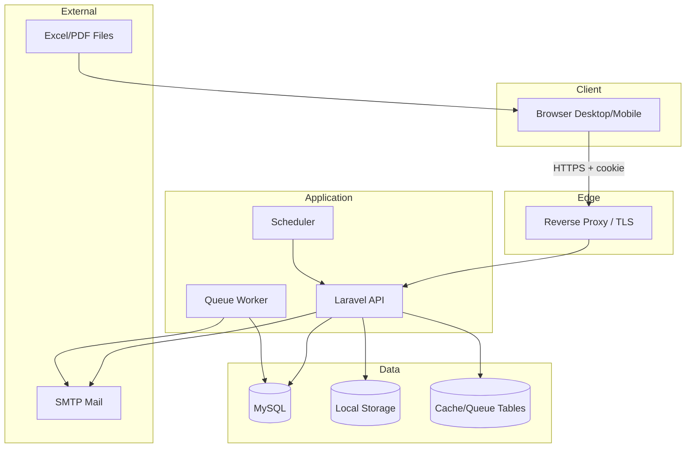
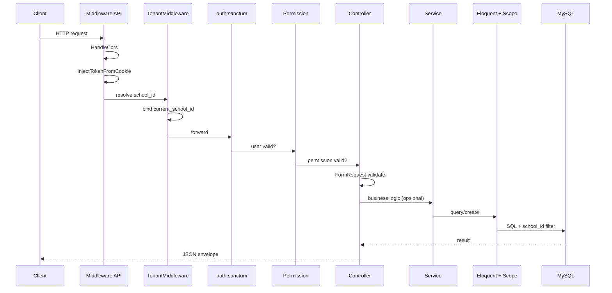
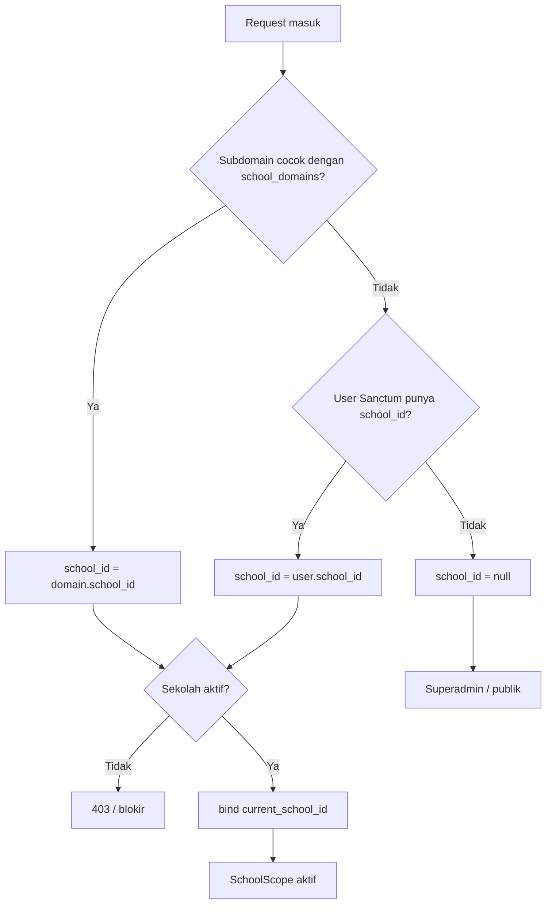
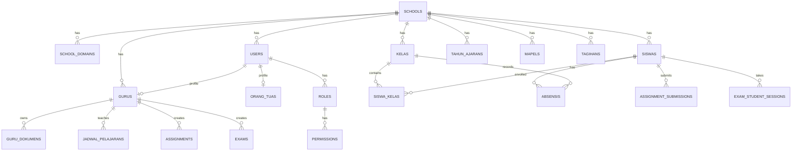
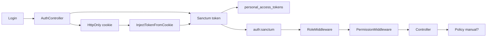
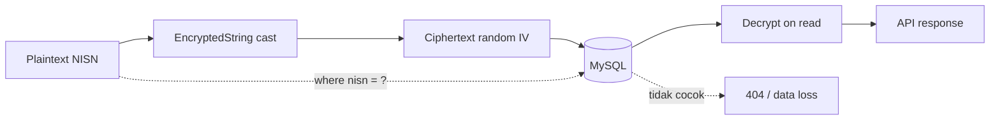
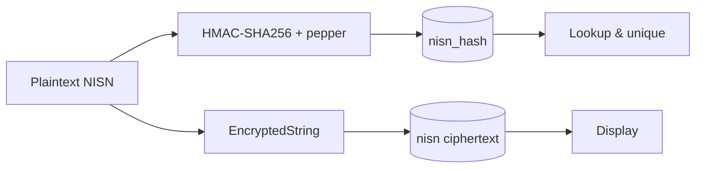
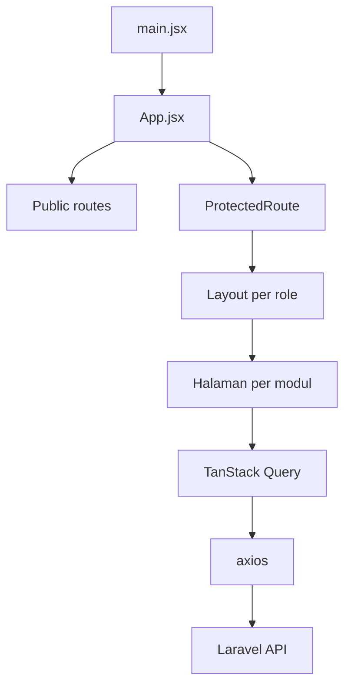
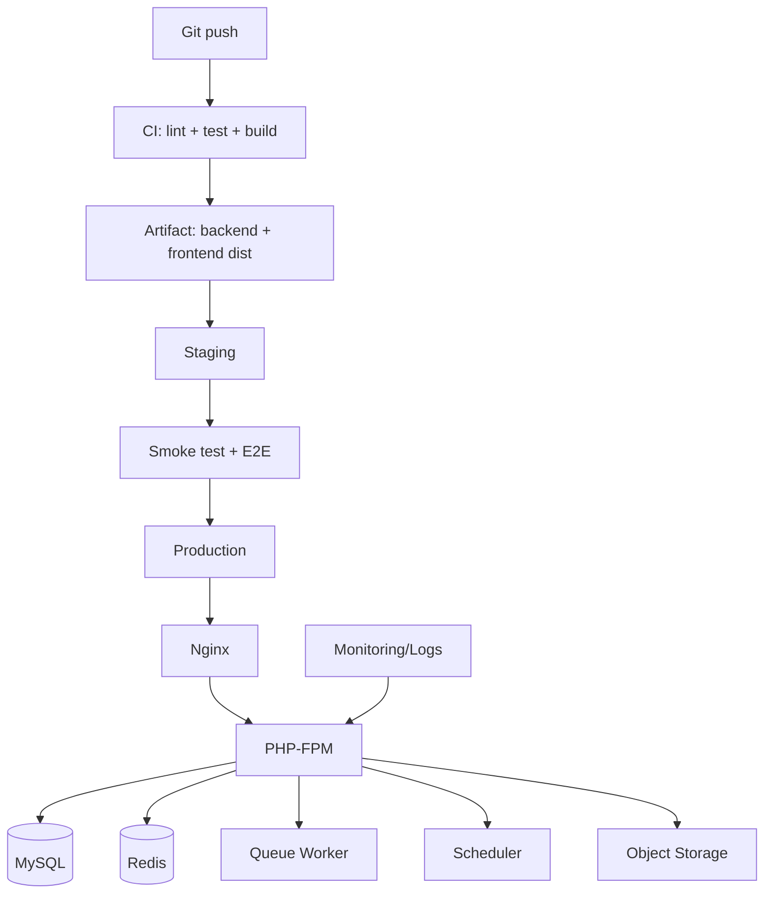

# ARCHITECTURE AUDIT — SCHOLARA

**Versi:** 1.0
**Tanggal:** 11 November 2026
**Metode:** Read-only static inspection
**Status runtime:** MySQL tidak berjalan; diagram dan alur disusun dari kode, bukan observasi runtime

---

## 1. Ringkasan Arsitektur

Scholara adalah **modular monolith** berbasis Laravel 12 yang melayani API untuk **single-page application** React 19. Model tenancy adalah **shared database, shared schema** dengan kolom `school_id` sebagai diskriminator.

| Karakteristik | Nilai |
|---|---|
| Gaya arsitektur | Modular monolith (route per domain, controller per resource) |
| Tenancy | Shared DB, shared schema, `school_id` |
| Autentikasi | Sanctum token + HttpOnly cookie |
| Otorisasi | Role + permission middleware; policy terbatas |
| Komunikasi | REST/JSON, tanpa versioning |
| Frontend | SPA React, React Router, TanStack Query |
| Persistence | MySQL; queue/cache default `database` |
| File storage | Local disk (`storage/app/private` dan `public`) |
| Deployment | Belum terdefinisi (tanpa Docker/CI) |

**Penilaian:** fondasi arsitektur **layak dilanjutkan**, tetapi implementasi belum konsisten. Masalah utama bukan pilihan teknologi, melainkan **batas domain yang kabur**, **tenant context yang tidak dipaksa di semua model**, dan **lapisan otorisasi objek yang hilang**.

---

## 2. Konteks Sistem



### 2.1 Aktor

| Aktor | Kebutuhan utama |
|---|---|
| Operator | Administrasi master data, akun, tahun ajaran |
| Guru | Absensi, LMS, data siswa, jadwal |
| Wali kelas | Absensi dan monitoring kelas |
| Kepala sekolah | Oversight, approval, laporan |
| Wakasek | Kurikulum, program, mapel, kelas |
| Bendahara/Admin keuangan | Tagihan, pembayaran, laporan |
| Orang tua | Anak, absensi, pengumuman, pembayaran |
| Siswa | LMS, nilai, rapor, jadwal |
| BK/Pustakawan/TU | Modul khusus |
| Superadmin | Pengelolaan SaaS/tenant |

---

## 3. Struktur Repositori

```
Scholara/
├── backend/
│   ├── app/
│   │   ├── Casts/                 # EncryptedString, EncryptedJson
│   │   ├── Console/Commands/      # sync permission, encrypt, archive
│   │   ├── Http/
│   │   │   ├── Controllers/       # 53 controller per domain
│   │   │   ├── Middleware/        # tenant, role, permission, cookie
│   │   │   └── Requests/          # 108 FormRequest
│   │   ├── Models/                # 80 model + Scopes
│   │   ├── Observers/             # activity log
│   │   ├── Policies/              # 7 policy
│   │   ├── Services/              # 14 service
│   │   └── Traits/                # HasSchoolScope, HasUlid
│   ├── bootstrap/app.php          # middleware & exception config
│   ├── config/                    # cors, sanctum, filesystems, queue
│   ├── database/
│   │   ├── migrations/            # 83 migrasi
│   │   └── seeders/               # SchoolSeeder, RbacCatalog
│   ├── routes/api/                # 15 file route per domain
│   └── tests/                     # 14 file test
├── frontend/
│   ├── src/
│   │   ├── App.jsx                # 86 deklarasi Route
│   │   ├── components/            # 25 komponen
│   │   ├── contexts/              # AuthContext
│   │   ├── lib/                   # axios
│   │   ├── pages/                 # 144 halaman per role
│   │   ├── routes/                # ProtectedRoute
│   │   └── services/
│   ├── dist/                      # build lokal
│   └── package.json
├── docs/                          # 31 dokumen
└── PROJECT_AUDIT_REPORT.md
```

### 3.1 Pengamatan struktur

**Baik:**
- Pemisahan `backend/` dan `frontend/` jelas.
- Route dipecah per domain, bukan satu file monolit.
- FormRequest, service, policy, observer, dan cast dipisahkan sesuai tanggung jawab.
- Frontend mengelompokkan halaman per role.

**Kurang:**
- Tidak ada pembagian modul backend yang tegas (mis. `app/Modules/Akademik`), sehingga controller master data bercampur dengan operator, kepsek, dan wakasek.
- `App.jsx` menjadi *god file* routing dengan 86 deklarasi.
- Tidak ada paket bersama untuk tipe/kontrak API antara backend dan frontend.
- Tidak ada folder `domain/`, `dto/`, atau `resources/` untuk transformasi response.

---

## 4. Siklus Hidup Request



### 4.1 Urutan middleware

`bootstrap/app.php`:

```php
$middleware->api(prepend: [
    HandleCors::class,
    InjectTokenFromCookie::class,
    TenantMiddleware::class,
]);
```

`auth:sanctum`, `role:`, dan `permission:` ditambahkan per route group.

**Catatan:**
- `InjectTokenFromCookie` berjalan sebelum `auth`, sehingga cookie dapat menjadi bearer token.
- `TenantMiddleware` berjalan sebelum `auth`, tetapi memiliki fallback `$request->user('sanctum')`; ini bekerja karena Sanctum dapat me-resolve token tanpa middleware auth.
- Tidak ada middleware `EncryptCookies` di API group, sehingga cookie token tidak terenkripsi.
- Tidak ada `ValidateCsrfToken`.

### 4.2 Resolusi tenant



**Keputusan baik:** header `X-School-ID` dihapus. Tenant tidak boleh ditentukan oleh input klien.

**Kelemahan:** ketika `school_id = null` (mis. domain pusat), `SchoolScope` fail-closed. Ini aman, tetapi membuat fitur seperti reset password gagal tanpa pesan yang jelas.

---

## 5. Arsitektur Multi-Tenancy

### 5.1 Model data



### 5.2 Scope

`SchoolScope`:
- `current_school_id` ter-bind → filter.
- Tidak ter-bind → `whereRaw('1 = 0')`.

`HasSchoolScope`:
- Menambahkan global scope.
- Mengisi `school_id` saat `creating` **hanya jika** `app()->bound('current_school_id')`.

**Konsekuensi:** model yang tidak memakai trait tidak mendapat scope maupun auto-fill. Ini akar dari banyak temuan.

### 5.3 Matriks konsistensi tenant

| Kategori | Model | Scope | `school_id` fillable | Status |
|---|---|---|---|---|
| Inti | `User`, `Guru`, `Siswa`, `Kelas`, `Mapel`, `TahunAjaran`, `Semester` | Ya | Ya | Baik |
| Akademik | `Absensi`, `Assignment`, `Exam`, `CourseMaterial`, `JadwalPelajaran` | Ya | Ya | Baik |
| Keuangan | `JenisTagihan`, `Tagihan`, `Pembayaran` | Ya | Ya | Baik |
| PPDB | `CalonSiswa`, `BerkasPendaftar`, `PembayaranPpdb` | Ya | Ya | Baik |
| Anak guru | `GuruDokumen`, `GuruCuti`, `GuruMutasi`, `GuruPendidikan`, dll. | **Tidak** | **Tidak** | **Rusak** |
| Profil | `OperatorProfile`, `UserBendahara`, `UserWaliKelas` | **Tidak** | **Tidak** | **Rusak** |
| Riwayat | `RiwayatKelas` (`SiswaKelas` hanya alias) | **Tidak** | **Tidak** | **Rusak** |
| Konten | `Galeri`, `Pengaturan` | **Tidak** | **Tidak** | **Rusak** |
| Global | `Kurikulum`, `ActivityLog`, `School*`, `Saas*` | Tidak | Sebagian | Perlu desain eksplisit |

### 5.4 Rekomendasi tenancy

1. **Satu aturan:** semua tabel dengan `school_id` wajib memakai `HasSchoolScope`, kecuali daftar global yang eksplisit.
2. **Auto-fill dari parent:** model anak mengambil `school_id` dari relasi, bukan dari request.
3. **Tenant context object:** ganti `app('current_school_id')` dengan `TenantContext` yang memiliki `id()`, `require()`, dan `isResolved()`.
4. **Fail-closed tetap dipertahankan.**
5. **Test wajib:** setiap endpoint list/detail/create harus punya test lintas tenant.

---

## 6. Arsitektur Autentikasi dan Otorisasi

### 6.1 Komponen



### 6.2 Lapisan otorisasi

| Lapisan | Kekuatan | Kelemahan |
|---|---|---|
| Tenant scope | Fail-closed | Tidak semua model memakai |
| Role middleware | Ada di semua route | Terlalu kasar untuk modul |
| Permission middleware | Ada di master data/operator | Tidak ada di 6 modul |
| Policy | 7 policy | Tidak mencakup LMS/absensi/DMS/keuangan |
| Object ownership | Hanya sebagian | Banyak `findOrFail` tanpa cek |

### 6.3 Role dan permission

- 14 role sistem.
- Permission didefinisikan di `database/seeders/Support/RbacCatalog.php`.
- `permissions:sync` menyinkronkan permission ke semua sekolah.
- Matriks role-permission memisahkan operator, wakasek, kepsek, guru, dll.

**Kelemahan:** role frontend hanya satu (`user.role`), sedangkan backend mendukung banyak role (`roles` array). Ini menyebabkan mismatch `wali_kelas`/`guru`.

### 6.4 Rekomendasi otorisasi

1. Tambahkan policy untuk setiap agregat: `AssignmentPolicy`, `ExamPolicy`, `CourseMaterialPolicy`, `AbsensiPolicy`, `GuruDokumenPolicy`, `GaleriPolicy`.
2. Terapkan `permission:` di semua route group.
3. Gunakan `Gate::authorize()` di controller, bukan pengecekan manual.
4. Samakan representasi role di frontend dan backend (array + active role).
5. Tambahkan test permission matrix.

---

## 7. Arsitektur Data

### 7.1 Domain tabel

| Domain | Tabel utama | Catatan |
|---|---|---|
| Tenant | `schools`, `school_domains`, `school_settings`, `school_subscriptions` | SaaS |
| Identitas | `users`, `roles`, `permissions`, `role_permissions`, `personal_access_tokens`, `sessions` | Scope per sekolah |
| Akademik | `tahun_ajarans`, `semesters`, `kelas`, `mapels`, `jadwal_pelajarans`, `plot_guru_mapels` | Composite unique |
| Siswa | `siswas`, `siswa_kelas`, `riwayat_kelas`, `orang_tuas`, `orang_tua_siswa` | PII terenkripsi |
| Guru | `gurus`, `guru_*` (19 tabel anak) | Banyak tanpa tenant |
| Absensi | `absensis` | Index tanggal |
| LMS | `course_materials`, `assignments`, `assignment_submissions`, `exams`, `exam_questions`, `exam_student_sessions` | Tanpa policy |
| Keuangan | `jenis_tagihans`, `tagihans`, `pembayarans` | UI belum terhubung |
| PPDB | `calon_siswas`, `berkas_pendaftars`, `pembayaran_ppdb` | UI admin placeholder |
| BK/Perpus/TU | `bk_*`, `perpustakaan_*`, `surats`, `legalisirs` | UI placeholder |
| Nilai | `nilais`, `nilai_akhirs`, `rapors` | Tanpa model/API/UI |
| DMS | `guru_dokumens`, `guru_dokumen_versions`, `guru_dokumen_logs` | Tanpa tenant |
| Log | `activity_logs` | PII plaintext |
| SaaS | `saas_*`, `tenant_usage_snapshots` | Tanpa API |

### 7.2 PII dan enkripsi



**Desain saat ini tidak dapat mencari.** Solusi yang disarankan:



### 7.3 Integritas dan constraint

- Composite unique per sekolah sudah ditambahkan untuk beberapa tabel.
- Unique pada kolom terenkripsi tidak efektif.
- Migrasi `DELETE ... WHERE school_id IS NULL` bersifat destruktif.
- Banyak `DB::statement` MySQL-spesifik mengurangi portabilitas.

### 7.4 Rekomendasi data

1. Blind index untuk PII.
2. Audit semua composite unique; pastikan kolomnya deterministik.
3. Tambahkan foreign key dan index yang hilang.
4. Pisahkan data operasional dan arsip.
5. Dokumentasikan retensi dan klasifikasi data.

---

## 8. Arsitektur Backend

### 8.1 Pola yang dipakai

| Pola | Implementasi | Penilaian |
|---|---|---|
| Route per domain | 15 file | Baik |
| Controller per resource | 53 controller | Baik, tetapi beberapa gemuk |
| FormRequest | 108 | Baik |
| Service layer | 14 service | Sebagian |
| Repository | Tidak ada | Tidak diperlukan untuk skala ini |
| DTO/Resource | Tidak ada | Perlu untuk response yang aman |
| Event/Listener | Observer | Terbatas pada log |
| Job/Queue | Tidak ada job | Perlu untuk import/export |
| Policy | 7 | Kurang |
| Exception handler | `bootstrap/app.php` | Baik |

### 8.2 Duplikasi

- **DMS:** `MasterData\Guru\GuruDokumenController` dan `Guru\GuruDokumenController`. Route aktif memakai yang rentan.
- **Master data:** logika serupa muncul di operator, wakasek, kepsek.
- **Response envelope:** diketik manual di setiap controller.
- **Validasi tenant:** dilakukan manual di beberapa service.

### 8.3 Rekomendasi backend

1. Konsolidasikan DMS menjadi satu controller/service.
2. Tambahkan `ApiResource`/DTO untuk response.
3. Pindahkan aturan bisnis dari controller ke service/action.
4. Tambahkan job untuk import/export dan enkripsi massal.
5. Tambahkan PHPStan/Psalm level 5+.
6. Pecah `master-data.php` menjadi sub-file per resource.

---

## 9. Arsitektur Frontend

### 9.1 Struktur



### 9.2 Pola

| Aspek | Implementasi | Penilaian |
|---|---|---|
| Routing | React Router 7, 86 route | Baik, tetapi god file |
| State auth | Context | Cukup |
| Data server | TanStack Query | Baik |
| HTTP | Axios + interceptor | Baik, tetapi dead code cookie |
| UI | Tailwind 4 | Baik |
| Tabel | TanStack Table | Baik |
| Chart | Recharts | Baik |
| Export | xlsx, jsPDF | Risiko dependensi |
| Code splitting | Tidak ada | Perlu |
| Type safety | Tidak ada TypeScript | Perlu dipertimbangkan |
| Test | Tidak ada | Perlu |

### 9.3 Role guard

```jsx
if (roles.length > 0 && !roles.includes(user.role)) {
  return <Navigate to="/unauthorized" replace />;
}
```

Masalah:
- Hanya satu role.
- Backend dapat mengembalikan beberapa role.
- `getRoleSlug()` memprioritaskan `guru`.
- Route `/guru` tidak mengizinkan `wali_kelas`.

### 9.4 Rekomendasi frontend

1. Pecah route per modul dengan `React.lazy`.
2. Gunakan array `roles` dan `activeRole`.
3. Hapus `getCookie` mati.
4. Tambahkan error boundary dan loading state konsisten.
5. Tambahkan test komponen dan E2E.
6. Optimasi aset dan bundle.

---

## 10. Arsitektur Keamanan

### 10.1 Kontrol yang ada

| Kontrol | Implementasi |
|---|---|
| TLS | Diasumsikan di reverse proxy |
| CORS | Exact origin dari env |
| Auth | Sanctum + HttpOnly cookie |
| Password | Hash + throttle |
| Tenant | Global scope fail-closed |
| Validasi | FormRequest |
| Enkripsi PII | Cast AES-256-CBC |
| Log | Activity log |
| Error | Envelope konsisten |

### 10.2 Celah arsitektural

1. **Tidak ada lapisan otorisasi objek** — role/permission saja tidak cukup.
2. **Tidak ada CSRF** untuk cookie-auth.
3. **Token permanen.**
4. **Path traversal** pada download.
5. **PII dalam log.**
6. **Tenant tidak dipaksa di semua model.**

### 10.3 Rekomendasi

- Terapkan defense-in-depth: tenant scope + policy + validasi input + output filtering.
- Tambahkan security header (CSP, HSTS, X-Content-Type-Options) di reverse proxy.
- Tambahkan rate limit per user/IP untuk endpoint sensitif.
- Tambahkan audit trail yang tidak menyimpan PII.
- Lakukan threat modeling per modul.

---

## 11. Arsitektur Deployment

### 11.1 Kondisi saat ini

- Tidak ada Dockerfile/docker-compose.
- Tidak ada CI/CD.
- Tidak ada konfigurasi Nginx/Apache.
- Tidak ada queue worker/scheduler.
- Tidak ada monitoring/backup.
- Health check `/up` tersedia.

### 11.2 Target deployment yang disarankan



### 11.3 Rekomendasi

1. Dockerize backend/frontend.
2. CI: `php artisan test`, `oxlint`, `vite build`, `npm audit`.
3. Staging dengan data sintetis.
4. Backup harian + restore test.
5. Queue worker via Supervisor.
6. Scheduler via cron.
7. Log terpusat + alert.
8. Object storage untuk dokumen/foto.

---

## 12. Inkonsistensi Arsitektural

| Inkonsistensi | Dampak | Rekomendasi |
|---|---|---|
| Scope tenant tidak merata | Kebocoran & 500 | Wajibkan trait |
| Dua controller DMS | Perbedaan keamanan | Konsolidasi |
| Role tunggal vs array | UI tidak sesuai hak | Samakan model role |
| API `/api` vs dokumen `/api/v1` | Integrasi sulit | Versioning |
| `local` vs `public` storage | DMS rusak | Satu disk |
| Response manual | Field sensitif bocor | API Resource |
| Permission parsial | Least privilege gagal | Terapkan semua |
| Cache/queue database | Skalabilitas terbatas | Redis |
| Tidak ada DTO | Kontrak tidak stabil | DTO/Resource |
| Tidak ada CI | Regresi | CI wajib |

---

## 13. Keputusan Arsitektur yang Perlu Diambil

| ID | Keputusan | Opsi | Rekomendasi |
|---|---|---|---|
| ADR-01 | Model tenancy | Shared schema vs schema-per-tenant | Pertahankan shared schema + perbaiki scope |
| ADR-02 | PII search | Encryption + blind index vs tokenization | Blind index |
| ADR-03 | Otorisasi | RBAC + policy vs ABAC | RBAC + policy |
| ADR-04 | API versioning | URL vs header | URL `/api/v1` |
| ADR-05 | Frontend | JS vs TypeScript | Migrasi bertahap ke TypeScript |
| ADR-06 | State | Context vs Zustand | Context + TanStack Query cukup |
| ADR-07 | Storage | Local vs S3-compatible | S3-compatible untuk produksi |
| ADR-08 | Queue/cache | Database vs Redis | Redis |
| ADR-09 | Deployment | VM vs container | Container |
| ADR-10 | Modul backend | Flat vs modular | Modular per domain |

---

## 14. Rekomendasi Arsitektur Utama

### 14.1 Jangka pendek (0–4 minggu)

1. Tutup path traversal dan terapkan blind index.
2. Wajibkan `HasSchoolScope` + `school_id` pada semua model operasional.
3. Tambahkan policy untuk LMS, absensi, DMS.
4. Samakan role frontend/backend.
5. Konsolidasikan DMS.
6. Tambahkan test tenant dan CI.

### 14.2 Jangka menengah (1–3 bulan)

1. Pecah `master-data.php` dan `App.jsx`.
2. Tambahkan API Resource/DTO.
3. Terapkan permission di semua modul.
4. Tambahkan queue job untuk import/export.
5. Tambahkan observability dan backup.
6. Selesaikan UI modul yang backend-only.

### 14.3 Jangka panjang (3–6 bulan)

1. API versioning + OpenAPI.
2. Migrasi bertahap ke TypeScript.
3. Object storage + CDN.
4. Redis untuk cache/queue/session.
5. Partisi/arsip data.
6. Superadmin SaaS dan billing.

---

## 15. Kesimpulan

Arsitektur Scholara **tidak perlu dibongkar**. Fondasi Laravel + React + shared-schema multi-tenancy sudah tepat untuk produk SaaS sekolah. Yang perlu dilakukan adalah **menegakkan invariant**:

1. Setiap query tenant harus ter-scope.
2. Setiap create harus memiliki `school_id`.
3. Setiap aksi pada objek harus diotorisasi.
4. Setiap PII harus dapat dicari tanpa membocorkan plaintext.
5. Setiap perubahan harus diuji di CI.

Jika lima invariant ini ditegakkan, arsitektur saat ini dapat menopang pertumbuhan hingga ratusan sekolah. Tanpa itu, penambahan fitur hanya akan memperbesar permukaan bug dan risiko keamanan.

---

**Auditor:** AI technical audit
**Tanggal:** 11 November 2026
**Versi:** 1.0
