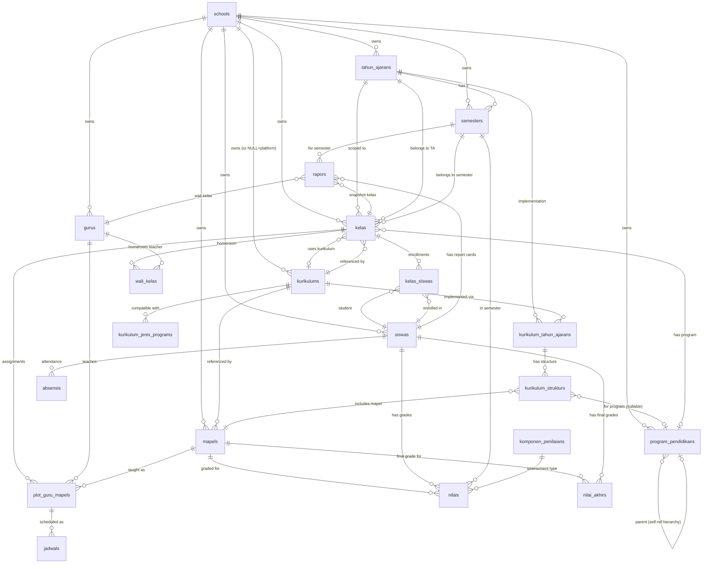
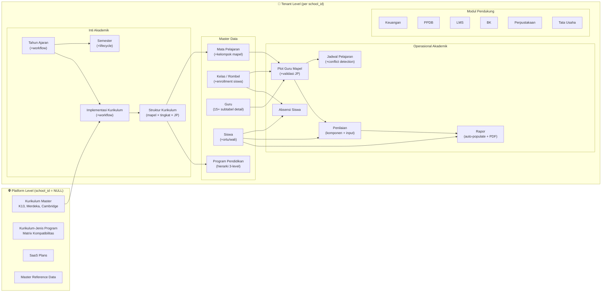

# 📋 LAPORAN AUDIT KOMPREHENSIF — Scholara SIAKAD SaaS

> **Tanggal Audit**: 26 November 2026  
> **Versi Project**: Laravel 12 + React 19 + MySQL + Sanctum  
> **Objek Audit**: Sistem Manajemen Sekolah Multi-Tenant (SIAKAD SaaS)

---

## BAB I — Executive Summary

### Kondisi Umum Sistem

Scholara adalah platform SIAKAD SaaS multi-tenant yang sudah mencapai **tingkat kematangan arsitektur menengah-atas (≈65-70%)**. Fondasi teknis — mulai dari tenant isolation, RBAC, dan domain akademik inti — sudah dibangun dengan pemikiran arsitektural yang baik. Namun, beberapa domain kritis (penilaian, rapor, jadwal) masih dalam tahap awal atau belum terintegrasi penuh.

### Modul yang Sudah Tersedia & Berfungsi
| Status | Modul |
|--------|-------|
| ✅ Berfungsi Baik | Auth, Users, Schools, Roles & Permissions, Tenant Isolation, Tahun Ajaran (dengan workflow), Semester (dengan lifecycle), Master Guru (komprehensif 15+ subtabel), Master Siswa, Kelas/Rombel, Kurikulum (master + implementasi + struktur + workflow), Program Pendidikan (hierarki multi-jenjang), Mata Pelajaran, Absensi, Keuangan (Tagihan/Pembayaran), PPDB, Pengumuman, Galeri, LMS (materi/tugas/ujian), BK (konseling/catatan), Perpustakaan, Tata Usaha (surat/legalisir), Naik Kelas, SaaS Subscription |
| ⚠️ Sebagian Berfungsi | Penilaian (komponen & input ada, perhitungan akhir dasar), Rapor (CRUD + finalisasi ada, integrasi nilai terbatas), Jadwal Pelajaran (CRUD ada, validasi bentrok belum ada), Plot Guru Mapel (penugasan ada, integrasi jadwal terbatas) |
| ❌ Belum Tersedia | Kelompok Mata Pelajaran (tabel `kelompok_mapels` tidak ditemukan), Versioning Kurikulum historis, Kalender Akademik per tenant (hanya global), Cetak rapor / PDF export |

### 3 Masalah Paling Penting
1. **CRITICAL** — Tabel `komponen_penilaians` masih menyimpan `kurikulum` sebagai ENUM (`K13`, `Merdeka`, `Semua`) padahal kurikulum sudah dimigrasikan ke tabel FK. Ini menciptakan dual-reference yang bisa inkonsisten.
2. **CRITICAL** — Tabel `kelas` juga masih menyimpan `kurikulum` sebagai ENUM lama (`Merdeka`, `K13`, `Lainnya`) bersamaan dengan `kurikulum_id` FK baru. Data bisa diverge.
3. **HIGH** — Dashboard Wakasek menggunakan data hardcoded (PILLAR_DATA, ALERTS, AGENDA) bukan dari API — memberikan ilusi fitur yang sebenarnya belum terkoneksi.

### Kesimpulan Kesiapan
- **Fondasi arsitektur**: ✅ Baik — multi-tenant, RBAC, global scope, ULID, soft deletes
- **Domain akademik inti**: ⚠️ 70% selesai — tahun ajaran, kurikulum, kelas, mapel baik; penilaian & rapor belum matang
- **Siap produksi?**: ❌ Belum — perlu penyelesaian penilaian, rapor, jadwal, dan pembersihan dual-schema (enum vs FK)

---

## BAB II — Project Architecture

### Struktur Backend (Laravel 12)

```
backend/
├── app/
│   ├── Casts/              # EncryptedPii (AES-256 untuk NIK, No KK, dll)
│   ├── Console/Commands/   # Artisan commands
│   ├── Enums/              # StatusTahunAjaran, StatusSemester, StatusImplementasiKurikulum
│   ├── Http/
│   │   ├── Controllers/
│   │   │   ├── Absensi/        # AbsensiController
│   │   │   ├── Auth/           # LoginController, PasswordResetController
│   │   │   ├── Bk/            # KonselingController, CatatanController
│   │   │   ├── Guru/          # GuruController, GuruDokumenController
│   │   │   ├── Kepsek/        # KepsekController, KalenderAkademikController
│   │   │   ├── Keuangan/      # TagihanController, PembayaranController
│   │   │   ├── Lms/           # MateriController, TugasController, UjianController
│   │   │   ├── MasterData/    # TahunAjaranController, SemesterController, KelasController,
│   │   │   │                  # MapelController, ProgramPendidikanController, GuruMasterController,
│   │   │   │                  # SiswaController, KurikulumController, KurikulumWorkflowController,
│   │   │   │                  # KurikulumStrukturController, JadwalPelajaranController
│   │   │   ├── Operator/      # OperatorController (manajemen akun semua role)
│   │   │   ├── Ortu/          # OrtuController
│   │   │   ├── Penilaian/     # NilaiController, RaporController
│   │   │   ├── Perpustakaan/  # BukuController, PeminjamanController
│   │   │   ├── Ppdb/          # PpdbController
│   │   │   ├── SuperAdmin/    # SuperAdminController, KurikulumPlatformController
│   │   │   ├── TataUsaha/     # SuratController, LegalisirController
│   │   │   └── Wakasek/       # WakasekController
│   │   ├── Middleware/     # TenantMiddleware, RoleMiddleware, PermissionMiddleware, UseSchoolFromRoute
│   │   ├── Requests/       # 50+ Form Request classes (terstruktur per domain)
│   │   └── Resources/      # API Resources (ProgramPendidikanResource, dll)
│   ├── Models/             # 40+ Model classes
│   ├── Models/Scopes/      # SchoolScope (global tenant scope)
│   ├── Observers/          # Model observers
│   ├── Policies/           # ProgramPendidikanPolicy
│   ├── Services/           # KurikulumService, GuruDokumenService, MapelService
│   └── Traits/             # HasSchoolScope, ApiResponse, HasUlid
├── database/
│   ├── migrations/         # 60+ migration files (kronologis)
│   ├── seeders/            # SchoolSeeder, MultiSchoolSeeder, GlobalSaaSSeeder, RbacCatalog
│   └── factories/
└── routes/
    └── api/                # 16 route files terpisah per domain
```

### Struktur Frontend (React 19 + Vite 8)

```
frontend/src/
├── components/
│   ├── layout/     # AppSidebar, AppHeader, SuperAdminSidebar (per-role sidebar)
│   ├── ortu/       # Komponen khusus parent portal
│   └── ui/         # Reusable UI components
├── config/         # App configuration
├── constants/      # Static constants
├── contexts/       # AuthContext (auth state management)
├── hooks/api/      # 15+ custom hooks — TanStack Query wrapper per domain:
│   │               # useTahunAjaran, useSemester, useKurikulum, useMapel,
│   │               # useProgramPendidikan, useAbsensi, useBk, useNilai, useRapor,
│   │               # usePerpustakaan, useTataUsaha, useKeuangan, useLms, usePpdb
├── lib/            # axios instance
├── pages/          # 90+ page components terpisah per role:
│   ├── auth/           # Login, Register, ForgotPassword, ResetPassword
│   ├── operator/       # Dashboard, ManajemenAkun, MasterData (guru/siswa/kelas/TA/ortu)
│   ├── kepsek/         # Dashboard, monitoring guru/siswa/absensi, kurikulum, TA
│   ├── wakasek/        # Dashboard, akademik (TA, kurikulum, mapel, kelas, jadwal, program)
│   ├── guru/           # Dashboard, jadwal, siswa, absensi, profil, LMS, penilaian
│   ├── walikelas/      # (pages exist)
│   ├── bendahara/      # Dashboard, keuangan
│   ├── guru-bk/        # Dashboard, konseling, catatan BK
│   ├── pustakawan/     # (pages exist)
│   ├── tata-usaha/     # (pages exist)
│   ├── ortu/           # Portal orang tua
│   ├── adminppdb/      # Admin PPDB
│   ├── admin-keuangan/ # Admin Keuangan
│   ├── superadmin/     # Developer dashboard, tenant, kurikulum platform
│   ├── siswa/          # Portal siswa + LMS
│   └── public/         # Landing, About, Akademik, Galeri, PPDB
├── routes/         # ProtectedRoute (role-based guard)
└── shared/         # Shared components (kurikulum, tahun-ajaran — reusable lintas role)
```

### Pola Arsitektur

| Aspek | Implementasi | Kualitas |
|-------|-------------|----------|
| Multi-Tenant | `HasSchoolScope` trait + `SchoolScope` global scope + `TenantMiddleware` | ✅ Baik |
| Auth | Laravel Sanctum (token-based SPA) | ✅ Baik |
| RBAC | Custom roles + permissions pivot table + `RoleMiddleware` + `PermissionMiddleware` | ✅ Baik |
| API Pattern | RESTful JSON, `ApiResponse` trait untuk konsistensi response | ✅ Baik |
| Frontend State | TanStack Query (server state) + React Context (auth state) | ✅ Baik |
| Data Tables | TanStack Table | ✅ Baik |
| Routing | React Router v7 + ProtectedRoute per role | ✅ Baik |
| PII Protection | `EncryptedPii` cast (AES-256 untuk NIK, No KK) | ✅ Baik |
| Public Identifier | ULID pattern — internal `id` tidak diexpose ke API | ✅ Baik |
| Soft Deletes | Diterapkan pada mayoritas tabel inti | ✅ Baik |
| Enum → Table | Migrasi dari hardcoded enum ke tabel referensi (kurikulum) | ⚠️ Sebagian |

### Hubungan Backend & Frontend

Frontend berkomunikasi melalui REST API (`/api/...`) menggunakan axios instance + Sanctum token. Setiap domain memiliki:
- **Backend**: Route file → Controller → Service (optional) → Model
- **Frontend**: Hook (`useXxx`) → Page component → TanStack Query

---

## BAB III — Database Audit

### A. Daftar Tabel Akademik (Ditemukan dari Migration)

| # | Tabel | school_id | Soft Delete | ULID | FK Utama |
|---|-------|-----------|-------------|------|----------|
| 1 | `schools` | — (root) | ✅ | ✅ | — |
| 2 | `school_settings` | ✅ | — | — | schools |
| 3 | `school_domains` | ✅ | — | — | schools |
| 4 | `users` | ✅ (nullable) | ✅ | ✅ | schools |
| 5 | `roles` | ✅ (nullable) | — | — | schools |
| 6 | `user_roles` | — | — | — | users, roles |
| 7 | `permissions` | ✅ | — | — | schools |
| 8 | `role_permissions` | — | — | — | roles, permissions |
| 9 | `tahun_ajarans` | ✅ (nullable) | ✅ | ✅ (added later) | schools |
| 10 | `semesters` | ✅ (nullable) | ✅ | ✅ (added later) | schools, tahun_ajarans |
| 11 | `kurikulums` | ✅ (nullable) | ✅ | ✅ | schools |
| 12 | `kurikulum_tahun_ajarans` | ✅ | ✅ | ✅ | kurikulums, tahun_ajarans, schools |
| 13 | `kurikulum_strukturs` | — | ✅ | — | kurikulum_tahun_ajarans, mapels, program_pendidikans |
| 14 | `kurikulum_jenis_programs` | — | — | — | kurikulums |
| 15 | `kurikulum_program_pendidikans` | ✅ (nullable) | — | — | kurikulums, program_pendidikans **(DEPRECATED)** |
| 16 | `program_pendidikans` | ✅ | ✅ | ✅ | schools, parent_id (self-ref) |
| 17 | `mapels` | ✅ (nullable) | ✅ | — | schools, kurikulum_id |
| 18 | `kelas` | ✅ (nullable) | ✅ | — | schools, tahun_ajarans, semesters, kurikulum_id, program_pendidikan_id |
| 19 | `gurus` | ✅ (nullable) | ✅ | ✅ | schools, users |
| 20 | `siswas` | ✅ (nullable) | ✅ | ✅ | schools, users |
| 21 | `kelas_siswas` | ✅ (nullable) | — | — | kelas, siswas |
| 22 | `plot_guru_mapels` | ✅ (nullable) | ✅ | — | gurus, mapels, kelas, tahun_ajarans, semesters |
| 23 | `wali_kelas` | ✅ (nullable) | — | — | gurus, kelas, tahun_ajarans, semesters |
| 24 | `jadwals` | ✅ (nullable) | ✅ | — | plot_guru_mapels |
| 25 | `komponen_penilaians` | ✅ (nullable) | ✅ | — | schools |
| 26 | `nilais` | ✅ (nullable) | — | — | siswas, mapels, kelas, tahun_ajarans, semesters, komponen_penilaians |
| 27 | `nilai_akhirs` | ✅ (nullable) | — | — | siswas, mapels, kelas, tahun_ajarans, semesters |
| 28 | `rapors` | ✅ (nullable) | ✅ | — | siswas, kelas, tahun_ajarans, semesters, gurus |
| 29 | `absensis` | ✅ (nullable) | — | — | siswas, kelas, tahun_ajarans, semesters |
| 30 | `catatan_walis` | ✅ (nullable) | ✅ | — | siswas, gurus, tahun_ajarans, semesters |
| 31+ | 15+ tabel guru detail, 10+ tabel keuangan, LMS, PPDB, Perpustakaan, dll | ✅ | varies | — | — |

### B. ERD Aktual — Domain Akademik Inti



### C. Masalah Database

#### C1. Dual-Schema Kurikulum (CRITICAL)

**Masalah**: Migrasi `2026_09_03_000002` menambahkan `kurikulum_id` FK ke `mapels` dan `kelas`, tetapi kolom ENUM lama `kurikulum` VARCHAR/ENUM **tidak dihapus**. Akibatnya:

- `kelas.kurikulum` (ENUM: 'Merdeka','K13','Lainnya') **DAN** `kelas.kurikulum_id` (FK) ada bersamaan
- `mapels.kurikulum` (ENUM: 'Kurikulum 2013','Kurikulum Merdeka','Keduanya') **DAN** `mapels.kurikulum_id` (FK) ada bersamaan
- `komponen_penilaians.kurikulum` (ENUM: 'K13','Merdeka','Semua') masih dipakai, **belum ada** `kurikulum_id` FK

**Dampak**: Data bisa inkonsisten — satu kelas bisa punya `kurikulum='K13'` tapi `kurikulum_id` menunjuk ke Merdeka.

**Lokasi**: 
- `backend/database/migrations/2026_08_05_000004_create_kelas_mapel_profil_tables.php`
- `backend/database/migrations/2026_09_03_000002_migrate_kurikulum_enum_to_fk.php`

#### C2. `kurikulum_strukturs` Tidak Punya school_id (MEDIUM)

Tabel ini bergantung pada `kurikulum_tahun_ajaran_id` untuk tenant isolation secara transitif. Ini aman selama query selalu join via `kurikulum_tahun_ajarans`, tapi **tidak memiliki SchoolScope langsung** — berisiko jika query langsung ke tabel ini.

#### C3. `pengaturans` Tanpa school_id (HIGH)

Tabel `pengaturans` adalah global singleton (key-value tanpa school_id). Ini sudah digantikan oleh `school_settings` yang per-tenant, tapi tabel lama **masih ada**. Potensi kebingungan dan data leak.

#### C4. `kalender_akademiks` Tanpa school_id (HIGH)

Kalender akademik hanya memiliki `tahun_ajaran_id` (nullable). Tidak ada `school_id` langsung — event kalender bisa terlihat lintas sekolah jika query tidak difilter melalui tahun ajaran.

#### C5. `pengumumans` dan `galeris` Tanpa school_id (HIGH)

Kedua tabel ini **tidak memiliki `school_id`**. Semua pengumuman dan galeri berpotensi terlihat oleh semua tenant.

#### C6. Nullable school_id Everywhere (MEDIUM)

Banyak tabel akademik memiliki `school_id` nullable — ini didesain untuk mendukung data platform-level (NULL = global). Namun perlu dipastikan SchoolScope menangani kasus NULL dengan benar agar data platform tidak terfilter.

---

## BAB IV — Academic Domain Audit

| Domain | Kondisi Aktual | Status | Gap | Rekomendasi |
|--------|---------------|--------|-----|-------------|
| **Academic Year** | Tabel `tahun_ajarans` ada dengan workflow status (DRAFT→UNDER_REVIEW→APPROVED→ACTIVE→COMPLETED→ARCHIVED). CRUD lengkap. Frontend di operator & wakasek & kepsek. ULID support. Soft delete. | ✅ **Fully Implemented** | Workflow approve/reject sudah di backend tapi integrasi transisi antar-state di frontend belum sepenuhnya tervalidasi end-to-end | — |
| **Semester** | Tabel `semesters` ada dengan lifecycle (UPCOMING→ACTIVE→CLOSED→ARCHIVED). FK ke tahun_ajaran. CRUD lengkap. 2 semester per TA (Ganjil/Genap via ENUM). | ✅ **Fully Implemented** | — | — |
| **Curriculum (Master)** | Tabel `kurikulums` ada. Mendukung platform-level (school_id=NULL, dikelola super admin) dan custom per sekolah. 4 jenis: nasional, internasional, khusus, custom. Tahun berlaku/berakhir. Metadata JSON. | ✅ **Fully Implemented** | — | — |
| **Curriculum Implementation** | Tabel `kurikulum_tahun_ajarans` ada. Workflow: DRAFT→UNDER_REVIEW→APPROVED→ACTIVE→COMPLETED. Backend workflow controller lengkap. Frontend UI ada di wakasek. | ✅ **Fully Implemented** | — | — |
| **Curriculum Structure** | Tabel `kurikulum_strukturs` ada. Per implementasi × tingkat × program × mapel + alokasi JP. Functional unique index (MySQL 8). | ✅ **Fully Implemented** | Belum ada school_id langsung; UI frontend untuk manage struktur masih terbatas | Tambah UI builder untuk drag-drop mapel ke struktur |
| **Subject (Mapel)** | Tabel `mapels` ada. FK ke kurikulum_id (baru). Support tingkat_min/max. Kelompok mapel via kolom `kelompok`. CRUD lengkap. | ✅ **Mostly Implemented** | Kolom ENUM `kurikulum` lama masih ada bersamaan dgn `kurikulum_id` FK. Tidak ada tabel `kelompok_mapels` terpisah — pengelompokan via kolom string. | Hapus kolom ENUM lama. Pertimbangkan tabel `kelompok_mapels` jika butuh hierarki. |
| **Education Program** | Tabel `program_pendidikans` ada. Self-referencing hierarchy (parent_id). 7 jenis: bidang_keahlian, program_keahlian, konsentrasi_keahlian, peminatan, mata_pelajaran_pilihan, keagamaan, umum. Jenjang sasaran per program. CRUD + tree view + dropdown. Policy-based authorization. | ✅ **Fully Implemented** | — | — |
| **Class Level / Rombel** | Tabel `kelas` ada. Kolom: nama_kelas, tingkat (1-12), kapasitas, kurikulum_id, program_pendidikan_id. FK ke tahun_ajaran + semester. Pivot `kelas_siswas` untuk enrollment. CRUD lengkap. | ✅ **Fully Implemented** | Dual kolom kurikulum (ENUM + FK). `tingkat` adalah integer — tidak ada tabel master tingkat terpisah. | Hapus kolom ENUM lama |
| **Teaching Assignment** | Tabel `plot_guru_mapels` ada. FK ke guru, mapel, kelas, TA, semester. Unique constraint: (school_id, guru_id, mapel_id, kelas_id, tahun_ajaran_id). CRUD di master-data routes. | ⚠️ **Partially Implemented** | Tidak ada validasi beban mengajar (jam min/max). Tidak ada integrasi otomatis dgn jadwal. Frontend masih terbatas (tab penugasan di detail guru). | Tambah validasi JP dan integrasi jadwal |
| **Schedule (Jadwal)** | Tabel `jadwals` ada. FK ke plot_guru_mapel. Kolom: hari, jam_mulai, jam_selesai, ruangan. CRUD ada di master-data routes. | ⚠️ **Partially Implemented** | **Tidak ada validasi bentrok** (guru/kelas/ruangan di waktu yang sama). Tidak ada slot template. Frontend page untuk jadwal ada tapi basic. | Implementasi conflict detection wajib |
| **Assessment (Penilaian)** | Tabel `komponen_penilaians`, `nilais`, `nilai_akhirs` ada. Routes: input single + bulk + hitung akhir. Hooks frontend: useNilai. | ⚠️ **Partially Implemented** | Komponen penilaian masih pakai ENUM kurikulum, bukan FK. Hitungan nilai akhir masih basic (average weighted). Tidak ada KKTP/KKM konfigurasi. Belum ada capaian per kompetensi/CP. | Migrasi ke kurikulum_id FK. Tambah KKM/KKTP configurable. |
| **Report Cards (Rapor)** | Tabel `rapors` ada. FK ke siswa, kelas, TA, semester, wali_kelas. Status: draft/final. Deskripsi sikap spiritual/sosial. Routes: index, buat per kelas, finalisasi, finalisasi massal. | ⚠️ **Partially Implemented** | Tidak ada integrasi otomatis dengan `nilai_akhirs`. Rapor harus dibuat manual per kelas. Tidak ada cetak PDF. Tidak ada rapor historis lintas tahun ajaran. Format rapor hardcoded (tidak configurable per kurikulum). | Build auto-populate nilai ke rapor. Implementasi PDF export. Config format rapor per kurikulum. |

---

## BAB V — Role & Permission Audit

### A. Role Catalog (dari RbacCatalog)

| # | Role Slug | Deskripsi | Multi-role Support |
|---|-----------|-----------|-------------------|
| 1 | `super_admin` | Platform admin (developer) — akses semua sekolah | ✅ Khusus (school_id=NULL) |
| 2 | `operator` | Admin sekolah — CRUD semua data master + manajemen akun | Per sekolah |
| 3 | `kepsek` | Kepala Sekolah — approval TA/kurikulum, monitoring, laporan | Per sekolah |
| 4 | `wakasek` | Wakil Kepala Sekolah (Kurikulum) — kebijakan akademik, mapel, jadwal | Per sekolah, ada `bidang` |
| 5 | `guru` | Guru mapel — input absensi, nilai, LMS | Per sekolah |
| 6 | `wali_kelas` | Wali kelas — semua hak guru + finalisasi rapor + catatan | Per sekolah |
| 7 | `guru_bk` | Guru BK — konseling, catatan BK, monitoring | Per sekolah |
| 8 | `bendahara` | Bendahara — keuangan tagihan/pembayaran | Per sekolah |
| 9 | `admin_keuangan` | Admin Keuangan — view/manage tagihan & pembayaran | Per sekolah |
| 10 | `pustakawan` | Pustakawan — buku & peminjaman | Per sekolah |
| 11 | `tata_usaha` | Tata Usaha — surat & legalisir | Per sekolah |
| 12 | `admin_ppdb` | Admin PPDB — penerimaan siswa baru | Per sekolah |
| 13 | `orang_tua` | Orang Tua — portal monitoring anak | Per sekolah |
| 14 | `siswa` | Siswa — portal LMS & data diri | Per sekolah |

### B. Permission Enforcement

```
Request → TenantMiddleware → auth:sanctum → RoleMiddleware → PermissionMiddleware → Controller
```

| Layer | Mekanisme | Status |
|-------|-----------|--------|
| **Tenant Isolation** | `TenantMiddleware` resolves `current_school_id` dari subdomain atau user.school_id. `SchoolScope` global scope filter semua query. | ✅ Baik |
| **Authentication** | Sanctum token-based. | ✅ Baik |
| **Role Check** | `RoleMiddleware` cek slug role dari `user_roles` pivot. Mendukung multi-role check (`role:guru,wali_kelas`). | ✅ Baik |
| **Permission Check** | `PermissionMiddleware` cek permission slug dari `role_permissions` join. Mendukung OR logic (`permission:a,b`). | ✅ Baik |
| **Policy** | `ProgramPendidikanPolicy` ada — model-level authorization. | ⚠️ Hanya 1 policy ditemukan |
| **Frontend Guard** | `ProtectedRoute` cek `user.role` dari context. | ✅ Baik |

### C. Matriks Role-Permission (Ringkasan dari RbacCatalog)

| Permission Area | operator | kepsek | wakasek | guru | wali_kelas | guru_bk | bendahara | tata_usaha | pustakawan |
|----------------|----------|--------|---------|------|------------|---------|-----------|------------|------------|
| master_data.guru.* | CRUD+Import/Export | View+Export | View+Export | — | — | — | — | View | — |
| master_data.siswa.* | CRUD+Import/Export | View | View+Export | View | View | View | — | View | View |
| master_data.kelas.* | View+Manage | View | View+Manage | — | — | — | — | — | — |
| master_data.mapel.* | View+Manage | View | View+Manage | — | — | — | — | — | — |
| master_data.tahun_ajaran.* | View+Manage | View+Approve+Activate | View+Manage+Review+Complete | View | View | — | — | — | — |
| master_data.kurikulum.* | View+Manage | View+Approve+Activate | View+Manage+Review+Complete | — | — | — | — | — | — |
| akademik.jadwal.* | View | — | View+Manage | — | — | — | — | — | — |
| akademik.nilai.* | — | View All | View All | Input+View Own | Input+View Own | — | — | — | — |
| akademik.rapor.* | Manage | View+Approve | View+Manage | — | View+Manage | — | — | — | — |
| absensi.* | Input+View All | View All+Rekap | View All+Rekap | Input+View Own | Input+View Own | View All | — | — | — |
| keuangan.* | Manage | View | — | — | — | — | Full | — | — |
| perpustakaan.* | — | — | — | — | — | — | — | — | Full |
| bk.* | — | — | — | — | — | Full | — | — | — |
| surat.* | — | — | — | — | — | — | — | Full | — |

### D. Celah Keamanan

> **⚠️ WARNING: Form Request `authorize()` selalu return `true`**
> 
> Hampir semua FormRequest memiliki `authorize(): bool { return true; }`. Authorization bergantung sepenuhnya pada middleware di route. Ini berarti jika middleware lupa dipasang di suatu route, tidak ada fallback authorization.
>
> **Lokasi**: Semua file di `app/Http/Requests/`
>
> **Dampak**: MEDIUM — middleware sudah konsisten dipasang, tapi defense-in-depth hilang.

> **⚠️ WARNING: Hanya 1 Policy Ditemukan**
>
> Hanya `ProgramPendidikanPolicy` yang ditemukan. Model-model kritis seperti `TahunAjaran`, `Kurikulum`, `Kelas`, `Siswa`, `Guru`, `Rapor` **tidak memiliki Policy**. Authorization sepenuhnya bergantung pada route middleware.
>
> **Dampak**: HIGH — tidak ada model-level authorization checks.

> **⚠️ WARNING: Beberapa Controller Query Tanpa Explicit Tenant Scope**
>
> Controller `GuruDokumenController` melakukan `Guru::where('nuptk', $nuptk)` — ini mengandalkan `SchoolScope` global scope. Jika scope di-bypass (withoutGlobalScopes), data guru sekolah lain bisa diakses.
>
> **Dampak**: LOW — global scope sudah efektif, tapi explicit check lebih aman.

> **⚠️ WARNING: `pengaturans`, `pengumumans`, `galeris`, `kalender_akademiks` Tanpa school_id**
>
> Tabel-tabel ini tidak memiliki kolom `school_id` dan tidak dilindungi SchoolScope. Semua tenant berbagi data ini.
>
> **Dampak**: HIGH — data leak potensial antar sekolah.

---

## BAB VI — Technical Findings

### CRITICAL Priority

| # | Modul | File | Masalah | Dampak |
|---|-------|------|---------|--------|
| C1 | Kelas | `backend/database/migrations/2026_08_05_000004_create_kelas_mapel_profil_tables.php` | Kolom ENUM `kurikulum` masih ada bersamaan dengan `kurikulum_id` FK | Data inkonsistensi; query bisa pakai kolom yang salah |
| C2 | Mapel | `backend/database/migrations/2026_08_05_000004_create_kelas_mapel_profil_tables.php` | Kolom ENUM `kurikulum` masih ada bersamaan dengan `kurikulum_id` FK | Sama dengan C1 |
| C3 | Komponen Penilaian | `backend/database/migrations/2026_08_05_000004_create_kelas_mapel_profil_tables.php` | ENUM `kurikulum` ('K13','Merdeka','Semua') **belum dimigrasikan ke FK** | Kurikulum baru tidak bisa dipakai di komponen penilaian tanpa ALTER TABLE |
| C4 | Pengumuman | `backend/database/migrations/2026_08_05_000002_create_akademik_core_tables.php` | Tabel `pengumumans` tidak punya `school_id` | Kebocoran data pengumuman antar sekolah |
| C5 | Galeri | `backend/database/migrations/2026_08_05_000002_create_akademik_core_tables.php` | Tabel `galeris` tidak punya `school_id` | Kebocoran data galeri antar sekolah |

### HIGH Priority

| # | Modul | File | Masalah | Dampak |
|---|-------|------|---------|--------|
| H1 | Jadwal | `backend/app/Http/Controllers/MasterData/JadwalPelajaranController.php` | Tidak ada validasi bentrok jadwal (guru/kelas/ruangan) | Guru bisa dijadwalkan di 2 tempat bersamaan |
| H2 | Kalender | `backend/database/migrations/2026_08_05_000002_create_akademik_core_tables.php` | `kalender_akademiks` tidak punya `school_id` | Event kalender bisa bocor antar tenant |
| H3 | Pengaturan | `backend/database/migrations/2026_08_05_000002_create_akademik_core_tables.php` | Tabel `pengaturans` (global singleton) masih ada di samping `school_settings` per-tenant | Duplikasi dan potensi konflik |
| H4 | Rapor | `backend/app/Http/Controllers/Penilaian/RaporController.php` | Rapor tidak auto-populate dari `nilai_akhirs` | Wali kelas harus input manual catatan tanpa lihat nilai otomatis |
| H5 | Frontend | `frontend/src/pages/wakasek/DashboardWakasek.jsx` | Dashboard wakasek menggunakan data hardcoded (PILLAR_DATA, ALERTS, AGENDA) | Tampilan menyesatkan — statistik tidak mencerminkan data aktual |
| H6 | Auth Model | Semua FormRequest | `authorize()` selalu return `true` di semua FormRequest | Tidak ada defense-in-depth jika middleware lupa dipasang |
| H7 | Policy | Hanya `ProgramPendidikanPolicy` ada | Model-level authorization minimal | Potensi akses tidak terkontrol jika route middleware miss |

### MEDIUM Priority

| # | Modul | Masalah |
|---|-------|---------|
| M1 | Kurikulum Struktur | Tidak punya `school_id` langsung — bergantung pada join transitif |
| M2 | Komponen Penilaian | Tidak terkait dengan kurikulum implementasi atau struktur — standalone per sekolah |
| M3 | Nilai Akhir | Hitungan basic (weighted average) — tidak mendukung multi-komponen fleksibel |
| M4 | Plot Guru Mapel | Tidak ada validasi beban mengajar (min/max JP per guru) |
| M5 | Kelas Siswa | Tidak ada riwayat enrollment per semester — hanya snapshot aktif |
| M6 | Penilaian Sikap | Rapor punya `deskripsi_sikap_spiritual` dan `deskripsi_sikap_sosial` tapi tidak ada input terstruktur |
| M7 | Ekskul & Rapor | Tabel `ekskuls` ada tapi tidak terintegrasi ke rapor |
| M8 | Model Scopes | Beberapa model guru detail (GuruPendidikan, GuruAbsensi, dll) **tidak menggunakan HasSchoolScope** — mengandalkan parent Guru |

### LOW Priority

| # | Modul | Masalah |
|---|-------|---------|
| L1 | Migration Count | 60+ migrasi dengan banyak "fix" — migration history berantakan tapi fungsional |
| L2 | Test Coverage | Tidak ada test files terdeteksi (folder `tests/` ada tapi kosong) |
| L3 | Naming Consistency | Campuran Bahasa Indonesia dan Inggris (kolom, tabel, enum values) |
| L4 | Deprecated Tables | `kurikulum_program_pendidikans` deprecated tapi belum di-drop |
| L5 | Frontend Page Count | 90+ halaman — beberapa role (pustakawan, tata_usaha) baru punya layout tanpa full implementation |

---

## BAB VII — Target Architecture

### Domain Architecture (Rekomendasi)



### Pemisahan Master Data vs Transactional Data

| Kategori | Tabel | Sifat |
|----------|-------|-------|
| **Platform Master** | kurikulums (school_id=NULL), kurikulum_jenis_programs, plans, master_* tables | Read-only untuk tenant, dikelola super admin |
| **Tenant Master** | gurus, siswas, mapels, program_pendidikans, komponen_penilaians | Per sekolah, jarang berubah |
| **Academic Configuration** | tahun_ajarans, semesters, kurikulum_tahun_ajarans, kurikulum_strukturs, kelas | Per TA/semester, disetup awal tahun |
| **Transactional** | nilais, nilai_akhirs, rapors, absensis, plot_guru_mapels, jadwals, tagihans, pembayarans | Data harian, volume tinggi |

---

## BAB VIII — Development Roadmap

### Phase 1: Critical Fixes (1-2 Minggu)

| Task | Jenis | Prioritas |
|------|-------|-----------|
| Tambah `school_id` ke `pengumumans`, `galeris`, `kalender_akademiks` + SchoolScope | Required Refactoring | CRITICAL |
| Hapus kolom ENUM `kurikulum` lama dari `kelas` dan `mapels` (pastikan `kurikulum_id` sudah terisi) | Required Refactoring | CRITICAL |
| Migrasi `komponen_penilaians.kurikulum` ENUM → `kurikulum_id` FK | Required Refactoring | CRITICAL |
| Drop tabel deprecated `pengaturans` (gunakan `school_settings` saja) | Required Refactoring | HIGH |
| Drop tabel deprecated `kurikulum_program_pendidikans` | Required Refactoring | LOW |

### Phase 2: Penilaian & Rapor (2-4 Minggu)

| Task | Jenis |
|------|-------|
| Tambah `kurikulum_id` FK ke `komponen_penilaians` | Required Refactoring |
| Implementasi KKM/KKTP configurable per kurikulum per mapel | New Feature |
| Auto-populate `nilai_akhirs` dari `nilais` berdasarkan bobot komponen | Missing Feature |
| Auto-populate rapor dari `nilai_akhirs` saat `buatPerKelas` | Missing Feature |
| Integrasi ekskul ke rapor | Missing Feature |
| Penilaian sikap terstruktur (bukan hanya free text di rapor) | New Feature |
| PDF export rapor | New Feature |

### Phase 3: Jadwal & Validasi (1-2 Minggu)

| Task | Jenis |
|------|-------|
| Implementasi conflict detection jadwal (guru, kelas, ruangan) | Missing Feature |
| Validasi beban mengajar per guru (min/max JP) | Missing Feature |
| Template slot jadwal per sekolah | New Feature |

### Phase 4: Dashboard & Laporan (2-3 Minggu)

| Task | Jenis |
|------|-------|
| Replace data hardcoded di Dashboard Wakasek dengan API data aktual | Required Refactoring |
| Dashboard Kepsek — statistik real-time | Missing Feature |
| Laporan rekapitulasi per domain | New Feature |
| Export laporan ke Excel/PDF | New Feature |

### Phase 5: Hardening (1-2 Minggu)

| Task | Jenis |
|------|-------|
| Tambah Policy untuk semua model kritis (TahunAjaran, Kurikulum, Kelas, Siswa, Guru, Rapor) | Missing Feature |
| Tambah authorization logic di FormRequest `authorize()` | Required Refactoring |
| Tulis unit & feature tests untuk RBAC dan tenant isolation | Missing Feature |
| Validasi end-to-end workflow transitions (TA, Semester, Kurikulum) | Missing Feature |

### Features yang TIDAK PERLU Dibangun Dulu

| Feature | Alasan |
|---------|--------|
| Multi-currency SaaS billing | IDR sudah cukup untuk market Indonesia |
| AI-powered analytics | Fondasi data penilaian belum matang |
| Mobile app (native) | Fokus web responsive dulu |
| Real-time collaboration (WebSocket) | Kompleksitas tinggi, value rendah saat ini |
| Blockchain certificate | Prematur untuk pasar target |

---

## BAB IX — Final Assessment

### 1. Apakah fondasi sistem sudah benar?

**YA, sebagian besar.** Arsitektur multi-tenant dengan global scope, RBAC custom, Sanctum auth, ULID pattern, encrypted PII, dan pemisahan route per domain sudah solid. Ini fondasi yang baik untuk scale.

### 2. Apakah perlu refactoring?

**YA, untuk 3 area kritis:**
1. **Dual-schema kurikulum** — ENUM lama harus dihapus, diganti FK sepenuhnya
2. **Tabel tanpa school_id** — pengumuman, galeri, kalender harus di-scope per tenant
3. **Komponen penilaian** — migrasi ke FK kurikulum

### 3. Apakah struktur database perlu perubahan?

**YA, minor.** Strukturnya sudah baik, tapi perlu:
- Pembersihan kolom deprecated (ENUM kurikulum di 3 tabel)
- Penambahan `school_id` ke 4 tabel yang belum punya
- Koneksi yang lebih kuat antara penilaian → rapor

### 4. Apakah modul akademik sudah saling terintegrasi?

**SEBAGIAN.** Alur `Kurikulum → Implementasi → Struktur → Mapel → Kelas` sudah terintegrasi. Tapi alur `Plot Guru → Jadwal → Penilaian → Rapor` **belum sepenuhnya terhubung**.

### 5. Apa yang harus dikerjakan pertama kali?

1. **Perbaiki tenant isolation** — tambah school_id ke tabel yang belum punya (pengumuman, galeri, kalender). Ini WAJIB sebelum go multi-tenant.
2. **Bersihkan dual-schema kurikulum** — hapus ENUM lama, pastikan semua query pakai FK.
3. **Matangkan penilaian → rapor pipeline**.

### 6. Risiko jika dilanjutkan tanpa perbaikan?

| Risiko | Severity | Penjelasan |
|--------|----------|------------|
| Data leak antar sekolah | 🔴 CRITICAL | Pengumuman, galeri, kalender bisa terlihat oleh tenant lain |
| Inkonsistensi kurikulum | 🔴 CRITICAL | Query bisa ambil data dari kolom ENUM atau FK — hasilnya bisa beda |
| Penilaian tidak reliable | 🟡 HIGH | Tanpa integrasi otomatis ke rapor, guru harus kerja double |
| Jadwal bentrok | 🟡 HIGH | Tanpa conflict detection, jadwal bisa kacau |
| Ilusi fitur dashboard | 🟡 MEDIUM | Data hardcoded di dashboard bisa menyesatkan keputusan |

---

> **REKOMENDASI UTAMA**: Perbaiki 5 temuan CRITICAL di Phase 1 sebelum menerima tenant baru. Fondasi arsitekturnya sudah baik — yang dibutuhkan adalah pembersihan legacy dan penyelesaian pipeline penilaian-rapor.
