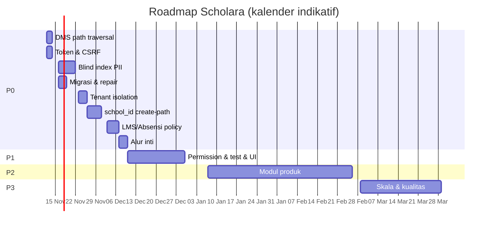

# DEVELOPMENT ROADMAP — SCHOLARA

**Versi:** 2.0 (menggantikan draft v1 yang tidak mencakup temuan kritis baru)
**Tanggal:** 11 November 2026
**Basis:** `PROJECT_AUDIT_REPORT.md`, `SECURITY_AUDIT.md` v2, `FEATURE_COMPLETENESS.md` v2
**Horizon:** 12–16 minggu (P0–P2), dilanjutkan P3
**Asumsi tim:** 2 backend engineer, 1 frontend engineer, 1 QA/part-time DevOps

---

## 1. Tujuan Roadmap

Roadmap ini disusun untuk mengubah Scholara dari **prototipe luas tetapi rapuh** menjadi **produk yang layak produksi**, dengan urutan:

1. **Hentikan pendarahan** — tutup kerentanan kritis dan perbaiki alur inti.
2. **Tegakkan invariant** — tenant, PII, otorisasi, sesi.
3. **Stabilkan** — test, CI, permission, UI yang rusak.
4. **Lengkapi produk** — modul backend-only menjadi fitur utuh.
5. **Skalakan** — performa, observability, API versioning.

**Prinsip:**
- Keamanan dan integritas data mendahului fitur baru.
- Setiap perbaikan harus disertai test regresi.
- Tidak ada task P1/P2 yang dimulai sebelum P0 selesai, kecuali perbaikan dokumentasi.
- Estimasi adalah person-days fokus, bukan durasi kalender.

---

## 2. Definisi Prioritas

| Prioritas | Definisi | Target |
|---|---|---|
| **P0** | Release blocker: keamanan kritis, kehilangan data, alur inti gagal | 0–4 minggu |
| **P1** | Stabilitas dan keamanan penting; risiko tinggi jika tidak diperbaiki | 4–7 minggu |
| **P2** | Kelengkapan produk; modul backend-only dan UX | 7–14 minggu |
| **P3** | Skala, kualitas, dan efisiensi jangka panjang | 14–20 minggu |

---

## 3. Ringkasan Roadmap

| Fase | Fokus | Task | Estimasi | Exit criteria |
|---|---|---|---:|---|
| P0 | Keamanan & integritas | 8 | 28 hari | Semua release blocker tertutup; test regresi lulus |
| P1 | Stabilisasi | 8 | 20 hari | Permission, test, CI, UI dasar beres |
| P2 | Kelengkapan produk | 8 | 50 hari | Modul utama punya UI end-to-end |
| P3 | Skala & kualitas | 6 | 28 hari | API versioned, performa, observability |
| **Total** | | **30** | **126 hari** | Production-ready |

---

## 4. P0 — Release Blocker

### P0-01 — Tutup Arbitrary File Read DMS

| Field | Nilai |
|---|---|
| **Estimasi** | 2 hari |
| **Dependensi** | — |
| **Pemilik** | Backend |
| **Temuan** | SEC-01 |

**Lingkup:**
- `MasterData\Guru\GuruDokumenController::downloadFile`
- Route `GET /api/operator/master-data/guru/{nuptk}/file-download`
- `GuruDokumenService` dan `Guru\GuruDokumenController` (konsolidasi)

**Langkah:**
1. Nonaktifkan route sementara atau tambahkan guard `realpath` hari ini.
2. Ubah endpoint menjadi `GET /dokumen/{id}/download`; ambil path dari DB.
3. Validasi `realpath` terhadap base directory dokumen.
4. Tolak `..`, absolute path, null byte, symlink, dan ekstensi berbahaya.
5. Konsolidasikan dua controller DMS menjadi satu.
6. Tambahkan test traversal.
7. Rotasi `APP_KEY` dan kredensial jika endpoint pernah terekspos.

**Acceptance criteria:**
- [ ] `path=../../../.env`, `..%2f`, absolute path, dan symlink ditolak 403/404.
- [ ] Hanya dokumen milik guru dan sekolah yang sama yang dapat diunduh.
- [ ] Tidak ada parameter path dari user.
- [ ] Test regresi lulus.

---

### P0-02 — Blind Index PII dan Migrasi Lookup

| Field | Nilai |
|---|---|
| **Estimasi** | 6 hari |
| **Dependensi** | P0-08 (urutan migrasi) |
| **Pemilik** | Backend + DB |
| **Temuan** | SEC-02 |

**Lingkup:**
- `siswas.nisn`, `siswas.nik`, `siswas.no_kk`
- `gurus.nuptk`, `gurus.nik`, `gurus.nip`, `gurus.no_kk`
- `orang_tuas.nik`, `orang_tuas.no_kk`
- 124 lookup di controller/service/request

**Langkah:**
1. Tambahkan kolom `*_hash CHAR(64)` dan index `(school_id, *_hash)`.
2. Definisikan `PiiHasher` (HMAC-SHA256 + pepper dari env).
3. Backfill hash untuk data existing (plaintext atau yang sudah didekripsi).
4. Ganti semua `where('nuptk'/'nisn')` ke hash.
5. Ganti unique rule ke hash + `school_id`.
6. Pertahankan cast enkripsi untuk display.
7. Tambahkan test duplikat dan lintas sekolah.
8. Dokumentasikan rotasi pepper.

**Acceptance criteria:**
- [ ] Detail/edit/hapus guru dan siswa berfungsi.
- [ ] Upload foto, verifikasi, absensi, dan tambah anak berfungsi.
- [ ] Dua NISN sama di sekolah yang sama ditolak; di sekolah berbeda diterima.
- [ ] Tidak ada `where('nisn')`/`where('nuptk')` tersisa.
- [ ] Test backfill idempoten.

---

### P0-03 — Perbaiki Isolasi Tenant

| Field | Nilai |
|---|---|
| **Estimasi** | 3 hari |
| **Dependensi** | — |
| **Pemilik** | Backend |
| **Temuan** | SEC-03, SEC-04, SEC-05 |

**Lingkup:**
- `OperatorController::index`, `listOrtu`
- `MasterDataSiswaController::index`
- `Pengaturan` dan `Galeri`
- `AuthController::registerOrtu`

**Langkah:**
1. Group semua `orWhere` dalam closure.
2. Tambahkan `HasSchoolScope` + `school_id` ke `Pengaturan` dan `Galeri`.
3. Ganti query `key` menjadi `(school_id, key)`.
4. Tambahkan policy `GaleriPolicy`.
5. Tambahkan test lintas tenant untuk list/search/update/delete.

**Acceptance criteria:**
- [ ] Pencarian user/siswa/ortu tidak pernah mengembalikan data sekolah lain.
- [ ] Kode registrasi hanya berlaku untuk sekolah yang benar.
- [ ] Galeri publik hanya menampilkan sekolah yang sesuai.
- [ ] Delete galeri lintas tenant ditolak.
- [ ] Test isolasi lulus.

---

### P0-04 — Lengkapi `school_id` Create-Path

| Field | Nilai |
|---|---|
| **Estimasi** | 5 hari |
| **Dependensi** | P0-03 |
| **Pemilik** | Backend |
| **Temuan** | SEC-06 |

**Lingkup model:**
`OperatorProfile`, `UserBendahara`, `UserWaliKelas`, `RiwayatKelas`, `Galeri`, `Pengaturan`, `GuruDokumen`, `GuruDokumenVersion`, `GuruDokumenLog`, `GuruCuti`, `GuruMutasi`, `GuruPendidikan`, `GuruJabatan`, `GuruSertifikasi`, `GuruInpassing`, `GuruDiklat`, `GuruKeluarga`, `GuruRekening`, `GuruAbsensi`, `GuruImportLog`, `GuruAnak`, `GuruKontakDarurat`, `GuruKompetensi`, `GuruPkg`, `KurikulumKomponenNilai`.

**Langkah:**
1. Tambahkan `HasSchoolScope` dan `school_id` ke `$fillable`.
2. Isi `school_id` dari parent, bukan request.
3. Tambahkan foreign key/index jika belum.
4. Tambahkan test create untuk setiap model.
5. Audit ulang semua `::create` di `app/`.

**Acceptance criteria:**
- [ ] Tidak ada HTTP 500 karena `school_id` NULL.
- [ ] Semua model anak memiliki `school_id` yang benar.
- [ ] Test create massal lulus.
- [ ] Tidak ada `school_id` yang diambil dari input user tanpa validasi.

---

### P0-05 — Policy LMS dan Absensi

| Field | Nilai |
|---|---|
| **Estimasi** | 4 hari |
| **Dependensi** | P0-04 |
| **Pemilik** | Backend |
| **Temuan** | SEC-07, SEC-08 |

**Lingkup:**
- `AssignmentController`, `ExamController`, `CourseMaterialController`
- `AbsensiController`

**Langkah:**
1. Buat `AssignmentPolicy`, `ExamPolicy`, `CourseMaterialPolicy`, `AbsensiPolicy`.
2. Daftarkan di `AuthServiceProvider`/auto-discovery.
3. Ganti `findOrFail` dengan `authorize` + query ter-scope.
4. Untuk siswa: cek enrollment kelas dan status publish.
5. Untuk absensi: cek jadwal/kelas yang diampu; dukung `wali_kelas`.
6. Tambahkan test negatif lintas guru/kelas/siswa.

**Acceptance criteria:**
- [ ] Guru tidak dapat mengubah/menghapus konten guru lain.
- [ ] Siswa hanya dapat mengakses materi published dan ujian kelasnya.
- [ ] Absensi hanya dapat diedit oleh guru/wali kelas yang berhak.
- [ ] Rekap dan showKelas memakai otorisasi yang sama.
- [ ] Test negatif lulus.

---

### P0-06 — Token Expiry, Revocation, dan CSRF

| Field | Nilai |
|---|---|
| **Estimasi** | 2 hari |
| **Dependensi** | — |
| **Pemilik** | Backend + Frontend |
| **Temuan** | SEC-09, SEC-10, SEC-14 |

**Langkah:**
1. Set `sanctum.expiration = 120`.
2. Implementasikan refresh/re-login atau sliding expiration.
3. Revoke semua token saat password berubah dan "logout semua perangkat".
4. Aktifkan CSRF untuk cookie-auth (`/sanctum/csrf-cookie` + `X-XSRF-TOKEN`).
5. Hapus fallback plaintext di `InjectTokenFromCookie` atau enkripsi cookie.
6. Set `SameSite=Strict` jika memungkinkan.
7. Tambahkan test 401/419.

**Acceptance criteria:**
- [ ] Token kedaluwarsa setelah 120 menit.
- [ ] Perubahan password mencabut semua sesi.
- [ ] Request tanpa CSRF token ditolak 419.
- [ ] Cookie tidak dapat dipalsukan tanpa APP_KEY.

---

### P0-07 — Perbaiki Alur Inti yang Rusak

| Field | Nilai |
|---|---|
| **Estimasi** | 3 hari |
| **Dependensi** | P0-02 |
| **Pemilik** | Backend |
| **Temuan** | SEC-13, SEC-15, SEC-16, bug absensi |

**Lingkup:**
- DMS storage `local` vs `public`
- Reset password tanpa subdomain
- Register ortu unique global
- `AbsensiController::showKelas` mapping `nisn`

**Langkah:**
1. Samakan disk/path DMS; gunakan `Storage::disk('local')`.
2. Resolve sekolah dari subdomain atau email user.
3. Scope unique `(school_id, username/email)`.
4. Perbaiki mapping `nisn` ke relasi siswa.
5. Tambahkan test end-to-end untuk masing-masing alur.

**Acceptance criteria:**
- [ ] Upload → download dokumen berhasil.
- [ ] Reset password mengirim email di subdomain dan domain pusat.
- [ ] Registrasi ortu dengan username sama di sekolah berbeda berhasil.
- [ ] Absensi menampilkan NISN yang benar.

---

### P0-08 — Urutan Migrasi Enkripsi dan Repair Data

| Field | Nilai |
|---|---|
| **Estimasi** | 3 hari |
| **Dependensi** | — |
| **Pemilik** | Backend + DBA |
| **Temuan** | SEC-02, integritas data |

**Langkah:**
1. Gabungkan/urutkan pelebaran kolom sebelum enkripsi.
2. Tambahkan pengecekan panjang ciphertext.
3. Backup dan audit orphan sebelum `DELETE`.
4. Buat command `encrypt:sensitive-data` idempoten + verifikasi coverage.
5. Tambahkan test migrasi dari DB kosong.
6. Dokumentasikan rollback.

**Acceptance criteria:**
- [ ] `migrate:fresh` berhasil tanpa `Data too long`.
- [ ] Semua data PII terenkripsi dan dapat didekripsi.
- [ ] Tidak ada orphan yang dihapus tanpa backup.
- [ ] Command enkripsi dapat dijalankan ulang tanpa duplikasi.

---

## 5. P1 — Stabilisasi

### P1-01 — Permission Middleware di Semua Modul

| Field | Nilai |
|---|---|
| **Estimasi** | 3 hari |
| **Dependensi** | P0-05 |
| **Temuan** | SEC-11 |

**Langkah:**
1. Petakan permission per route di `keuangan`, `ppdb`, `lms`, `bk`, `perpustakaan`, `tata-usaha`.
2. Tambahkan `permission:` per operasi.
3. Sesuaikan `RbacCatalog` dan `permissions:sync`.
4. Tambahkan test matrix role/permission.

**Acceptance:** semua route modul memakai permission; role tanpa permission ditolak 403.

### P1-02 — Hapus PII dari Activity Log

| Field | Nilai |
|---|---|
| **Estimasi** | 2 hari |
| **Dependensi** | P0-02 |
| **Temuan** | SEC-12 |

**Langkah:** log hanya `field_name` + `model_id`; masking; retensi; audit log lama.

**Acceptance:** tidak ada NISN/NUPTK/NIK di `activity_logs.keterangan`.

### P1-03 — Reset Password dan Unique Ortu

| Field | Nilai |
|---|---|
| **Estimasi** | 2 hari |
| **Dependensi** | P0-07 |
| **Temuan** | SEC-15, SEC-16 |

**Acceptance:** reset berfungsi di domain pusat; registrasi lintas sekolah valid.

### P1-04 — Selaraskan Role Frontend/Backend

| Field | Nilai |
|---|---|
| **Estimasi** | 3 hari |
| **Dependensi** | — |
| **Temuan** | AUTH-04 |

**Langkah:**
1. Kirim `roles` array dan `active_role`.
2. Ubah `ProtectedRoute` untuk menerima array.
3. Izinkan `wali_kelas` di route guru yang sesuai.
4. Implementasikan dashboard wali kelas minimal.

**Acceptance:** user multi-role dapat mengakses semua UI yang diizinkan backend.

### P1-05 — Dead Link dan Halaman Keuangan

| Field | Nilai |
|---|---|
| **Estimasi** | 3 hari |
| **Dependensi** | P1-04 |
| **Temuan** | FEATURE 6.1–6.2 |

**Langkah:**
1. Daftarkan 4 halaman keuangan di `App.jsx`.
2. Perbaiki link sidebar operator/bendahara.
3. Hapus route/halaman mati.
4. Tambahkan test route smoke.

**Acceptance:** semua link sidebar menuju route yang ada; halaman keuangan dapat diakses.

### P1-06 — Perbaiki Test Suite dan CI

| Field | Nilai |
|---|---|
| **Estimasi** | 4 hari |
| **Dependensi** | P0-02, P0-04 |
| **Temuan** | Bagian 14 |

**Langkah:**
1. Perbaiki helper tenant (subdomain/bind).
2. Ganti `pluck` PII dengan akses model.
3. Tambahkan test regresi P0.
4. Siapkan MySQL test di CI.
5. Jalankan `php artisan test`, `oxlint`, `vite build`.

**Acceptance:** CI hijau; test suite berjalan < 10 menit; coverage inti > 60%.

### P1-07 — Audit Dependensi

| Field | Nilai |
|---|---|
| **Estimasi** | 1 hari |
| **Dependensi** | — |
| **Temuan** | SEC-17 |

**Langkah:** `npm audit`, ganti `xlsx` jika perlu, pin versi, tambahkan Dependabot.

**Acceptance:** tidak ada CVE kritis/tinggi tanpa mitigasi terdokumentasi.

### P1-08 — Koreksi Dokumentasi

| Field | Nilai |
|---|---|
| **Estimasi** | 2 hari |
| **Dependensi** | — |
| **Temuan** | Bagian 15 |

**Langkah:** perbarui README, matrix, API docs; hapus kredensial; tandai dokumen stale.

**Acceptance:** dokumentasi sesuai kode; tidak ada secret di file tracked.

---

## 6. P2 — Kelengkapan Produk

### P2-01 — UI Keuangan End-to-End

| Field | Nilai |
|---|---|
| **Estimasi** | 8 hari |
| **Dependensi** | P1-05 |
| **Modul** | Keuangan |

**Lingkup:** daftar tagihan, generate tagihan, pembayaran, kuitansi, laporan, export.

**Acceptance:** bendahara dapat membuat tagihan, mencatat pembayaran, dan mencetak laporan tanpa menyentuh API manual.

### P2-02 — UI PPDB End-to-End

| Field | Nilai |
|---|---|
| **Estimasi** | 6 hari |
| **Dependensi** | P1-01 |
| **Modul** | PPDB |

**Lingkup:** daftar pendaftar, verifikasi berkas, konversi ke siswa, pembayaran.

**Acceptance:** admin PPDB dapat memproses pendaftar dari verifikasi sampai menjadi siswa.

### P2-03 — UI BK, Perpustakaan, Tata Usaha

| Field | Nilai |
|---|---|
| **Estimasi** | 8 hari |
| **Dependensi** | P1-01 |
| **Modul** | BK/Perpus/TU |

**Acceptance:** ketiga role memiliki dashboard dan CRUD dasar.

### P2-04 — LMS Siswa, Nilai, dan Rapor

| Field | Nilai |
|---|---|
| **Estimasi** | 10 hari |
| **Dependensi** | P0-05 |
| **Modul** | LMS/Akademik |

**Lingkup:**
- Model `Nilai`, `NilaiAkhir`, `Rapor`.
- API siswa: materi, tugas, ujian, nilai.
- UI siswa: dashboard, LMS, nilai, rapor.
- Guru: input nilai, kalkulasi, cetak rapor.

**Acceptance:** siswa dapat melihat materi/tugas/nilai/rapor; guru dapat menginput dan mencetak.

### P2-05 — Superadmin SaaS

| Field | Nilai |
|---|---|
| **Estimasi** | 6 hari |
| **Dependensi** | — |
| **Modul** | SaaS |

**Lingkup:** CRUD sekolah, domain, langganan, invoice, kuota, status.

**Acceptance:** superadmin dapat membuat/menonaktifkan sekolah dan mengelola langganan.

### P2-06 — Optimasi Frontend

| Field | Nilai |
|---|---|
| **Estimasi** | 4 hari |
| **Dependensi** | — |
| **Modul** | Frontend |

**Langkah:** lazy route, manual chunk, image optimization, hapus kode mati.

**Acceptance:** chunk utama < 1 MB; Lighthouse performance > 80 di 3G cepat.

### P2-07 — Observability dan Backup

| Field | Nilai |
|---|---|
| **Estimasi** | 4 hari |
| **Dependensi** | — |
| **Modul** | Infra |

**Langkah:** log terpusat, alert error 5xx, backup harian, restore test, health check.

**Acceptance:** backup dapat direstore; error 5xx memicu alert < 5 menit.

### P2-08 — Aksesibilitas dan Responsif

| Field | Nilai |
|---|---|
| **Estimasi** | 4 hari |
| **Dependensi** | P2-01..P2-05 |
| **Modul** | Frontend |

**Acceptance:** WCAG AA dasar; tabel dapat digunakan di tablet; form punya label/error.

---

## 7. P3 — Skala dan Kualitas

### P3-01 — API Versioning dan OpenAPI

| Field | Nilai |
|---|---|
| **Estimasi** | 5 hari |
| **Dependensi** | P1-06 |

**Langkah:** `/api/v1`, OpenAPI 3.1, generated docs, contract test, deprecation policy.

**Acceptance:** kontrak API terdokumentasi dan diuji; perubahan breaking punya jalur migrasi.

### P3-02 — Redis untuk Cache/Queue/Session

| Field | Nilai |
|---|---|
| **Estimasi** | 4 hari |
| **Dependensi** | P2-07 |

**Acceptance:** cache/queue/session memakai Redis; beban DB turun; worker stabil.

### P3-03 — Partisi dan Arsip Data

| Field | Nilai |
|---|---|
| **Estimasi** | 5 hari |
| **Dependensi** | P3-02 |

**Lingkup:** `activity_logs`, `absensis`, `tagihans`, `pembayarans`.

**Acceptance:** data > 1 tahun terarsip otomatis; query dashboard tetap cepat.

### P3-04 — Konsolidasi Design System

| Field | Nilai |
|---|---|
| **Estimasi** | 5 hari |
| **Dependensi** | P2-08 |

**Acceptance:** komponen dasar konsisten; duplikasi UI berkurang; dokumentasi komponen ada.

### P3-05 — E2E Test

| Field | Nilai |
|---|---|
| **Estimasi** | 6 hari |
| **Dependensi** | P1-06 |

**Lingkup:** Playwright untuk login, CRUD guru/siswa, absensi, LMS, keuangan.

**Acceptance:** alur kritis teruji di CI; flaky rate < 5%.

### P3-06 — Dokumentasi Otomatis

| Field | Nilai |
|---|---|
| **Estimasi** | 3 hari |
| **Dependensi** | P3-01 |

**Acceptance:** route/API docs generated di CI; tidak ada drift dokumentasi.

---

## 8. Rencana Sprint

| Sprint | Durasi | Fokus | Deliverable |
|---|---|---|---|
| Sprint 0 | 1 minggu | P0-01, P0-06 | DMS aman; token/CSRF diperbaiki |
| Sprint 1 | 2 minggu | P0-02, P0-08 | Blind index; migrasi bersih |
| Sprint 2 | 2 minggu | P0-03, P0-04 | Tenant isolation; create-path |
| Sprint 3 | 1 minggu | P0-05, P0-07 | Policy LMS/absensi; alur inti |
| Sprint 4 | 2 minggu | P1-01..P1-05 | Permission, UI dasar, role |
| Sprint 5 | 2 minggu | P1-06..P1-08 | Test, CI, dependensi, docs |
| Sprint 6–9 | 8 minggu | P2-01..P2-08 | Modul produk lengkap |
| Sprint 10–12 | 6 minggu | P3-01..P3-06 | Skala, API, E2E |

**Catatan:** sprint dapat berjalan paralel untuk backend/frontend, tetapi P0-02 dan P0-04 harus selesai sebelum P2 dimulai.

---

## 9. Rencana Sumber Daya

| Peran | Alokasi | Tanggung jawab |
|---|---|---|
| Backend engineer 1 | 100% | P0-02, P0-04, P0-05, P1-01 |
| Backend engineer 2 | 100% | P0-01, P0-03, P0-07, P0-08 |
| Frontend engineer | 100% | P1-04, P1-05, P2-01..P2-06, P2-08 |
| QA | 50% | P1-06, P3-05, regresi |
| DevOps | 25% | P2-07, P3-02, P3-03 |
| DBA | 25% | P0-02, P0-08, P3-03 |
| Product owner | 25% | Priorisasi, acceptance |

**Total estimasi:** 126 person-days fokus; dengan tim di atas, ±12–16 minggu kalender.

---

## 10. Risk Register

| ID | Risiko | Prob. | Dampak | Mitigasi | Owner |
|---|---|---|---|---|---|
| R-01 | Migrasi enkripsi merusak data | Sedang | Tinggi | Backup, staging, dry-run, idempoten | DBA |
| R-02 | Backfill hash salah | Sedang | Tinggi | Verifikasi sampel, checksum, rollback | Backend |
| R-03 | Perbaikan tenant memecahkan query | Tinggi | Sedang | Test regresi, feature flag | Backend |
| R-04 | Token expiry memutus sesi | Tinggi | Rendah | Refresh flow, komunikasi | Backend |
| R-05 | Scope creep fitur baru | Tinggi | Sedang | Change control, P0/P1 lock | PO |
| R-06 | Tidak ada QA | Tinggi | Tinggi | CI wajib, test regression | QA |
| R-07 | Data orphan dihapus | Rendah | Tinggi | Backup + audit sebelum delete | DBA |
| R-08 | Keterbatasan waktu tim | Sedang | Sedang | Prioritaskan P0/P1, defer P2 | PO |
| R-09 | Dependensi tidak maintained | Sedang | Sedang | Audit, pin, alternative | Frontend |
| R-10 | Deployment tanpa monitoring | Sedang | Tinggi | P2-07 sebelum produksi | DevOps |

---

## 11. Definition of Done

Sebuah task dianggap selesai jika:

- [ ] Kode diimplementasikan dan di-review.
- [ ] Test unit/integration ditambahkan dan lulus.
- [ ] Tidak ada regresi pada test suite.
- [ ] Dokumentasi teknis diperbarui.
- [ ] Tidak ada secret/PII di log.
- [ ] Acceptance criteria terpenuhi.
- [ ] Diuji di staging dengan data sintetis.
- [ ] Tidak ada error 500 pada alur bahagia dan alur negatif utama.

**Untuk P0 tambahan:**
- [ ] Threat model diperbarui.
- [ ] Test eksploitasi/negatif lulus.
- [ ] Rollback plan tersedia.

---

## 12. KPI Keberhasilan

| KPI | Baseline | Target |
|---|---:|---:|
| Temuan P0 terbuka | 8 | 0 |
| Temuan HIGH terbuka | 6 | 0 |
| Test suite lulus | Tidak diketahui | 100% |
| Coverage inti | Rendah | > 60% |
| Endpoint dengan permission | Sebagian | 100% |
| Model dengan tenant scope | 36/80 | 100% model operasional |
| Lookup PII plaintext | 124 | 0 |
| Chunk utama frontend | 3,1 MB | < 1 MB |
| Lighthouse performance | Tidak diukur | > 80 |
| Waktu reset password | Gagal senyap | < 1 menit email terkirim |
| Error 5xx produksi | Tidak dimonitor | < 0,1% request |

---

## 13. Change Log

| Versi | Tanggal | Perubahan |
|---|---|---|
| 1.0 | 2026-08-12 | Draft awal; task umum, tidak mencakup temuan baru |
| 2.0 | 2026-11-11 | Ditulis ulang: P0-01..P0-08, P1, P2, P3; blind index; DMS; tenant; policy; test/CI |

---

**Pemilik roadmap:** Tech Lead
**Review berikutnya:** setelah P0 selesai (± 4 minggu)
**Status:** Aktif
