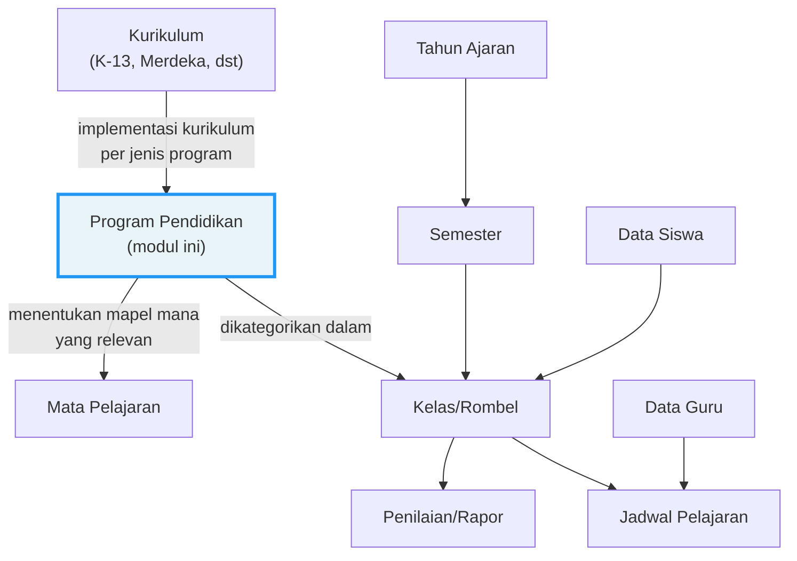
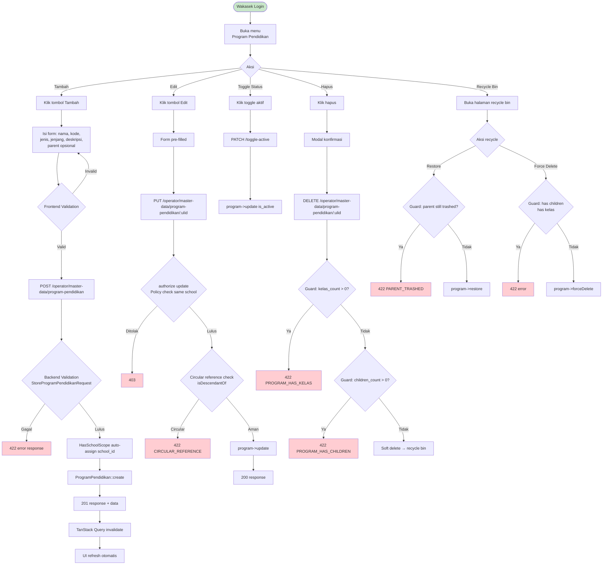
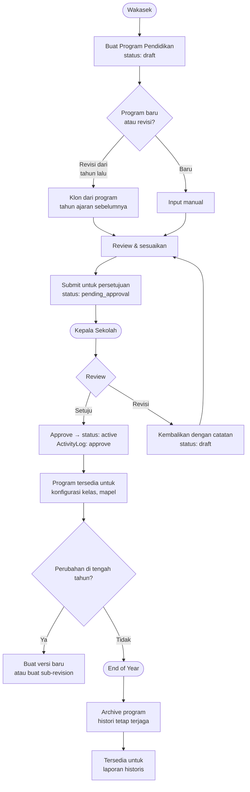
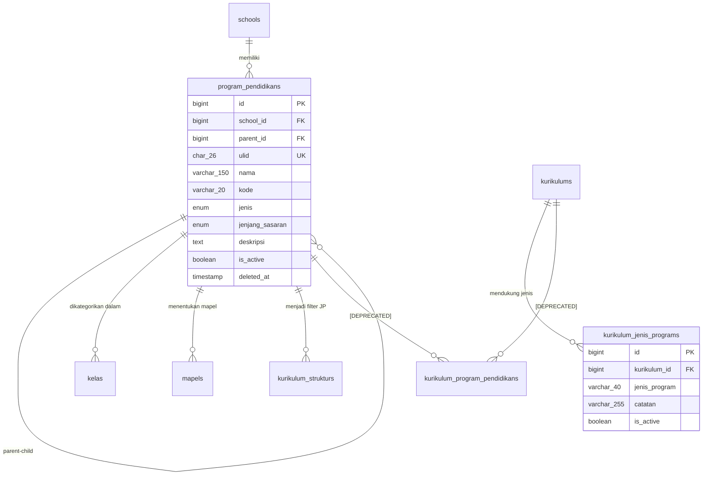
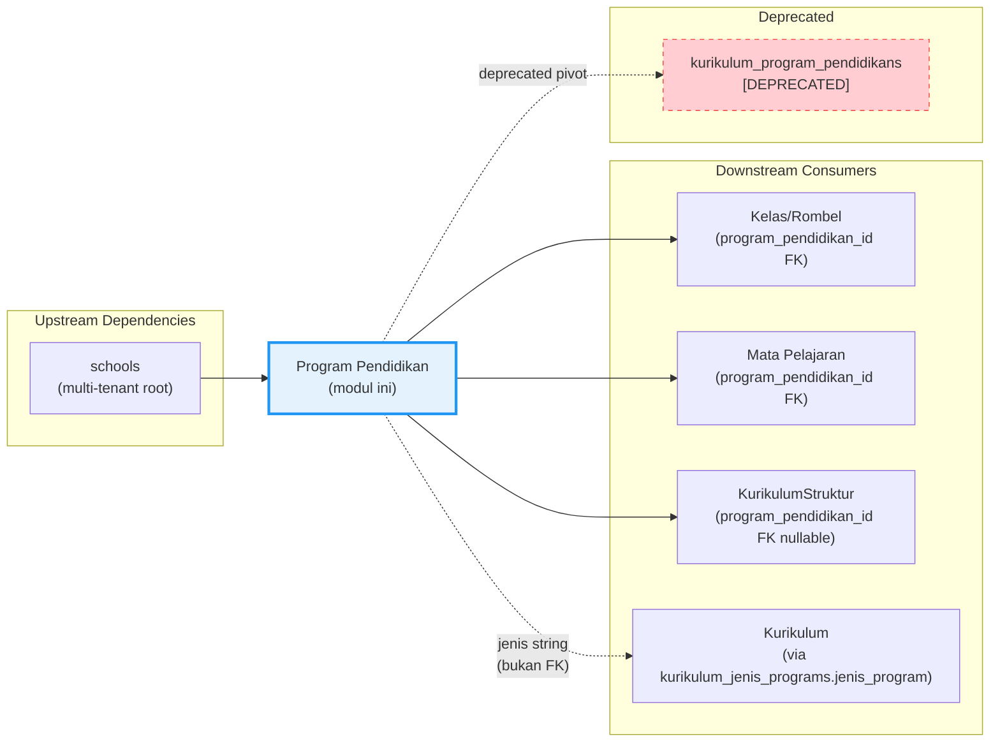
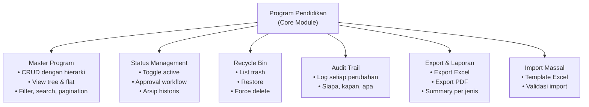

# AUDIT KOMPREHENSIF — PROGRAM PENDIDIKAN
## Scholara School Management SaaS

**Versi:** 1.0  
**Tanggal Audit:** 18 November 2026  
**Metode:** Read-only static inspection (kode, migrasi, route, frontend)  
**Status Runtime:** MySQL tidak berjalan; semua temuan berdasarkan analisis statis  
**Auditor (Persona):** Senior SaaS Product Architect · Education System Analyst · Business Process Analyst · Software Architect · Database Architect · UI/UX Auditor · QA Engineer · Indonesian EdTech Consultant

> **PENTING:** Dokumen ini adalah hasil audit murni. Tidak ada perubahan kode, migrasi, atau konfigurasi yang dilakukan. Setiap temuan disertai bukti berupa nama file, class, function, atau baris kode yang relevan.

---

## DAFTAR ISI

1. [Executive Summary](#1-executive-summary)
2. [Inventaris Fitur](#2-inventaris-fitur-phase-1)
3. [Business Domain Analysis](#3-business-domain-analysis-phase-2)
4. [Workflow Analysis](#4-workflow-analysis-phase-3)
5. [Role & Permission Audit](#5-role--permission-audit-phase-4)
6. [Database & Data Architecture Audit](#6-database--data-architecture-audit-phase-5)
7. [Integration Audit](#7-integration-audit-phase-6)
8. [UI/UX & Functional Audit](#8-uiux--functional-audit-phase-7)
9. [Security & Reliability Audit](#9-security--reliability-audit-phase-8)
10. [Gap Analysis](#10-gap-analysis-phase-9)
11. [Product Recommendation](#11-product-recommendation-phase-10)
12. [Development Roadmap](#12-development-roadmap)
13. [Final Assessment](#13-final-assessment)

---

## 1. Executive Summary

### 1.1 Ringkasan

Modul **Program Pendidikan** pada Scholara merupakan salah satu modul master data yang paling matang implementasinya dibandingkan modul lain dalam sistem. Modul ini mengelola hierarki program pendidikan (misalnya: Bidang Keahlian → Program Keahlian → Konsentrasi Keahlian pada SMK, atau Peminatan pada SMA) yang berfungsi sebagai salah satu dimensi kategorisasi kelas dan mata pelajaran.

**Penilaian Keseluruhan: PARTIALLY COMPLETE — 68%**

| Dimensi | Nilai | Catatan |
|---|---|---|
| Implementasi Backend | ✅ 85% | CRUD lengkap, guard bisnis solid |
| Implementasi Frontend | ✅ 75% | UI fungsional, beberapa state edge case hilang |
| Keamanan | ⚠️ 70% | Multi-tenant solid, namun audit trail belum ada |
| Integrasi Antarmodul | ⚠️ 55% | Referensi ada, integrasi UI belum konsisten |
| Business Logic | ⚠️ 60% | Guard ada, workflow approval belum tersedia |
| Kesiapan Produksi | ❌ 45% | Belum ada export, audit trail, approval, dan test coverage |

### 1.2 Temuan Kritis

| ID | Tingkat | Temuan |
|---|---|---|
| GAP-01 | CRITICAL | Tidak ada audit trail untuk operasi CRUD Program Pendidikan |
| GAP-02 | CRITICAL | `index()` dan `tree()` tidak memanggil `$this->authorize()` — policy tidak diperiksa |
| GAP-03 | HIGH | `trash()` tidak berpaginasi — potensi memory exhaustion jika data banyak |
| GAP-04 | HIGH | `isDescendantOf()` memuat seluruh parent_map sekolah — O(n) tanpa batas atas |
| GAP-05 | HIGH | Pivot `kurikulum_program_pendidikans` deprecated tetapi masih direferensi model Kurikulum |
| GAP-06 | HIGH | Tidak ada test coverage sama sekali untuk modul ini |

### 1.3 Kekuatan Utama

- Multi-tenant isolation 3 lapis (GlobalScope + Trait + Policy) — desain solid
- Hierarki self-referencing dengan 10 business guard implementasi
- Soft delete + recycle bin dengan guard restore parent-first
- Validasi request terpisah (Store/Update Request class)
- Enum `jenis` mendukung 7 jenis program mencakup SD hingga SMK/MAK
- ULID sebagai public identifier (aman untuk URL)

---

## 2. Inventaris Fitur (Phase 1)

### 2.1 Backend — API & Business Logic

| No | Modul/Submodul | Fungsi | Status | Lokasi File |
|---|---|---|---|---|
| 1 | CRUD — Index | Daftar flat dengan filter & pagination | ✅ Implemented | `ProgramPendidikanController::index()` L17-51 |
| 2 | CRUD — Tree | Hierarki nested untuk tampilan pohon | ✅ Implemented | `ProgramPendidikanController::tree()` L62-95 |
| 3 | CRUD — Dropdown | Flat list aktif untuk select/combobox | ✅ Implemented | `ProgramPendidikanController::dropdown()` L244-270 |
| 4 | CRUD — Show | Detail satu program + children 2 level | ✅ Implemented | `ProgramPendidikanController::show()` L127-141 |
| 5 | CRUD — Store | Tambah program baru dengan validasi | ✅ Implemented | `ProgramPendidikanController::store()` L99-123 |
| 6 | CRUD — Update | Edit program + guard circular reference | ✅ Implemented | `ProgramPendidikanController::update()` L145-183 |
| 7 | CRUD — Toggle Active | Aktifkan/nonaktifkan program | ✅ Implemented | `ProgramPendidikanController::toggleActive()` L222-236 |
| 8 | CRUD — Soft Delete | Hapus ke recycle bin + guard kelas/children | ✅ Implemented | `ProgramPendidikanController::destroy()` L187-214 |
| 9 | Recycle Bin — List | Daftar program terhapus | ✅ Implemented | `ProgramPendidikanController::trash()` L279-288 |
| 10 | Recycle Bin — Restore | Pulihkan dari recycle bin + guard parent | ✅ Implemented | `ProgramPendidikanController::restore()` L294-323 |
| 11 | Recycle Bin — Force Delete | Hapus permanen + guard kelas/children | ✅ Implemented | `ProgramPendidikanController::forceDelete()` L329-366 |
| 12 | Business Guard — Circular | Cegah circular reference di hierarki | ✅ Implemented | `ProgramPendidikanController::isDescendantOf()` L377-393 |
| 13 | Business Guard — Kelas | Blokir hapus jika ada kelas terikat | ✅ Implemented | Controller L195-209 |
| 14 | Business Guard — Children | Blokir hapus jika ada sub-program | ✅ Implemented | Controller L203-209 |
| 15 | Business Guard — Parent Trashed | Blokir restore jika parent masih dihapus | ✅ Implemented | Controller L303-315 |
| 16 | Multi-Tenant Isolation | 3-layer isolation (scope, trait, policy) | ✅ Implemented | `SchoolScope`, `HasSchoolScope`, `ProgramPendidikanPolicy` |
| 17 | Authorization — Policy | View/create/update/delete/restore/forceDelete | ✅ Implemented | `ProgramPendidikanPolicy.php` |
| 18 | Validasi Request | Store & Update request dengan rules | ✅ Implemented | `StoreProgramPendidikanRequest`, `UpdateProgramPendidikanRequest` |
| 19 | Resource Transform | API response transformer | ✅ Implemented | `ProgramPendidikanResource.php` |
| 20 | Audit Trail | Log aktivitas CRUD | ❌ Tidak ada | — |
| 21 | Approval Workflow | Persetujuan kepala sekolah | ❌ Tidak ada | — |
| 22 | Export Excel/PDF | Ekspor data program | ❌ Tidak ada | — |
| 23 | Bulk Operations | Aktifkan/nonaktifkan massal | ❌ Tidak ada | — |
| 24 | Test Coverage | Unit/feature tests | ❌ Tidak ada | — |

### 2.2 Frontend — UI & UX

| No | Modul/Submodul | Fungsi | Status | Lokasi File |
|---|---|---|---|---|
| 25 | Halaman Master Program | List view dengan filter, search, pagination | ✅ Implemented | `MasterProgramWakasek.jsx` |
| 26 | Tabel Program | Tabel dengan kolom lengkap + aksi | ✅ Implemented | `ProgramTable.jsx` |
| 27 | Filter Toolbar | Filter jenis, jenjang, status aktif | ✅ Implemented | `FilterToolbar.jsx` |
| 28 | Modal Program | Form tambah/edit dengan validasi | ✅ Implemented | `ModalProgram.jsx` |
| 29 | Modal Hapus | Konfirmasi hapus | ✅ Implemented | `ModalHapus.jsx` |
| 30 | Recycle Bin | Halaman tampilkan program terhapus | ✅ Implemented | `RecycleBinProgramWakasek.jsx` |
| 31 | Config Program | Enum labels, colors, icons | ✅ Implemented | `programConfig.js` |
| 32 | API Hook | TanStack Query hooks untuk semua endpoint | ✅ Implemented | `useProgramPendidikan.js` |
| 33 | Sidebar Navigation | Link menu program pendidikan | ✅ Implemented | `WakasekSidebar.jsx` L31 |
| 34 | App Router | Route `/wakasek/program-pendidikan` | ✅ Implemented | `App.jsx` L633 |
| 35 | View Tree/Hierarki | Tampilan pohon struktur program | ⚠️ Partial | `MasterProgramWakasek.jsx` — API tree tersedia, UI belum pakai |
| 36 | Pagination Server-side | Pagination dari server | ⚠️ Partial | Frontend pakai client-side per 12 root nodes |
| 37 | Export UI | Tombol export Excel/PDF | ❌ Tidak ada | — |
| 38 | Bulk Select | Checkbox multi-pilih | ❌ Tidak ada | — |
| 39 | History Log UI | Tampilan audit trail | ❌ Tidak ada | — |

### 2.3 Database

| No | Entitas | Tabel | Status | Migrasi |
|---|---|---|---|---|
| 40 | Program Pendidikan | `program_pendidikans` | ✅ Ada | `2026_08_27_000005_replace_jurusans_with_program_pendidikans.php` |
| 41 | Jenis Program (enum extension) | `program_pendidikans.jenis` | ✅ Ada | `2026_08_29_000002_extend_program_pendidikans_jenis_enum.php` |
| 42 | Pivot Kurikulum-Jenis | `kurikulum_jenis_programs` | ✅ Ada | `2026_10_03_000002_create_kurikulum_jenis_programs_table.php` |
| 43 | Pivot Kurikulum-Program (deprecated) | `kurikulum_program_pendidikans` | ⚠️ Deprecated | `2026_09_03_000004_create_kurikulum_pivot_tables.php` |

---

## 3. Business Domain Analysis (Phase 2)

### 3.1 Definisi Domain

**Program Pendidikan** dalam konteks manajemen sekolah Indonesia adalah **kategorisasi struktural jalur pendidikan** yang menentukan spesialisasi atau peminatan akademik suatu sekolah. Ini berbeda dari:

| Konsep | Tanggung Jawab |
|---|---|
| **Program Pendidikan** | Struktur jalur/spesialisasi (Bidang Keahlian, Program Keahlian, Peminatan) |
| **Kurikulum** | Dokumen resmi (K-13, Merdeka, Cambridge) yang diterapkan |
| **Tahun Ajaran** | Periode akademik (2024/2025) |
| **Semester** | Sub-periode dalam tahun ajaran |
| **Kelas/Rombel** | Kelompok belajar aktual yang menggunakan program tertentu |
| **Mata Pelajaran** | Konten akademik yang diajarkan |
| **Jadwal Pelajaran** | Alokasi waktu untuk mata pelajaran |
| **Penilaian** | Evaluasi capaian siswa |

### 3.2 Jenis Program yang Didukung Sistem

```
jenis enum:
├── bidang_keahlian       → SMK: level 1 hierarki (cth: Teknologi Informasi)
├── program_keahlian      → SMK: level 2 hierarki (cth: Teknik Komputer dan Informatika)
├── konsentrasi_keahlian  → SMK: level 3 hierarki (cth: Rekayasa Perangkat Lunak)
├── peminatan             → SMA: Kelompok peminatan IPA/IPS/Bahasa (K-13)
├── mata_pelajaran_pilihan → SMA: Mapel pilihan (Merdeka Belajar)
├── keagamaan             → Madrasah: spesialisasi keagamaan
└── umum                  → SD/SMP: program umum tanpa peminatan
```

```
jenjang_sasaran enum:
SD | MI | SMP | MTs | SMA | MA | SMK | MAK | semua
```

### 3.3 Domain Boundary yang Direkomendasikan



### 3.4 Tanggung Jawab Modul Program Pendidikan

**Harus menjadi tanggung jawab modul ini:**
- Definisi dan pemeliharaan entitas program pendidikan (CRUD)
- Hierarki program (parent-child)
- Jenis dan jenjang sasaran program
- Status aktif/nonaktif program
- Soft delete dan recycle bin

**Bukan tanggung jawab modul ini (delegasikan ke modul lain):**
- Alokasi jam pembelajaran → tanggung jawab **KurikulumStruktur**
- Penetapan kurikulum untuk program → tanggung jawab **Kurikulum**
- Jadwal pelajaran per program → tanggung jawab **Jadwal Pelajaran**
- Evaluasi pelaksanaan program → tanggung jawab **Rapor/Penilaian**
- Kalender pendidikan → modul tersendiri

### 3.5 Potensi Tumpang Tindih

| Area | Program Pendidikan | Kurikulum | Status |
|---|---|---|---|
| Jenis program | Mendefinisikan | Mengacu via `jenis_program` | ⚠️ Reduplikasi enum di `kurikulum_jenis_programs` |
| Kategori mapel | `program_pendidikan_id` di mapel | `kurikulum_id` di mapel | ⚠️ Dua FK terpisah di tabel `mapels` |
| Kategori kelas | `program_pendidikan_id` di kelas | `kurikulum_id` di kelas (baru) + `kurikulum` string (legacy) | ⚠️ Tiga kolom kurikulum di `kelas` |

---

## 4. Workflow Analysis (Phase 3)

### 4.1 Existing Workflow (Alur yang Benar-benar Sudah Berjalan)



### 4.2 Workflow yang BELUM Tersedia

| Workflow | Status | Keterangan |
|---|---|---|
| Approval kepala sekolah | ❌ Belum ada | Tidak ada field status/approval, tidak ada endpoint approve |
| Draft → Review → Active lifecycle | ❌ Belum ada | Hanya is_active binary (true/false) |
| Notifikasi perubahan ke stakeholder | ❌ Belum ada | Tidak ada notification system untuk modul ini |
| Audit trail / histori perubahan | ❌ Belum ada | `ActivityLog::log()` tidak dipanggil di controller |
| Kloning program dari tahun sebelumnya | ❌ Belum ada | Tidak ada endpoint clone/duplicate |
| Import massal via Excel | ❌ Belum ada | Tidak ada import controller/service |
| Export program | ❌ Belum ada | Tidak ada export controller/service |

### 4.3 Expected Workflow (Rekomendasi Alur Ideal)



---

## 5. Role & Permission Audit (Phase 4)

### 5.1 Implementasi RBAC Aktual

**Sumber:** `backend/database/seeders/Support/RbacCatalog.php`  
**Permission yang ada:**
- `master_data.program.view` — lihat program pendidikan
- `master_data.program.manage` — kelola (create/update/delete/toggle)

**Middleware route:**
```
GET  .../program-pendidikan         → permission:master_data.program.view
GET  .../program-pendidikan/tree    → permission:master_data.program.view
GET  .../program-pendidikan/dropdown → permission:master_data.program.view
GET  .../program-pendidikan/trash   → permission:master_data.program.view
GET  .../program-pendidikan/:ulid   → permission:master_data.program.view
POST .../program-pendidikan         → permission:master_data.program.manage
PUT  .../program-pendidikan/:ulid   → permission:master_data.program.manage
PATCH .../program-pendidikan/:ulid/toggle-active → permission:master_data.program.manage
DELETE .../program-pendidikan/:ulid → permission:master_data.program.manage
PATCH .../program-pendidikan/:ulid/restore → permission:master_data.program.manage
DELETE .../program-pendidikan/:ulid/force-delete → permission:master_data.program.manage
```

**Distribusi permission dari RBAC Catalog:**

| Role | `master_data.program.view` | `master_data.program.manage` | Sumber |
|---|---|---|---|
| Wakasek (Kurikulum) | ✅ | ✅ | `RbacCatalog.php` L359-420 |
| Operator | ✅ | ❌ (explicitly excluded) | `RbacCatalog.php` L41 — **termasuk dalam view** |
| Kepala Sekolah | ✅ | ❌ | `RbacCatalog.php` |
| Guru | ❌ | ❌ | Tidak disebut dalam catalog |
| Wali Kelas | ❌ | ❌ | Tidak disebut |
| Guru BK | ❌ | ❌ | Tidak disebut |
| Bendahara | ❌ | ❌ | Tidak disebut |
| Tata Usaha | ❌ | ❌ | Tidak disebut |
| Admin Keuangan | ❌ | ❌ | Tidak disebut |
| Pustakawan | ❌ | ❌ | Tidak disebut |
| Orang Tua/Wali | ❌ | ❌ | Tidak disebut |
| Super Admin SaaS | UNKNOWN | UNKNOWN | Tidak terverifikasi dari kode |

> **Catatan konfirmasi:** `ProgramPendidikanPolicy::create()` mengizinkan `operator || wakasek`, namun route middleware hanya memberi `manage` ke wakasek. Middleware menang → operator tidak bisa create. Ini inkonsistensi policy, bukan bug (middleware lebih ketat).

### 5.2 Matriks Permission Aktual vs Ideal

| Aksi | Wakasek | Operator | Kepsek | Guru | Orang Tua | Status |
|---|---|---|---|---|---|---|
| **View list** | ✅ | ✅ | ✅ | ❌ | ❌ | Aktual |
| **View list** | ✅ | ✅ | ✅ | ⚠️ read-only | ❌ | Ideal |
| **Create** | ✅ | ❌ | ❌ | ❌ | ❌ | Aktual |
| **Create** | ✅ | ✅ | ❌ | ❌ | ❌ | Ideal |
| **Edit** | ✅ | ❌ | ❌ | ❌ | ❌ | Aktual |
| **Edit** | ✅ | ✅ | ❌ | ❌ | ❌ | Ideal |
| **Toggle Active** | ✅ | ❌ | ❌ | ❌ | ❌ | Aktual |
| **Toggle Active** | ✅ | ❌ | ✅ | ❌ | ❌ | Ideal (kepsek approve) |
| **Delete (soft)** | ✅ | ❌ | ❌ | ❌ | ❌ | Aktual |
| **Delete (soft)** | ✅ | ❌ | ❌ | ❌ | ❌ | Ideal |
| **Restore** | ✅ | ❌ | ❌ | ❌ | ❌ | Aktual |
| **Restore** | ✅ | ❌ | ❌ | ❌ | ❌ | Ideal |
| **Force Delete** | ✅ | ❌ | ❌ | ❌ | ❌ | Aktual |
| **Force Delete** | ❌ | ❌ | ❌ | ❌ | ❌ | Ideal (hanya Super Admin) |
| **Approve** | ❌ | ❌ | ❌ | ❌ | ❌ | Aktual (tidak ada) |
| **Approve** | ❌ | ❌ | ✅ | ❌ | ❌ | Ideal |
| **Export** | ❌ | ❌ | ❌ | ❌ | ❌ | Aktual (tidak ada) |
| **Export** | ✅ | ✅ | ✅ | ❌ | ❌ | Ideal |

### 5.3 Temuan Authorization

| Temuan | Tingkat | Detail |
|---|---|---|
| `index()` tanpa `authorize()` | HIGH | Controller L17 — SchoolScope memfilter data, tapi policy tidak dipanggil |
| `tree()` tanpa `authorize()` | HIGH | Controller L62 — sama dengan index |
| Policy `create` vs middleware tidak sinkron | MEDIUM | Policy izinkan operator, middleware tidak |
| Force delete hanya wakasek | MEDIUM | Operasi destruktif permanen seharusnya lebih ketat |
| Tidak ada permission `approve` | HIGH | Jika approval workflow ditambahkan, permission belum ada |

---

## 6. Database & Data Architecture Audit (Phase 5)

### 6.1 Struktur Tabel `program_pendidikans`

**Migrasi:** `2026_08_27_000005_replace_jurusans_with_program_pendidikans.php`  
**Extended:** `2026_08_29_000002_extend_program_pendidikans_jenis_enum.php`

| Kolom | Tipe | Nullable | Default | Keterangan |
|---|---|---|---|---|
| `id` | bigint PK | No | auto | Integer PK internal |
| `school_id` | bigint FK | No | — | FK → schools, CASCADE DELETE |
| `parent_id` | bigint FK | Yes | NULL | Self-ref, SET NULL ON DELETE |
| `ulid` | char(26) | No | — | Public identifier, UNIQUE global |
| `nama` | varchar(150) | No | — | Nama program |
| `kode` | varchar(20) | Yes | NULL | Kode singkat, UNIQUE per school |
| `jenis` | enum(7) | No | — | Jenis program |
| `jenjang_sasaran` | enum(9) | No | `semua` | Jenjang target |
| `deskripsi` | text | Yes | NULL | Deskripsi opsional |
| `is_active` | boolean | No | true | Status aktif |
| `created_at` | timestamp | Yes | — | — |
| `updated_at` | timestamp | Yes | — | — |
| `deleted_at` | timestamp | Yes | NULL | Soft delete |

**Indexes:**
- `PRIMARY (id)`
- `UNIQUE (ulid)`
- `UNIQUE (school_id, kode)` — kode unik per sekolah
- `INDEX (school_id)`
- `INDEX (parent_id)`
- `INDEX (jenis)`
- `INDEX (is_active)`

### 6.2 ER Diagram



### 6.3 Multi-Tenant Audit

| Aspek | Status | Bukti |
|---|---|---|
| Kolom `school_id` tersedia | ✅ | Migration L — kolom `school_id` NOT NULL |
| Global scope aktif | ✅ | `HasSchoolScope` → `SchoolScope::apply()` → `WHERE school_id = ?` |
| Fail-closed saat no context | ✅ | `SchoolScope.php` → `WHERE 1=0` jika `current_school_id` null |
| Auto-assign pada create | ✅ | `HasSchoolScope::bootHasSchoolScope()` → `creating` event |
| Policy sameSchool check | ✅ | `ProgramPendidikanPolicy::sameSchool()` di semua methods |
| `forceDelete` bypass scope | ⚠️ | L351 — eksplisit `withoutGlobalScope(SchoolScope::class)` untuk cek kelas; dimaksudkan untuk cross-check, bukan cross-tenant access, tapi perlu audit lebih lanjut |
| Cross-tenant leakage di `isDescendantOf` | ✅ Aman | `pluck('parent_id', 'id')` melewati SchoolScope → hanya data sekolah aktif |

### 6.4 Evaluasi Data Architecture

| Aspek | Nilai | Keterangan |
|---|---|---|
| Struktur tabel sesuai domain | ✅ | Self-referencing FK sudah tepat |
| Relasi FK tepat | ✅ | `school_id` CASCADE, `parent_id` SET NULL |
| Redundant data | ⚠️ | `kurikulum_program_pendidikans` deprecated tapi belum di-drop |
| Kolom tidak digunakan | ⚠️ | `kode` nullable — apakah wajib dalam konteks sekolah tertentu? |
| Lifecycle data jelas | ✅ | Soft delete + recycle bin |
| Histori perubahan | ❌ | Tidak ada audit trail / versioning |
| Multi-year records | ⚠️ | Program tidak terikat tahun ajaran — bisa dipakai lintas tahun tanpa konteks historis |
| Unique constraints | ✅ | `(school_id, kode)` unique |
| Soft delete tepat | ✅ | SoftDeletes trait + policy guard |
| Integritas data | ✅ | Business guards di controller |

### 6.5 Temuan Database

| ID | Temuan | Dampak |
|---|---|---|
| DB-01 | `kurikulum_program_pendidikans` deprecated tapi belum di-drop dan masih direferensi di `Kurikulum.php` L169-177 | Kebingungan developer, potensi query ke tabel kosong |
| DB-02 | Tidak ada `created_by`, `updated_by` di `program_pendidikans` (berbeda dengan `MataPelajaran`, `KurikulumStruktur`) | Tidak ada audit siapa yang membuat/mengubah |
| DB-03 | `jenis` sebagai DB ENUM — tambah nilai baru membutuhkan ALTER TABLE | Fleksibilitas rendah untuk jenis program baru |
| DB-04 | Tidak ada versioning/snapshotting — perubahan nama program tidak tercatat | Laporan historis mungkin tidak akurat |
| DB-05 | `forceDelete` cek kelas menggunakan `withoutGlobalScope` — potensi security review | Perlu dipastikan hanya untuk count, tidak mengekspos data lintas tenant |

---

## 7. Integration Audit (Phase 6)

### 7.1 Dependency Map



### 7.2 Status Integrasi Per Modul

| Modul | Tipe Relasi | Status Implementasi | Catatan |
|---|---|---|---|
| **Schools** | `school_id` FK (upstream) | ✅ Fully integrated | CASCADE DELETE |
| **Kelas** | `program_pendidikan_id` FK (downstream) | ✅ Backend OK | Kelas.php L49 `belongsTo(ProgramPendidikan)` |
| **Mata Pelajaran** | `program_pendidikan_id` FK (downstream) | ⚠️ Backend OK, UI belum konsisten | MataPelajaran.php L79 `belongsTo`; UI form mapel perlu verifikasi |
| **KurikulumStruktur** | `program_pendidikan_id` FK nullable (downstream) | ⚠️ Backend OK | NULL = berlaku semua program; withTrashed() L100 |
| **Kurikulum** | Relasi via jenis_program string (tidak via FK langsung) | ⚠️ Loose coupling | `kurikulum_jenis_programs.jenis_program` = string enum value |
| **kurikulum_program_pendidikans** | M-N pivot (deprecated) | ❌ Deprecated | Tabel ada tapi kosong; model Kurikulum masih referensi |
| **Tahun Ajaran** | Tidak ada relasi langsung | ❌ Tidak terintegrasi | Program tidak bound ke tahun ajaran |
| **Semester** | Tidak ada relasi langsung | ❌ Tidak terintegrasi | — |
| **Jadwal Pelajaran** | Via kelas → program | ⚠️ Indirect | Tidak ada query langsung program → jadwal |
| **Penilaian/Rapor** | Via kelas → program | ⚠️ Indirect | — |
| **Laporan Akademik** | Tidak ada | ❌ Tidak ada | Tidak ada laporan agregasi per program |
| **Kalender Pendidikan** | Tidak ada | ❌ Tidak ada | — |

### 7.3 Integrasi yang Sudah Berjalan tetapi Belum Konsisten

1. **Kurikulum ↔ Program:** Kurikulum menggunakan `jenis_program` (VARCHAR) sebagai penghubung, bukan FK langsung ke `program_pendidikans.id`. Ini artinya perubahan enum `jenis` tidak otomatis memengaruhi `kurikulum_jenis_programs`. Loose coupling yang disengaja tapi perlu dokumentasi.

2. **Kelas → Program:** Backend menghalangi hapus program jika ada kelas terikat (guard benar). Namun saat edit program, tidak ada peringatan bahwa ada N kelas yang akan terpengaruh.

3. **Mapel → Program:** MataPelajaran punya `program_pendidikan_id` nullable. Saat program dihapus, mapel tidak diblokir (tidak ada guard di controller Program untuk mapel). Verifikasi: apakah ada `mapel_count` guard di destroy()? Jawaban: **TIDAK** — hanya `kelas_count` yang dicek.

---

## 8. UI/UX & Functional Audit (Phase 7)

### 8.1 Struktur Navigasi

| Aspek | Status | Detail |
|---|---|---|
| Lokasi menu | ✅ | Sidebar Wakasek → Akademik → Program Pendidikan |
| URL | ✅ | `/wakasek/program-pendidikan` |
| Route terdaftar | ✅ | `App.jsx` L633 |
| Breadcrumb | UNKNOWN | Tidak terverifikasi dari kode yang dibaca |

### 8.2 Halaman Master Program

**File:** `MasterProgramWakasek.jsx` (429 baris)

| Komponen | Status | Catatan |
|---|---|---|
| Judul halaman | ✅ | Tersedia |
| Tombol Tambah Program | ✅ | Trigger ModalProgram |
| Tombol ke Recycle Bin | ✅ | Link ke halaman trash |
| Filter toolbar | ✅ | Filter jenis, jenjang, is_active |
| Search bar | ✅ | Search by nama/kode |
| Tabel daftar program | ✅ | ProgramTable.jsx |
| Loading state | ✅ | Spinner/skeleton saat fetch |
| Empty state | ⚠️ | Perlu verifikasi — tidak terkonfirmasi dari kode |
| Error state | ⚠️ | Perlu verifikasi |
| Pagination | ⚠️ | Client-side per 12 root; server pagination ada tapi tidak dipakai penuh |

### 8.3 Tabel Program

**File:** `ProgramTable.jsx` (572 baris)

| Kolom | Status | Catatan |
|---|---|---|
| Nama program | ✅ | — |
| Kode | ✅ | — |
| Jenis (dengan label) | ✅ | Menggunakan `programConfig.js` |
| Jenjang sasaran | ✅ | — |
| Status aktif | ✅ | Toggle switch |
| Jumlah kelas | ✅ | `kelas_count` dari withCount |
| Jumlah sub-program | ✅ | `children_count` |
| Parent program | ✅ | Ditampilkan jika ada |
| Aksi Edit | ✅ | — |
| Aksi Hapus | ✅ | — |
| Jumlah siswa | ⚠️ | `siswas` count — perlu verifikasi relasi |

### 8.4 Modal Form (ModalProgram.jsx — 625 baris)

| Field | Status | Validasi |
|---|---|---|
| Nama program | ✅ | Required, max 150 |
| Kode | ✅ | Optional, format uppercase |
| Jenis | ✅ | Dropdown dengan label Indonesia |
| Jenjang sasaran | ✅ | Dropdown dengan options |
| Deskripsi | ✅ | Textarea optional |
| Parent program | ✅ | Dropdown dengan search |
| is_active | ✅ | Toggle (edit mode) |

| Aspek Form | Status | Catatan |
|---|---|---|
| Validasi frontend | ✅ | Required fields |
| Error display | ✅ | Per-field error dari API |
| Loading state submit | ✅ | Tombol disabled saat submit |
| Reset form saat close | ⚠️ | Perlu verifikasi |
| Pre-fill saat edit | ✅ | Data dari API |

### 8.5 Recycle Bin (RecycleBinProgramWakasek.jsx — 565 baris)

| Aspek | Status | Catatan |
|---|---|---|
| Daftar program terhapus | ✅ | Tersedia |
| Tombol Restore | ✅ | Tersedia |
| Tombol Force Delete | ✅ | Tersedia dengan konfirmasi |
| Tanggal dihapus | ✅ | `deleted_at` ditampilkan |
| Info siapa yang menghapus | ❌ | Tidak ada karena tidak ada `deleted_by` |
| Filter/Search di recycle bin | ⚠️ | Perlu verifikasi |
| Pagination di recycle bin | ❌ | Backend `get()` tanpa paginate |

### 8.6 UX Issues

| ID | Issue | Dampak | Level |
|---|---|---|---|
| UX-01 | Pagination client-side: semua data root dimuat sekaligus, baru dipaginasi di frontend | Berat di sekolah dengan 50+ program root | MEDIUM |
| UX-02 | View tree/hierarki tersedia di API tapi UI belum menggunakannya — hierarki hanya terlihat di kolom "parent" di tabel flat | Sulit memvisualisasikan struktur SMK 3-level | HIGH |
| UX-03 | Tidak ada label "X kelas sedang menggunakan program ini" di tampilan program sebelum hapus | User tidak tahu dampak hapus hingga error muncul | MEDIUM |
| UX-04 | Toggle active di tabel langsung mengubah tanpa konfirmasi | Risiko perubahan tidak disengaja | LOW |
| UX-05 | Penamaan "Program Pendidikan" mungkin membingungkan untuk guru SD/SMP yang tidak mengenal istilah ini | Usability untuk non-SMK | MEDIUM |
| UX-06 | Recycle bin tidak berpaginasi — jika ada 100+ program terhapus, semua dimuat | Performance issue | MEDIUM |

---

## 9. Security & Reliability Audit (Phase 8)

### 9.1 Authentication & Authorization

| Aspek | Status | Bukti |
|---|---|---|
| Sanctum token auth | ✅ | Semua route di bawah `auth:sanctum` middleware |
| Permission middleware | ✅ | `permission:master_data.program.view` / `manage` |
| Policy check di show | ✅ | `$this->authorize('view', $program)` L138 |
| Policy check di update | ✅ | `$this->authorize('update', $program)` L149 |
| Policy check di destroy | ✅ | `$this->authorize('delete', $program)` L193 |
| Policy check di index | ❌ | `index()` TIDAK memanggil authorize — hanya permission middleware |
| Policy check di tree | ❌ | `tree()` TIDAK memanggil authorize — hanya permission middleware |
| Policy check di dropdown | ❌ | `dropdown()` TIDAK memanggil authorize |
| Policy check di trash | ❌ | `trash()` TIDAK memanggil authorize |
| Policy check di store | ❌ | `store()` TIDAK memanggil authorize — hanya request validation |

> **Catatan:** Karena SchoolScope global selalu aktif dan middleware permission sudah memfilter role, risiko aktual dari tidak ada policy di index/tree/dropdown/trash adalah rendah dalam skenario normal. Namun ini adalah defense-in-depth yang hilang dan melanggar prinsip consistent authorization.

### 9.2 Multi-Tenant Security

| Aspek | Status | Bukti |
|---|---|---|
| Tenant isolation di index | ✅ | SchoolScope global → WHERE school_id |
| Tenant isolation di tree | ✅ | SchoolScope + explicit `$schoolId` di eager load |
| Tenant isolation di show | ✅ | SchoolScope + policy sameSchool |
| Tenant isolation di store | ✅ | HasSchoolScope auto-assign |
| Tenant isolation di update | ✅ | firstOrFail via SchoolScope |
| Tenant isolation di destroy | ✅ | firstOrFail via SchoolScope |
| Tenant isolation di trash | ✅ | onlyTrashed() via SchoolScope |
| Cross-tenant restore | ✅ | onlyTrashed via SchoolScope + policy |
| Cross-tenant force delete | ⚠️ | Menggunakan `withoutGlobalScope` untuk count kelas — perlu review |

### 9.3 Input Validation

| Aspek | Status | Bukti |
|---|---|---|
| Nama: required, max 150 | ✅ | `StoreProgramPendidikanRequest` |
| Kode: nullable, max 20, regex alphanumeric | ✅ | Request rules |
| Kode: unique per school | ✅ | `Rule::unique('program_pendidikans', 'kode')->where(school_id)->ignore()` |
| Jenis: in enum values | ✅ | `in:bidang_keahlian,...` |
| Jenjang: in enum values | ✅ | Validated |
| Parent ID: same school check | ✅ | Custom rule di request |
| Cannot self-parent | ✅ | `Rule::notIn([$this->program?->ulid])` di UpdateRequest |
| Search input sanitasi | ⚠️ | `LIKE "%{$request->search}%"` — user input langsung diinterpolasi (meski PDO binding melindungi dari injection, pola ini tidak ideal) |

### 9.4 Mass Assignment

| Aspek | Status | Keterangan |
|---|---|---|
| `$fillable` defined | ✅ | `ProgramPendidikan` model punya `$fillable` |
| `school_id` di $fillable | ✅ | Tapi diisi via trait, bukan user input |
| `is_active` di $fillable | ✅ | Bisa diset via store (selalu true) dan update |

### 9.5 Data Integrity & Reliability

| Aspek | Status | Keterangan |
|---|---|---|
| Transaction wrapping di store | ❌ | Tidak ada DB::transaction |
| Transaction wrapping di update | ❌ | Tidak ada DB::transaction |
| Transaction wrapping di destroy | ❌ | Tidak ada DB::transaction |
| Concurrent update handling | ❌ | Tidak ada optimistic locking / timestamp check |
| Audit trail | ❌ | `ActivityLog::log()` tidak dipanggil di controller ini |
| Error logging | ⚠️ | Tidak ada explicit try-catch di controller — menggunakan Laravel default handler |

### 9.6 Audit Trail Analysis

`ActivityLog` model tersedia dan digunakan oleh modul lain (TahunAjaran, Semester, GuruImport). Namun `ProgramPendidikanController` **tidak mengimport dan tidak memanggil** `ActivityLog::log()` sama sekali.

Modul yang SUDAH menggunakan ActivityLog:
- `TahunAjaranController` — ✅ log di setiap operasi
- `SemesterController` — ✅ log di setiap operasi
- `GuruImportController` — ✅ log import

Modul Program Pendidikan: **❌ tidak ada audit trail**

---

## 10. Gap Analysis (Phase 9)

### 10.1 Tabel Gap Analysis

| ID | Temuan | Kondisi Sekarang | Kondisi Ideal | Dampak | Prioritas |
|---|---|---|---|---|---|
| GAP-01 | **Tidak ada audit trail** | Controller tidak memanggil `ActivityLog::log()` | Setiap operasi CRUD tercatat dengan user, waktu, perubahan | Tidak ada jejak siapa yang mengubah/menghapus program | CRITICAL |
| GAP-02 | **`index()` & `tree()` tanpa `authorize()`** | Hanya permission middleware, policy tidak diperiksa | Semua endpoint memanggil policy | Defense-in-depth hilang; konsistensi autorisasi rusak | CRITICAL |
| GAP-03 | **`trash()` tanpa pagination** | `get()` ambil semua | `paginate()` dengan limit | Memory exhaustion jika trash besar | HIGH |
| GAP-04 | **`isDescendantOf()` O(n) tanpa batas** | Load seluruh parent_map sekolah | Gunakan CTE rekursif atau batasi kedalaman | Slow query jika hierarki besar | HIGH |
| GAP-05 | **Pivot `kurikulum_program_pendidikans` deprecated tapi masih direferensi** | Model Kurikulum L169-177 masih ada `programPendidikans()` via pivot lama | Hapus method atau ganti ke `kurikulum_jenis_programs` | Kebingungan developer, bug potensial | HIGH |
| GAP-06 | **Tidak ada test coverage** | Zero test file untuk modul ini | Minimal feature test untuk CRUD + guard | Regresi tidak terdeteksi | HIGH |
| GAP-07 | **Tidak ada guard hapus untuk mapel terikat** | `destroy()` hanya cek kelas dan children | Juga cek `mapels_count` | Orphan FK jika program dihapus padahal ada mapel | HIGH |
| GAP-08 | **Policy `create()` izinkan operator, middleware tidak** | Inkonsistensi antara policy dan middleware | Sinkronkan — putuskan satu sumber kebenaran | Kebingungan developer, sulit di-maintain | MEDIUM |
| GAP-09 | **Tidak ada approval workflow** | is_active binary tanpa persetujuan | Status: draft → pending → active | Program bisa aktif tanpa review kepsek | MEDIUM |
| GAP-10 | **UI tidak menggunakan tree view** | Hierarki hanya tampak di kolom "parent" di tabel flat | Tree/accordion view untuk visualisasi hierarki | Sulit memahami struktur program SMK 3-level | MEDIUM |
| GAP-11 | **Tidak ada export** | Tidak ada fitur export | Export Excel/PDF daftar program | Administrasi tidak dapat membuat dokumen program | MEDIUM |
| GAP-12 | **Program tidak terikat tahun ajaran** | Program bersifat permanen, bukan per-tahun-ajaran | Tambah relasi opsional ke tahun ajaran atau arsip historis | Sulit melacak program mana yang aktif di tahun mana | MEDIUM |
| GAP-13 | **Pagination client-side** | 12 root per halaman, semua data dimuat | Server-side pagination konsisten | Performance di sekolah dengan banyak program | MEDIUM |
| GAP-14 | **Tidak ada bulk operations** | Hanya aksi satu per satu | Multi-select untuk toggle/delete massal | Efisiensi rendah saat setup awal | LOW |
| GAP-15 | **Toggle active tanpa konfirmasi** | Langsung berubah saat diklik | Modal konfirmasi singkat | Risiko perubahan tidak disengaja | LOW |
| GAP-16 | **Tidak ada created_by/updated_by di tabel** | Berbeda dengan model lain yang punya audit fields | Tambah `created_by`, `updated_by` | Tidak tahu siapa yang membuat/mengubah | MEDIUM |
| GAP-17 | **Search menginterpolasi user input ke LIKE** | `LIKE "%{$request->search}%"` | Gunakan PDO binding yang sudah ada; tambah sanitasi | Risiko minor (PDO melindungi), tapi pattern tidak ideal | LOW |
| GAP-18 | **`forceDelete` cek kelas menggunakan `withoutGlobalScope`** | Eksplisit bypass scope untuk count kelas | Verifikasi bahwa count tidak bocorkan data lintas tenant | Potensi cross-tenant count | MEDIUM |
| GAP-19 | **Tidak ada fitur import massal** | Input satu per satu | Import via Excel untuk setup awal | Setup awal lambat untuk sekolah besar | LOW |
| GAP-20 | **View tree tidak diimplementasikan di UI** | Hanya flat list | Komponen tree dengan expand/collapse | Visualisasi hierarki buruk | MEDIUM |

### 10.2 Ringkasan Prioritas

| Prioritas | Jumlah Gap | ID |
|---|---|---|
| CRITICAL | 2 | GAP-01, GAP-02 |
| HIGH | 5 | GAP-03, GAP-04, GAP-05, GAP-06, GAP-07 |
| MEDIUM | 9 | GAP-08 s/d GAP-16, GAP-18, GAP-20 |
| LOW | 4 | GAP-15, GAP-17, GAP-19, dan lainnya |

---

## 11. Product Recommendation (Phase 10)

### 11.1 Definisi Final Domain Program Pendidikan

**Program Pendidikan** dalam Scholara harus didefinisikan sebagai:

> *Entitas master data yang mendefinisikan **jalur/spesialisasi pendidikan** yang tersedia di sebuah sekolah, terlepas dari tahun ajaran atau kurikulum. Program ini menjadi dimensi kategorisasi untuk kelas, mata pelajaran, dan struktur kurikulum.*

**Batas tanggung jawab:**
- **IN SCOPE:** Definisi entitas, hierarki, jenis, jenjang, status aktif
- **OUT OF SCOPE:** Kurikulum yang digunakan, jadwal, penilaian, kalender

### 11.2 Submodul yang Direkomendasikan



### 11.3 Must Have (Wajib untuk Operasional)

| No | Rekomendasi | Alasan Bisnis |
|---|---|---|
| 1 | **Tambah audit trail** — panggil `ActivityLog::log()` di setiap operasi CRUD | Akuntabilitas, kepatuhan, debugging |
| 2 | **Tambah `authorize()` di index(), tree(), dropdown(), trash(), store()**  | Defense-in-depth, konsistensi autorisasi |
| 3 | **Pagination di trash()** — ganti `get()` ke `paginate()` | Reliability di production |
| 4 | **Guard mapel di destroy()** — tambah cek `mapels_count > 0` | Data integrity |
| 5 | **Sinkronkan policy create vs middleware** | Consistency, maintainability |
| 6 | **Tambah feature test minimal** — CRUD, guard, tenant isolation | Regression prevention |
| 7 | **Tambah `created_by`, `updated_by` ke tabel** | Konsistensi dengan model lain |

### 11.4 Should Have (Penting untuk Kualitas)

| No | Rekomendasi | Alasan Bisnis |
|---|---|---|
| 8 | **Implementasi UI tree view** — gunakan endpoint `/tree` yang sudah ada | UX untuk SMK dengan 3-level hierarki |
| 9 | **Server-side pagination konsisten** | Performance |
| 10 | **Hapus atau ganti `programPendidikans()` di Kurikulum** menggunakan pivot baru | Technical debt cleanup |
| 11 | **Drop tabel `kurikulum_program_pendidikans` yang deprecated** | Schema cleanup |
| 12 | **Tambah export Excel dasar** | Kebutuhan administrasi sekolah |
| 13 | **Konfirmasi toggle active** | UX safety |
| 14 | **Perbaiki `isDescendantOf()`** — implementasi CTE atau batasi depth | Performance di hierarki besar |

### 11.5 Could Have (Pengembangan Lanjutan)

| No | Rekomendasi | Alasan Bisnis |
|---|---|---|
| 15 | **Approval workflow** — status draft → pending → active + notifikasi kepsek | Governance lebih baik |
| 16 | **Import massal via Excel** | Efisiensi setup awal |
| 17 | **Bulk operations** (toggle/delete massal) | Produktivitas admin |
| 18 | **Relasi opsional ke tahun ajaran** untuk tracking historis | Pelaporan multi-year |
| 19 | **Clone/duplicate program** dari tahun sebelumnya | Efisiensi siklus tahunan |
| 20 | **Wrap store/update dalam DB::transaction** | Reliability |

### 11.6 Future Innovation (Potensi Diferensiasi)

| No | Rekomendasi | Dampak |
|---|---|---|
| 21 | **Template program dari marketplace** — platform menyediakan template program standard (SMK TI, SMA IPA, dsb.) yang bisa di-clone sekolah | Differentiator vs kompetitor, onboarding lebih cepat |
| 22 | **Validasi kepatuhan terhadap regulasi** — cek apakah struktur program sesuai dengan Permendikbud terkini | Value add untuk pengawas/akreditasi |
| 23 | **Program analytics** — visualisasi distribusi siswa per program, tren pemilihan | Data-driven decision making untuk kepsek |
| 24 | **Rekomendasi program berbasis data siswa** | AI-assisted curriculum planning |

### 11.7 Rekomendasi Struktur Database

```sql
-- Tambahan yang direkomendasikan ke tabel program_pendidikans:
ALTER TABLE program_pendidikans
  ADD COLUMN created_by BIGINT UNSIGNED NULL AFTER is_active,
  ADD COLUMN updated_by BIGINT UNSIGNED NULL AFTER created_by,
  ADD COLUMN status ENUM('draft','pending_approval','active','archived') NOT NULL DEFAULT 'active' AFTER is_active,
  ADD COLUMN approved_by BIGINT UNSIGNED NULL,
  ADD COLUMN approved_at TIMESTAMP NULL,
  ADD FOREIGN KEY (created_by) REFERENCES users(id) ON DELETE SET NULL,
  ADD FOREIGN KEY (updated_by) REFERENCES users(id) ON DELETE SET NULL,
  ADD FOREIGN KEY (approved_by) REFERENCES users(id) ON DELETE SET NULL;

-- Drop tabel deprecated setelah migrasi data:
-- DROP TABLE kurikulum_program_pendidikans; (setelah dipastikan kosong)
```

> **PERHATIAN:** Rekomendasi ini hanya untuk perencanaan. Jangan eksekusi tanpa backup dan testing.

### 11.8 Rekomendasi Role & Permission

```
master_data.program.view     → operator, kepsek, wakasek, [guru: read-only opsional]
master_data.program.manage   → operator, wakasek (tambahkan operator)
master_data.program.approve  → kepsek (permission baru untuk workflow approval)
master_data.program.export   → operator, wakasek, kepsek (permission baru)
master_data.program.import   → operator, wakasek (permission baru)
master_data.program.force_delete → super_admin_saas saja (pindahkan dari wakasek)
```

### 11.9 Rekomendasi UI/UX

1. **Tree View Component:** Implementasikan accordion/tree menggunakan data dari endpoint `/tree` yang sudah ada. Gunakan library seperti `react-arborist` atau implementasi custom dengan Tailwind.

2. **Status Badge:** Tambahkan badge visual yang jelas untuk status program (Aktif / Nonaktif / Draft / Pending).

3. **Impact Warning:** Sebelum hapus, tampilkan: "Program ini digunakan oleh X kelas dan Y mata pelajaran."

4. **Empty State Informatif:** Saat belum ada program, tampilkan panduan singkat tentang cara membuat program pertama.

5. **Tooltips Penjelasan Jenis:** Tambahkan tooltip/popover yang menjelaskan perbedaan `bidang_keahlian`, `program_keahlian`, dll. — tidak semua admin familiar dengan istilah SMK.

---

## 12. Development Roadmap

### Sprint 1 — Critical Fixes (Prioritas Sangat Tinggi)

| Task | Kompleksitas | Keterangan |
|---|---|---|
| Tambah `ActivityLog::log()` di semua operasi CRUD controller | S | Copy pattern dari TahunAjaranController |
| Tambah `$this->authorize()` di `index()`, `tree()`, `dropdown()`, `trash()`, `store()` | S | Tambah 5 baris |
| Pagination di `trash()` | S | Ganti `get()` → `paginate()` |
| Tambah guard `mapels_count` di `destroy()` | S | Copy pattern dari kelas_count guard |

### Sprint 2 — High Priority Fixes

| Task | Kompleksitas | Keterangan |
|---|---|---|
| Feature test: CRUD + guard + tenant isolation | M | 20-30 test cases |
| Sinkronkan policy create dengan middleware (putuskan: izinkan operator atau tidak) | S | 1 tempat ubah |
| Perbaiki `isDescendantOf()` — gunakan CTE MySQL rekursif | M | Query tunggal rekursif |
| Tambah `created_by`, `updated_by` ke tabel | M | Migration + model boot |
| Remove/replace `programPendidikans()` deprecated di Kurikulum model | S | Hapus atau ganti pivot |

### Sprint 3 — UX & Feature Improvements

| Task | Kompleksitas | Keterangan |
|---|---|---|
| Implementasi tree view UI menggunakan endpoint `/tree` yang sudah ada | M | Komponen React baru |
| Server-side pagination konsisten | S | Ubah hook + UI |
| Export Excel dasar | M | Gunakan pattern GuruExportService |
| Konfirmasi modal untuk toggle active | S | Dialog kecil |
| Tooltips/help text untuk jenis program | S | Tambah prop tooltip ke Select |

### Sprint 4 — Advanced Features

| Task | Kompleksitas | Keterangan |
|---|---|---|
| Approval workflow (status lifecycle) | L | Migration + controller + UI |
| Import massal via Excel | L | Service + validation + job |
| Bulk operations UI | M | Multi-select + bulk API |
| Clone/duplicate program | M | Endpoint + UI |
| Wrap CRUD dalam DB::transaction | S | Error safety |

---

## 13. Final Assessment

### 13.1 Scorecard

| Dimensi | Skor | Bobot | Nilai Tertimbang |
|---|---|---|---|
| Kelengkapan Implementasi | 68% | 25% | 17.0 |
| Keamanan | 70% | 20% | 14.0 |
| Kualitas Business Logic | 72% | 20% | 14.4 |
| Desain Database | 75% | 15% | 11.25 |
| UX & Usability | 60% | 10% | 6.0 |
| Integrasi Antarmodul | 55% | 10% | 5.5 |
| **Total** | | **100%** | **68.15 / 100** |

**Penilaian Akhir: 68/100 — CUKUP BAIK, TIDAK SIAP PRODUKSI**

### 13.2 Kesimpulan

Modul Program Pendidikan adalah salah satu modul **paling solid** dalam arsitektur Scholara dari sisi backend. Business guards sudah baik, multi-tenant isolation 3 lapis sudah benar, dan validasi request sudah terpisah dengan bersih.

Namun modul ini **belum siap produksi** karena:

1. **Tidak ada audit trail** — tidak ada jejak siapa yang mengubah program pendidikan. Ini kritikal untuk akuntabilitas di lingkungan sekolah.
2. **Defense-in-depth authorization hilang** — beberapa endpoint tidak memanggil policy.
3. **Tidak ada test coverage** — regresi tidak akan terdeteksi.
4. **Guard hapus untuk mapel belum ada** — potensial data integrity issue.
5. **UX visualisasi hierarki belum optimal** — API tree sudah ada tapi UI belum menggunakannya.

Dengan 4 sprint perbaikan yang terfokus, modul ini dapat mencapai **85+ / 100** dan layak untuk production.

### 13.3 Referensi File Utama

| File | Deskripsi |
|---|---|
| [`backend/app/Http/Controllers/MasterData/ProgramPendidikanController.php`](file:///Users/sahalanwarhadi/project_Sahal/Scholara/backend/app/Http/Controllers/MasterData/ProgramPendidikanController.php) | Controller utama (394 baris) |
| [`backend/app/Models/ProgramPendidikan.php`](file:///Users/sahalanwarhadi/project_Sahal/Scholara/backend/app/Models/ProgramPendidikan.php) | Model dengan hierarki & scope |
| [`backend/app/Policies/ProgramPendidikanPolicy.php`](file:///Users/sahalanwarhadi/project_Sahal/Scholara/backend/app/Policies/ProgramPendidikanPolicy.php) | Authorization policy |
| [`backend/app/Http/Requests/ProgramPendidikan/StoreProgramPendidikanRequest.php`](file:///Users/sahalanwarhadi/project_Sahal/Scholara/backend/app/Http/Requests/ProgramPendidikan/StoreProgramPendidikanRequest.php) | Validasi create |
| [`backend/app/Http/Requests/ProgramPendidikan/UpdateProgramPendidikanRequest.php`](file:///Users/sahalanwarhadi/project_Sahal/Scholara/backend/app/Http/Requests/ProgramPendidikan/UpdateProgramPendidikanRequest.php) | Validasi update |
| [`backend/app/Http/Resources/ProgramPendidikanResource.php`](file:///Users/sahalanwarhadi/project_Sahal/Scholara/backend/app/Http/Resources/ProgramPendidikanResource.php) | API resource transformer |
| [`backend/app/Traits/HasSchoolScope.php`](file:///Users/sahalanwarhadi/project_Sahal/Scholara/backend/app/Traits/HasSchoolScope.php) | Multi-tenant auto-scope trait |
| [`backend/app/Models/Scopes/SchoolScope.php`](file:///Users/sahalanwarhadi/project_Sahal/Scholara/backend/app/Models/Scopes/SchoolScope.php) | Global query scope |
| [`backend/database/migrations/2026_08_27_000005_replace_jurusans_with_program_pendidikans.php`](file:///Users/sahalanwarhadi/project_Sahal/Scholara/backend/database/migrations/2026_08_27_000005_replace_jurusans_with_program_pendidikans.php) | Migrasi tabel utama |
| [`frontend/src/pages/wakasek/akademik/program-pendidikan/MasterProgramWakasek.jsx`](file:///Users/sahalanwarhadi/project_Sahal/Scholara/frontend/src/pages/wakasek/akademik/program-pendidikan/MasterProgramWakasek.jsx) | Halaman utama frontend |
| [`frontend/src/hooks/api/useProgramPendidikan.js`](file:///Users/sahalanwarhadi/project_Sahal/Scholara/frontend/src/hooks/api/useProgramPendidikan.js) | API hooks |
| [`frontend/src/config/programConfig.js`](file:///Users/sahalanwarhadi/project_Sahal/Scholara/frontend/src/config/programConfig.js) | Config enum labels & UI |
| [`backend/database/seeders/Support/RbacCatalog.php`](file:///Users/sahalanwarhadi/project_Sahal/Scholara/backend/database/seeders/Support/RbacCatalog.php) | RBAC matrix |
| [`backend/app/Models/ActivityLog.php`](file:///Users/sahalanwarhadi/project_Sahal/Scholara/backend/app/Models/ActivityLog.php) | Audit trail model (tersedia tapi belum dipakai di modul ini) |

---

*Laporan ini ditulis berdasarkan inspeksi statis terhadap source code. Tidak ada perubahan kode yang dilakukan. Verifikasi runtime disarankan sebelum mengimplementasikan rekomendasi.*

**End of Report — PROGRAM_PENDIDIKAN_AUDIT.md v1.0**
