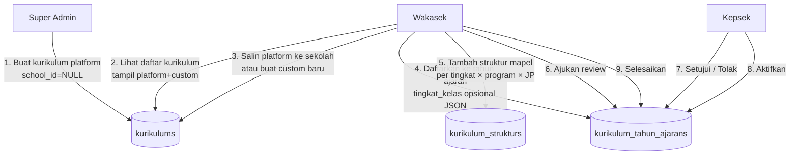
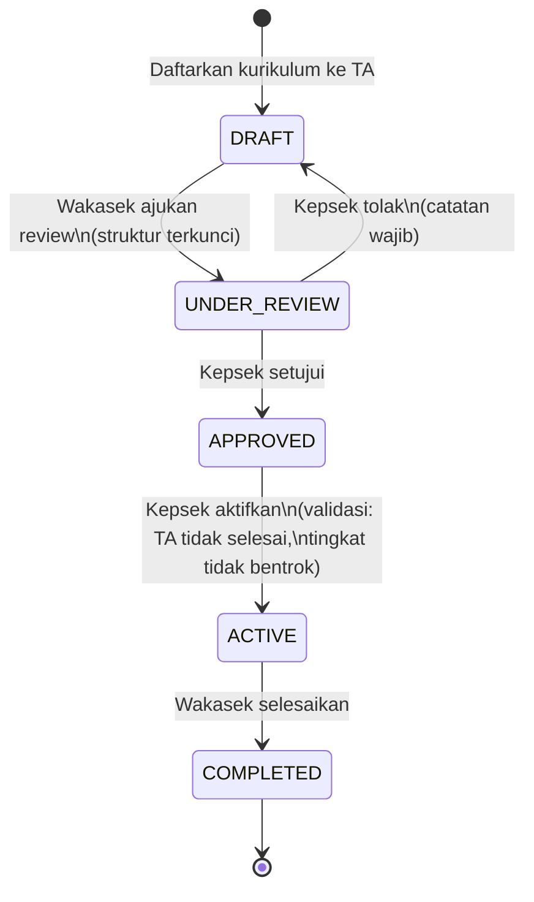
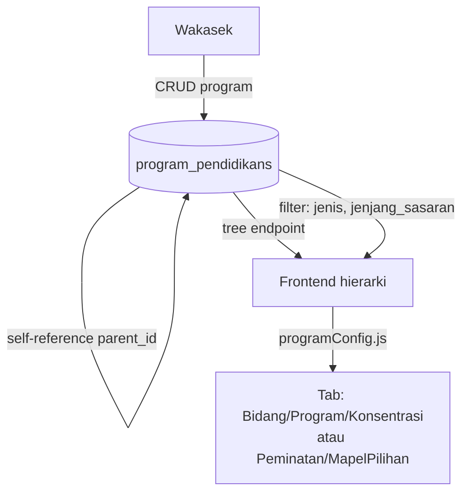
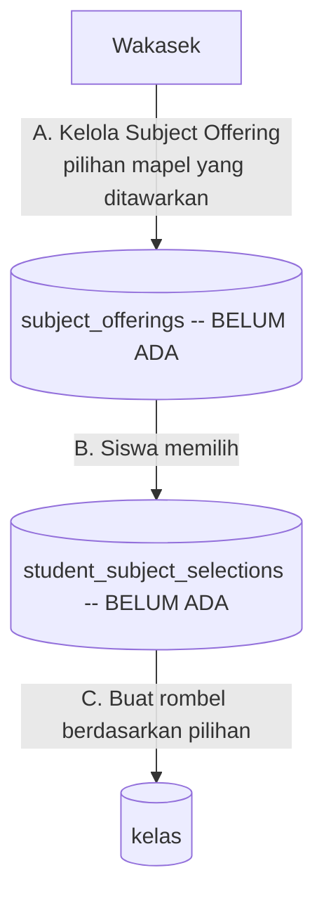
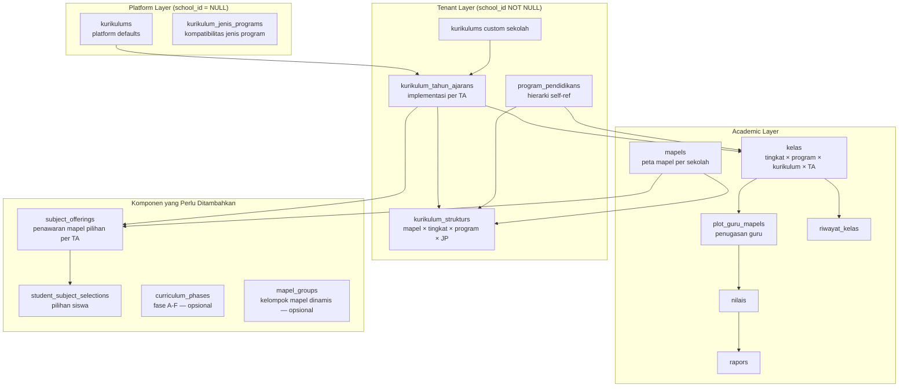
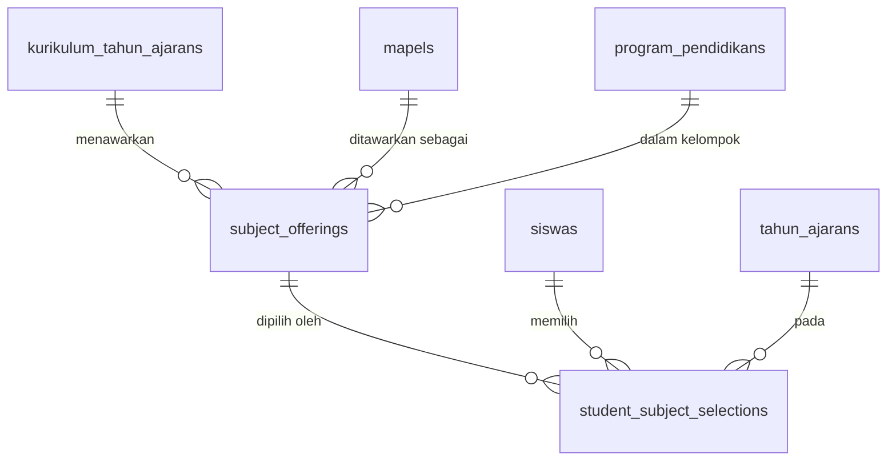
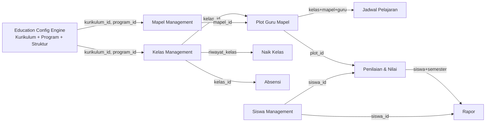

# EDUCATION CONFIGURATION ENGINE
## Audit, System Analysis & Architecture Blueprint

---

## 1. Document Information

| Atribut | Nilai |
|---|---|
| **Nama Dokumen** | Education Configuration Engine — Audit & Analysis |
| **Tujuan** | Single Source of Truth untuk pengembangan fitur konfigurasi pendidikan |
| **Tanggal Audit** | 20 November 2026 |
| **Status Audit** | Selesai — Tidak ada implementasi yang dilakukan |
| **Backend** | Laravel 11, PHP 8.3, MySQL 8.0.13+ |
| **Frontend** | React 18, TanStack Query v5, Tailwind CSS |
| **Autentikasi** | Laravel Sanctum + multi-tenant RBAC custom |
| **Multi-tenant** | `school_id` per tabel + Global Scope `HasSchoolScope` |
| **Repository** | `/Users/sahalanwarhadi/project_Sahal/Scholara` |
| **Modul Diperiksa** | backend/app/Models, Controllers, Services, Migrations, frontend/src |

---

## 2. Project Vision & Objectives

### Latar Belakang

Scholara adalah SaaS Sekolah multi-tenant yang ditujukan untuk berbagai satuan pendidikan Indonesia: SD/MI, SMP/MTs, SMA/MA, SMK/MAK. Sistem harus mampu mengelola keberagaman kurikulum dan struktur pendidikan tanpa perubahan source code setiap kali ada kebutuhan baru.

### Tujuan Education Configuration Engine

Sistem ini **bukan sekadar CRUD Kurikulum dan Program Pendidikan**. Tujuan akhirnya adalah membangun fondasi konfigurasi pendidikan yang:

1. **Fleksibel** — tidak hardcode kurikulum atau struktur program.
2. **Dinamis** — struktur program dapat dikonfigurasi per sekolah.
3. **Multi-tenant** — setiap sekolah punya konfigurasi terisolasi.
4. **Versioned** — perubahan kurikulum memiliki riwayat dan tidak merusak data historis.
5. **Extensible** — dapat mengakomodasi jenjang dan karakteristik sekolah baru.

---

## 3. Business Background

### 3.1 Keberagaman Kurikulum Indonesia

| Kurikulum | Jenjang | Karakteristik Program |
|---|---|---|
| Kurikulum 2013 (K13) | SD/MI, SMP/MTs, SMA/MA, SMK/MAK | Peminatan IPA/IPS/Bahasa di SMA/MA; Bidang/Program/Kompetensi Keahlian di SMK |
| Kurikulum Merdeka | SD/MI, SMP/MTs, SMA/MA, SMK/MAK | Fase A–F; Mata Pelajaran Pilihan di SMA/MA; Konsentrasi Keahlian di SMK |
| Cambridge / IB | Internasional | Struktur kustom, tidak terikat nomenklatur Kemdikbud |
| Kurikulum Pesantren | Khusus | Kombinasi mapel umum dan keagamaan mendalam |

### 3.2 Keberagaman Struktur Program Pendidikan

#### SMK/MAK — Hierarki 3 Level
```
Bidang Keahlian (level 1)
  └─ Program Keahlian (level 2)
       └─ Konsentrasi Keahlian (level 3)
```

#### SMA/MA K13 — Peminatan
```
Peminatan IPA / IPS / Bahasa / Keagamaan (1 level, melekat ke rombel)
```

#### SMA/MA Kurikulum Merdeka — Kelompok Mapel Pilihan
```
Mata Pelajaran Pilihan (dipilih per siswa, bukan per rombel)
  + Keagamaan (khusus MA/MAN)
```

#### SD/MI, SMP/MTs
```
Tidak menggunakan program pendidikan (kelas.program_pendidikan_id = NULL)
```

### 3.3 Skenario Multi-Kurikulum Satu Sekolah

Satu sekolah dalam satu tahun ajaran yang sama dapat menerapkan kurikulum berbeda untuk angkatan berbeda:

```
Tahun Ajaran 2025/2026:
  Kelas XII → Kurikulum 2013
  Kelas XI  → Kurikulum 2013
  Kelas X   → Kurikulum Merdeka
```

### 3.4 Jenis-Jenis Sekolah MA yang Memiliki Kebutuhan Khusus

| Subtipe | Karakteristik |
|---|---|
| MA Reguler | Peminatan umum + keagamaan |
| MAN Insan Cendekia (man_ic) | Fokus riset, sains, keimanan |
| MAN Program Keagamaan (man_pk) | Pendalaman kitab, bahasa Arab tingkat tinggi |
| MAN Plus Keterampilan (man_plus_vokasi) | MA reguler + hierarki vokasi (Bidang → Program → Konsentrasi) |

---

## 4. Current System Audit

### 4.1 Arsitektur Backend

Scholara menggunakan arsitektur **modular controller** dengan service layer terpisah. Tidak menggunakan Repository pattern secara eksplisit.

```
backend/
├── app/
│   ├── Enums/
│   │   ├── StatusImplementasiKurikulum.php   ← DRAFT→REVIEW→APPROVED→ACTIVE→COMPLETED
│   │   ├── StatusTahunAjaran.php             ← DRAFT→REVIEW→APPROVED→ACTIVE→COMPLETED→ARCHIVED
│   │   └── StatusSemester.php
│   ├── Http/
│   │   ├── Controllers/
│   │   │   ├── MasterData/
│   │   │   │   ├── KurikulumController.php
│   │   │   │   ├── KurikulumWorkflowController.php
│   │   │   │   ├── KurikulumStrukturController.php
│   │   │   │   ├── KurikulumCakupanController.php
│   │   │   │   ├── ProgramPendidikanController.php
│   │   │   │   └── MasterDataMapelController.php
│   │   │   └── SuperAdmin/
│   │   │       └── KurikulumPlatformController.php
│   │   ├── Requests/
│   │   │   ├── Kurikulum/
│   │   │   │   ├── DaftarkanKurikulumRequest.php
│   │   │   │   ├── PlatformKurikulumRequest.php
│   │   │   │   ├── StoreKurikulumRequest.php
│   │   │   │   ├── StoreKurikulumStrukturRequest.php
│   │   │   │   ├── UbahImplementasiRequest.php
│   │   │   │   ├── UpdateKurikulumRequest.php
│   │   │   │   └── UpdateKurikulumStrukturRequest.php
│   │   │   └── ProgramPendidikan/
│   │   │       ├── StoreProgramPendidikanRequest.php
│   │   │       └── UpdateProgramPendidikanRequest.php
│   │   └── Resources/
│   │       ├── KurikulumResource.php
│   │       ├── KurikulumDetailResource.php
│   │       └── ProgramPendidikanResource.php
│   ├── Models/
│   │   ├── Kurikulum.php
│   │   ├── KurikulumKomponenNilai.php
│   │   ├── KurikulumStruktur.php
│   │   ├── ProgramPendidikan.php
│   │   ├── Kelas.php
│   │   ├── MataPelajaran.php
│   │   ├── TahunAjaran.php
│   │   ├── Semester.php
│   │   ├── RiwayatKelas.php
│   │   ├── PlotGuruMapel.php
│   │   ├── Nilai.php
│   │   ├── Rapor.php
│   │   ├── Siswa.php
│   │   └── School.php
│   ├── Policies/
│   │   └── ProgramPendidikanPolicy.php
│   ├── Services/
│   │   ├── KurikulumService.php
│   │   ├── KurikulumWorkflowService.php
│   │   ├── KurikulumStrukturService.php
│   │   ├── KurikulumCakupanService.php
│   │   └── TahunAjaranService.php
│   └── Traits/
│       ├── HasSchoolScope.php
│       └── HasUlid.php
└── routes/api/
    ├── master-data.php   ← endpoint kurikulum, program, mapel, kelas, tahun ajaran
    ├── superadmin.php    ← endpoint platform kurikulum (school_id NULL)
    └── wakasek.php       ← view-only guru, siswa, absensi
```

### 4.2 Arsitektur Frontend

```
frontend/src/
├── config/
│   └── programConfig.js           ← konfigurasi UI dinamis per jenis sekolah × kurikulum
├── hooks/api/
│   ├── useKurikulum.js            ← TanStack Query kurikulum + implementasi + struktur
│   └── useProgramPendidikan.js    ← TanStack Query program pendidikan
├── pages/
│   ├── wakasek/akademik/
│   │   ├── kurikulum/
│   │   │   ├── MasterKurikulum.jsx
│   │   │   └── components/ModalKurikulum.jsx
│   │   ├── program-pendidikan/
│   │   │   ├── MasterProgramWakasek.jsx
│   │   │   ├── RecycleBinProgramWakasek.jsx
│   │   │   └── components/ (ModalProgram, ModalHapus, ProgramTable, FilterToolbar, ModalToggleStatus)
│   │   └── mapel/
│   │       ├── MasterMapelWakasek.jsx
│   │       └── components/ (MapelTable, MapelHelpers, ModalImportMapel)
│   └── superadmin/kurikulum/
│       ├── KurikulumPlatform.jsx
│       ├── KurikulumSekolah.jsx
│       ├── KurikulumSekolahList.jsx
│       └── DetailImplementasiSuperAdmin.jsx
└── shared/kurikulum/
    ├── DaftarImplementasiKurikulum.jsx
    ├── DetailImplementasiKurikulum.jsx
    ├── implementasiStatus.js
    ├── tingkatSekolah.js
    └── components/
        ├── ImplementasiStatusBadge.jsx
        ├── ImplementasiWorkflowPanel.jsx
        ├── KurikulumTahunAjaranSection.jsx
        ├── ModalUbahImplementasi.jsx
        └── StrukturKurikulumSection.jsx
```

### 4.3 Multi-Tenant Implementation

Multi-tenancy diimplementasikan dengan pola **school_id per tabel**:

- `HasSchoolScope` trait: menambahkan Global Scope `SchoolScope` yang otomatis memfilter query berdasarkan `current_school_id` dari IoC container.
- `current_school_id` di-inject oleh middleware ke IoC container saat request masuk.
- Model `Kurikulum` adalah pengecualian: `school_id` nullable karena ada kurikulum platform (NULL = tersedia semua sekolah).
- Policy `ProgramPendidikanPolicy::sameSchool()` sebagai lapisan kedua keamanan.

---

## 5. Existing Feature Analysis

### 5.1 Fitur yang Sudah Berjalan (Production-Ready)

| Fitur | Status | File Utama |
|---|---|---|
| Kurikulum Platform (superadmin CRUD) | ✅ Berjalan | `KurikulumPlatformController`, `KurikulumService::createPlatform/updatePlatform/deletePlatform` |
| Kurikulum Custom per Sekolah | ✅ Berjalan | `KurikulumService::createForSchool`, `KurikulumController::store` |
| Salin Kurikulum Platform ke Sekolah | ✅ Berjalan | `KurikulumService::salinDariPlatform`, `KurikulumController::salin` |
| Program Pendidikan Hierarkis (self-reference parent_id) | ✅ Berjalan | `ProgramPendidikan`, `ProgramPendidikanController::tree/index/store/update` |
| Daftarkan Kurikulum ke Tahun Ajaran (`kurikulum_tahun_ajarans`) | ✅ Berjalan | `KurikulumController::daftarkanKeTahunAjaran`, `KurikulumService::daftarkanKeTahunAjaran` |
| Workflow Implementasi Kurikulum (DRAFT→REVIEW→APPROVED→ACTIVE→COMPLETED) | ✅ Berjalan | `KurikulumWorkflowService`, `KurikulumWorkflowController` |
| Struktur Kurikulum per Implementasi (mapel + JP per tingkat + program) | ✅ Berjalan | `KurikulumStruktur`, `KurikulumStrukturService`, `KurikulumStrukturController` |
| Laporan Cakupan Kurikulum (struktur vs penugasan guru) | ✅ Berjalan | `KurikulumCakupanService`, `KurikulumCakupanController` |
| Matriks Kompatibilitas Kurikulum ↔ Jenis Program | ✅ Berjalan | tabel `kurikulum_jenis_programs` |
| Isolasi Multi-Tenant per Tenant | ✅ Berjalan | `HasSchoolScope`, `ProgramPendidikanPolicy` |
| Soft Delete + Recycle Bin (Kurikulum & Program) | ✅ Berjalan | `SoftDeletes`, endpoint `/trash`, `/restore`, `/force-delete` |
| ULID sebagai Public Identifier | ✅ Berjalan | `HasUlid`, semua endpoint menggunakan ULID |
| Audit Columns (created_by, updated_by, deleted_by) | ✅ Berjalan | Semua model utama |
| Kolom Legacy `kurikulum` ENUM di kelas dan mapels | ⚠️ Masa Transisi | `Kelas::kurikulumRef`, `MataPelajaran::kurikulumRef` |

### 5.2 Fitur yang Sudah Ada Tapi Belum Lengkap

| Fitur | Keterangan |
|---|---|
| Kolom `kelas.kurikulum` (ENUM lama) + `kelas.kurikulum_id` (FK baru) | Dua kolom berkoeksistensi; accessor `getNamaKurikulumAttribute` sebagai bridge |
| Kolom `mapels.kurikulum` (ENUM lama) + `mapels.kurikulum_id` (FK baru) | Pola sama; legacy belum dimigrasi penuh |
| Pivot `kurikulum_program_pendidikans` | Tabel sudah ada tapi deprecated/kosong; digantikan `kurikulum_jenis_programs` |
| Komponen Penilaian (`komponen_penilaians`) | Masih ada kolom ENUM `kurikulum` ('K13','Merdeka','Semua'); belum dimigrasi ke FK |
| Fase (A-F) Kurikulum Merdeka | Belum ada tabel `fases` atau kolom khusus; hanya ada di metadata JSON |
| Kelompok Mapel di Kurikulum Merdeka | Dikelola via field `kelompok` VARCHAR di `kurikulum_strukturs`, belum ada tabel master |

### 5.3 Fitur yang Belum Tersedia

| Fitur | Urgensi |
|---|---|
| **Subject Offering (Penawaran Mata Pelajaran)** — daftar mapel pilihan yang ditawarkan sekolah per TA | Tinggi (K.Merdeka SMA) |
| **Student Subject Selection** — siswa memilih dari daftar penawaran | Tinggi (K.Merdeka SMA) |
| **Versioning Snapshot Konfigurasi** — snapshot konfigurasi saat rapor diterbitkan | Tinggi |
| **Curriculum Template System** — template bawaan yang bisa di-fork oleh sekolah dengan full structural template | Sedang |
| **Phase Management** — tabel master fase (A, B, C, D, E, F) + relasi ke tingkat | Sedang |
| **Subject Group (Kelompok Mapel)** — tabel master kelompok mapel dinamis | Sedang |
| **Penerapan kurikulum lintas semester** — saat ini: satu implementasi bisa per semester ATAU per TA; belum ada UI granular | Sedang |

---

## 6. Database Audit & Relationship Analysis

### 6.1 Tabel-Tabel Relevan

| Tabel | Fungsi | Tenant | Soft Delete |
|---|---|---|---|
| `kurikulums` | Master kurikulum (platform NULL + custom sekolah) | school_id nullable | ✅ |
| `kurikulum_komponen_nilaians` | Komponen nilai per kurikulum (Formatif, Sumatif, dll) | school_id nullable | ✅ |
| `kurikulum_tahun_ajarans` | Implementasi kurikulum per sekolah per tahun ajaran | school_id NOT NULL | ❌ |
| `kurikulum_strukturs` | Struktur mapel per implementasi (tingkat × program × mapel + JP) | school_id NOT NULL | ❌ |
| `kurikulum_jenis_programs` | Matriks kompatibilitas kurikulum ↔ jenis program | global (tidak ada school_id) | ❌ |
| `kurikulum_program_pendidikans` | Pivot lama (deprecated, kosong) | school_id nullable | ❌ |
| `program_pendidikans` | Hierarki program (self-reference parent_id) | school_id NOT NULL | ✅ |
| `kelas` | Rombongan belajar (FK ke kurikulum, program, tahun ajaran, semester) | school_id NOT NULL | ✅ |
| `mapels` | Mata pelajaran (dengan FK kurikulum_id + legacy kurikulum ENUM) | school_id NOT NULL | ✅ |
| `tahun_ajarans` | Tahun ajaran dengan workflow status | school_id NOT NULL | ✅ |
| `semesters` | Semester per tahun ajaran | school_id NOT NULL | ✅ |
| `komponen_penilaians` | Komponen penilaian (masih ada ENUM kurikulum) | school_id NOT NULL | ❌ |
| `plot_guru_mapels` | Penugasan guru per mapel per kelas per semester | school_id NOT NULL | ✅ |
| `riwayat_kelas` | Riwayat siswa di kelas (snapshot nama kelas) | — | ✅ |
| `nilais` | Nilai siswa per komponen per plot | school_id NOT NULL | ✅ |
| `rapors` | Rapor siswa per semester | school_id NOT NULL | ✅ |
| `schools` | Data sekolah (jenis, jenjang, subtipe) | — | ✅ |

### 6.2 ERD Aktual (State Sekarang)

```mermaid
erDiagram
    schools {
        id PK
        ulid UK
        nama string
        jenis enum
        subtipe string
        jenjang string
        kurikulum string
    }

    kurikulums {
        id PK
        ulid UK
        school_id FK_nullable
        nama string
        kode string
        tahun_berlaku smallint
        tahun_berakhir smallint_nullable
        jenis enum
        is_active boolean
        is_platform_default boolean
        metadata json
    }

    kurikulum_komponen_nilaians {
        id PK
        school_id FK_nullable
        kurikulum_id FK
        nama string
        kategori enum
        bobot_persen float
        urutan int
        is_wajib boolean
    }

    program_pendidikans {
        id PK
        ulid UK
        school_id FK
        parent_id FK_nullable_self
        nama string
        kode string
        jenis enum
        jenjang_sasaran enum
        is_active boolean
    }

    kurikulum_jenis_programs {
        id PK
        kurikulum_id FK
        jenis_program varchar
        is_active boolean
    }

    kurikulum_tahun_ajarans {
        id PK
        ulid UK
        school_id FK
        kurikulum_id FK
        tahun_ajaran_id FK
        semester_id FK_nullable
        tingkat_kelas json_nullable
        status varchar
        is_active boolean
    }

    kurikulum_strukturs {
        id PK
        ulid UK
        school_id FK
        kurikulum_tahun_ajaran_id FK
        tingkat tinyint
        program_pendidikan_id FK_nullable
        mapel_id FK
        kelompok varchar
        alokasi_jp_minggu tinyint
        jenis_komponen varchar
        is_wajib boolean
        urutan_rapor smallint
    }

    tahun_ajarans {
        id PK
        ulid UK
        school_id FK
        tahun string
        status enum
        is_active boolean
        is_archived boolean
    }

    semesters {
        id PK
        ulid UK
        school_id FK
        tahun_ajaran_id FK
        nama string
        tgl_mulai date
        tgl_selesai date
        status enum
    }

    kelas {
        id PK
        school_id FK
        tahun_ajaran_id FK
        semester_id FK_nullable
        nama_kelas string
        tingkat tinyint
        program_pendidikan_id FK_nullable
        kurikulum_id FK_nullable
        kurikulum varchar_legacy
        wali_kelas_id FK_nullable
        is_active boolean
    }

    mapels {
        id PK
        ulid UK
        school_id FK
        kode string
        nama_mapel string
        kelompok enum_legacy
        tingkat string
        program_pendidikan_id FK_nullable
        kurikulum_id FK_nullable
        kurikulum enum_legacy
        is_active boolean
    }

    plot_guru_mapels {
        id PK
        school_id FK
        guru_id FK
        mapel_id FK
        kelas_id FK
        tahun_ajaran_id FK
        semester_id FK
        beban_jam int
    }

    nilais {
        id PK
        school_id FK
        siswa_id FK
        plot_id FK
        komponen_id FK_nullable
        tahun_ajaran_id FK
        semester_id FK
        nilai float
        deskripsi text
    }

    rapors {
        id PK
        school_id FK
        siswa_id FK
        kelas_id FK_nullable
        tahun_ajaran_id FK
        semester_id FK
        status enum
        status_kenaikan string
    }

    riwayat_kelas {
        id PK
        siswa_id FK
        kelas_id FK
        nama_kelas_snapshot string
        tahun_ajaran_id FK
        semester_id FK
        tanggal_masuk date
        tanggal_keluar date_nullable
        jenis_perubahan string
    }

    schools ||--o{ kurikulums : "custom kurikulum"
    schools ||--o{ program_pendidikans : "has"
    schools ||--o{ kelas : "has"
    schools ||--o{ mapels : "has"
    schools ||--o{ tahun_ajarans : "has"
    schools ||--o{ kurikulum_tahun_ajarans : "implements"

    kurikulums ||--o{ kurikulum_komponen_nilaians : "has"
    kurikulums ||--o{ kurikulum_jenis_programs : "compatible with"
    kurikulums ||--o{ kurikulum_tahun_ajarans : "used in"
    kurikulums ||--o{ kelas : "assigned to"
    kurikulums ||--o{ mapels : "scoped to"

    kurikulum_tahun_ajarans ||--o{ kurikulum_strukturs : "has structure"
    kurikulum_tahun_ajarans }o--|| tahun_ajarans : "for"
    kurikulum_tahun_ajarans }o--o| semesters : "optional per semester"

    program_pendidikans ||--o| program_pendidikans : "parent (self-ref)"
    program_pendidikans ||--o{ kelas : "used in"
    program_pendidikans ||--o{ mapels : "scoped to"
    program_pendidikans ||--o{ kurikulum_strukturs : "in structure"

    kurikulum_strukturs }o--|| mapels : "references"

    tahun_ajarans ||--o{ semesters : "has"
    tahun_ajarans ||--o{ kelas : "has"

    kelas ||--o{ riwayat_kelas : "contains"
    kelas ||--o{ plot_guru_mapels : "has"
    kelas ||--o{ rapors : "snapshot"

    plot_guru_mapels ||--o{ nilais : "has scores"
```

### 6.3 Masalah Desain yang Ditemukan

#### Issue #1 — Kolom Legacy ENUM Belum Selesai Dimigrasi

```
Tabel: kelas
  kolom LAMA: kurikulum ENUM('K13','Merdeka','Lainnya')     ← masih ada
  kolom BARU: kurikulum_id FK → kurikulums.id               ← sudah ada

Tabel: mapels
  kolom LAMA: kurikulum ENUM('Kurikulum 2013','Kurikulum Merdeka','Keduanya')  ← masih ada
  kolom BARU: kurikulum_id FK → kurikulums.id                                 ← sudah ada

Tabel: komponen_penilaians
  kolom LAMA: kurikulum ENUM('K13','Merdeka','Semua')        ← belum ada FK baru sama sekali
```

**Risiko**: Query lama yang masih memakai ENUM akan memberi hasil berbeda dari query yang memakai FK. Accessor bridge `getNamaKurikulumAttribute()` sudah tersedia di Kelas dan MataPelajaran, namun belum ada di semua query.

#### Issue #2 — Pivot `kurikulum_program_pendidikans` Deprecated/Kosong

Tabel `kurikulum_program_pendidikans` dibuat di migrasi `2026_09_03_000004` tetapi kemudian digantikan oleh `kurikulum_jenis_programs` di migrasi `2026_10_03_000002` karena masalah unique constraint dengan NULL.

**Risiko**: Tabel zombie yang menambah kebingungan developer baru.

#### Issue #3 — Kelompok Mapel Belum Dinormalisasi

Field `kelompok` pada `kurikulum_strukturs` adalah `VARCHAR(50)` tanpa tabel master. Field `kelompok` pada tabel `mapels` (original) adalah `ENUM` hardcode:

```sql
-- mapels.kelompok (original ENUM dari migration 2026_08_05_000004):
ENUM('A - Wajib','B - Wajib','C - Muatan Lokal','Pengembangan Diri','Ekstrakurikuler','Lainnya')
```

Ini hardcode untuk K13 dan tidak mendukung kelompok Kurikulum Merdeka.

#### Issue #4 — Tidak Ada Tabel `subject_offerings` dan `student_subject_selections`

Untuk Kurikulum Merdeka SMA/MA, siswa memilih mata pelajaran pilihan. Belum ada mekanisme untuk:
- Mendaftarkan penawaran mapel pilihan per TA per sekolah.
- Merekam pilihan mapel per siswa.
- Menghubungkan pilihan siswa ke rombongan belajar.

#### Issue #5 — Fase Kurikulum Merdeka Hanya di Metadata

Kurikulum Merdeka menggunakan fase A–F. Fase disinggung di komentar kode (`metadata` di `kurikulums`) tetapi tidak ada tabel, kolom, atau relasi khusus untuk fase. Ini membatasi kemampuan sistem melakukan validasi berbasis fase.

#### Issue #6 — `Schools.kurikulum` Kolom Legacy Bertahan

```php
// School.php
protected $fillable = [..., 'kurikulum', ...];

const KURIKULUM_MERDEKA = 'Kurikulum Merdeka';
const KURIKULUM_K13 = 'K13';
const KURIKULUM_LAINNYA = 'Lainnya';
```

Ini adalah kolom global yang menyiratkan sekolah hanya punya satu kurikulum, padahal sistem sudah mendukung multi-kurikulum per sekolah via `kurikulum_tahun_ajarans`.

---

## 7. Business Logic & Workflow Analysis

### 7.1 Workflow Aktual: Konfigurasi Kurikulum per Sekolah



### 7.2 Workflow Aktual: Status Implementasi Kurikulum



### 7.3 Workflow Aktual: Manajemen Program Pendidikan



### 7.4 Workflow Ideal yang Belum Tersedia



---

## 8. Gap Analysis

| Aspek | Kondisi Sekarang | Kebutuhan Ideal | Gap | Prioritas |
|---|---|---|---|---|
| **Template Kurikulum Platform** | Kurikulum platform (school_id=NULL) + salin ke sekolah | Full template dengan struktur mapel, komponen, fase | Hanya metadata tanpa template struktur penuh | Sedang |
| **Program Pendidikan Hierarkis** | Self-reference parent_id, 7 jenis, sudah mendukung SMK 3-level | Mendukung MAN Plus Vokasi (MA + hierarki vokasi) | Sudah didukung via jenis `keagamaan`+`bidang_keahlian` | ✅ Memadai |
| **Multi-Kurikulum per Sekolah** | `kurikulum_tahun_ajarans` dengan `tingkat_kelas` JSON | Satu tingkat dapat memakai kurikulum berbeda per TA | ✅ Sudah didukung | ✅ Memadai |
| **Versioning/Historis** | Implementasi (kta) sebagai snapshot; workflow DRAFT→COMPLETED | Snapshot konfigurasi lengkap saat rapor diterbitkan | Tidak ada snapshot immutable | Tinggi |
| **Fase Kurikulum Merdeka** | Hanya disebut di komentar/metadata | Tabel `phases` dengan relasi ke tingkat + kurikulum | Belum ada tabel fase | Sedang |
| **Kelompok Mapel Dinamis** | ENUM hardcode (K13) + VARCHAR bebas di `kurikulum_strukturs` | Tabel master kelompok mapel dinamis per kurikulum | ENUM di `mapels.kelompok` tidak fleksibel | Sedang |
| **Subject Offering** | Belum ada | Daftar mapel pilihan yang ditawarkan sekolah per TA | Belum ada sama sekali | Tinggi (K.Merdeka) |
| **Student Subject Selection** | Belum ada | Siswa memilih dari daftar penawaran | Belum ada sama sekali | Tinggi (K.Merdeka) |
| **Migrasi Legacy ENUM** | 3 kolom ENUM (kelas, mapels, komponen_penilaians) masih ada | Semua digantikan FK ke `kurikulums` | Dua selesai parsial, satu (komponen_penilaians) belum | Tinggi |
| **Komponen Penilaian per Implementasi** | Komponen di `kurikulum_komponen_nilaians` per kurikulum, tidak per implementasi | Komponen bisa dikustomisasi per implementasi/TA | Kurang granular | Rendah |
| **Cakupan Guru vs Struktur** | `KurikulumCakupanService` sudah ada, READ-ONLY | Sudah memadai | ✅ Sudah didukung | ✅ Memadai |
| **Pemantauan SuperAdmin** | READ-ONLY view implementasi per sekolah | Sudah memadai | ✅ Sudah didukung | ✅ Memadai |
| **Pivot Zombie** | `kurikulum_program_pendidikans` deprecated/kosong | Tidak ada pivot zombie | Tabel perlu dibersihkan | Rendah |
| **School.kurikulum Legacy** | Kolom global di schools masih ada | Dihapus setelah migrasi selesai | Menyiratkan satu kurikulum per sekolah | Sedang |

---

## 9. Target Architecture

### 9.1 Prinsip Arsitektur

Arsitektur yang direkomendasikan mempertahankan fondasi yang sudah ada (sangat baik) dan **mengembangkan** komponen yang belum ada. Tidak ada rewrite total.



### 9.2 Komponen yang Dapat Digunakan Kembali (Reuse)

| Komponen | Status | Tindakan |
|---|---|---|
| `Kurikulum` model + scopes | ✅ Sangat baik | Pertahankan |
| `ProgramPendidikan` model + hierarki | ✅ Sangat baik | Pertahankan |
| `KurikulumStruktur` model | ✅ Baik | Pertahankan |
| `KurikulumWorkflowService` | ✅ Baik | Pertahankan |
| `KurikulumCakupanService` | ✅ Baik | Pertahankan |
| `HasSchoolScope` trait | ✅ Fundamental | Pertahankan |
| Workflow RBAC (permission middleware) | ✅ Baik | Pertahankan |
| Frontend `useKurikulum.js` | ✅ Komprehensif | Pertahankan + tambah |
| Frontend `useProgramPendidikan.js` | ✅ Baik | Pertahankan |
| `programConfig.js` | ✅ Desain cerdas | Perluas untuk MA Plus Vokasi |

### 9.3 Komponen yang Perlu Diperbaiki

| Komponen | Masalah | Perbaikan |
|---|---|---|
| `komponen_penilaians` | Kolom ENUM `kurikulum` hardcode | Tambah `kurikulum_id` FK (nullable), migrasi data |
| `mapels.kelompok` | ENUM K13-centric | Ubah ke VARCHAR; buat tabel `mapel_kelompoks` jika diperlukan |
| `kelas.kurikulum` + `mapels.kurikulum` | Dua kolom berkoeksistensi | Migrasi data; drop kolom ENUM setelah validasi |
| `School.kurikulum` | Kolom global yang menyesatkan | Deprecate dan hapus setelah seluruh fitur pakai FK |
| `kurikulum_program_pendidikans` | Tabel zombie | Drop tabel setelah konfirmasi tidak ada konsumen |

---

## 10. Proposed Database Design

### 10.1 Tabel Baru yang Direkomendasikan

#### A. `subject_offerings` — Penawaran Mata Pelajaran Pilihan

```sql
CREATE TABLE subject_offerings (
    id              BIGINT UNSIGNED AUTO_INCREMENT PRIMARY KEY,
    ulid            CHAR(26)        NOT NULL UNIQUE,
    school_id       BIGINT UNSIGNED NOT NULL REFERENCES schools(id) ON DELETE CASCADE,
    kurikulum_tahun_ajaran_id BIGINT UNSIGNED NOT NULL REFERENCES kurikulum_tahun_ajarans(id) ON DELETE CASCADE,
    mapel_id        BIGINT UNSIGNED NOT NULL REFERENCES mapels(id) ON DELETE RESTRICT,
    program_pendidikan_id BIGINT UNSIGNED NULL REFERENCES program_pendidikans(id) ON DELETE SET NULL,
    tingkat         TINYINT UNSIGNED NOT NULL,
    kelompok        VARCHAR(80)     NULL,       -- 'MIPA', 'IPS', 'Bahasa', 'Vokasi'
    kuota           SMALLINT UNSIGNED NULL,     -- batas maksimal siswa
    is_active       BOOLEAN         NOT NULL DEFAULT TRUE,
    catatan         TEXT            NULL,
    created_by      BIGINT UNSIGNED NULL REFERENCES users(id) ON DELETE SET NULL,
    updated_by      BIGINT UNSIGNED NULL REFERENCES users(id) ON DELETE SET NULL,
    created_at      TIMESTAMP,
    updated_at      TIMESTAMP,

    UNIQUE KEY uq_offering_impl_mapel_tingkat (kurikulum_tahun_ajaran_id, mapel_id, tingkat),
    INDEX idx_offering_school (school_id),
    INDEX idx_offering_impl (kurikulum_tahun_ajaran_id)
);
```

**Fungsi**: Mendaftarkan mapel pilihan yang ditawarkan sekolah dalam satu implementasi kurikulum, untuk jenjang yang mendukung pemilihan mapel oleh siswa (SMA/MA Kurikulum Merdeka).

#### B. `student_subject_selections` — Pilihan Mata Pelajaran Siswa

```sql
CREATE TABLE student_subject_selections (
    id                  BIGINT UNSIGNED AUTO_INCREMENT PRIMARY KEY,
    ulid                CHAR(26)        NOT NULL UNIQUE,
    school_id           BIGINT UNSIGNED NOT NULL REFERENCES schools(id) ON DELETE CASCADE,
    siswa_id            BIGINT UNSIGNED NOT NULL REFERENCES siswas(id) ON DELETE CASCADE,
    subject_offering_id BIGINT UNSIGNED NOT NULL REFERENCES subject_offerings(id) ON DELETE RESTRICT,
    tahun_ajaran_id     BIGINT UNSIGNED NOT NULL REFERENCES tahun_ajarans(id) ON DELETE CASCADE,
    tingkat             TINYINT UNSIGNED NOT NULL,
    status              VARCHAR(20)     NOT NULL DEFAULT 'pending', -- pending|approved|rejected
    catatan             TEXT            NULL,
    approved_by         BIGINT UNSIGNED NULL REFERENCES users(id) ON DELETE SET NULL,
    approved_at         TIMESTAMP       NULL,
    created_at          TIMESTAMP,
    updated_at          TIMESTAMP,

    UNIQUE KEY uq_selection_siswa_offering (siswa_id, subject_offering_id, tahun_ajaran_id),
    INDEX idx_selection_school (school_id),
    INDEX idx_selection_siswa (siswa_id),
    INDEX idx_selection_ta (tahun_ajaran_id)
);
```

**Fungsi**: Merekam pilihan mata pelajaran setiap siswa dari daftar penawaran yang tersedia.

### 10.2 ERD Target (Tambahan dari Existing)



### 10.3 Perubahan Tabel Existing yang Direkomendasikan

#### A. `komponen_penilaians` — Migrasi ENUM ke FK

```sql
-- Tambah kolom baru (nullable — untuk backward compat)
ALTER TABLE komponen_penilaians
    ADD COLUMN kurikulum_id BIGINT UNSIGNED NULL
        REFERENCES kurikulums(id) ON DELETE SET NULL
        COMMENT 'FK ke kurikulums.id. NULL = berlaku semua kurikulum.';

-- Setelah data di-backfill, kolom ENUM lama bisa di-drop
-- ALTER TABLE komponen_penilaians DROP COLUMN kurikulum;
```

#### B. `mapels.kelompok` — Ubah dari ENUM ke VARCHAR

```sql
-- Migration untuk mengubah ENUM → VARCHAR
ALTER TABLE mapels
    MODIFY COLUMN kelompok VARCHAR(80) NULL
    COMMENT 'Kelompok mapel dinamis. NULL=tanpa kelompok.';
```

#### C. `kelas.kurikulum` dan `mapels.kurikulum` — Drop setelah Backfill Selesai

```sql
-- Lakukan setelah validasi penuh bahwa kurikulum_id sudah terisi semua
-- ALTER TABLE kelas DROP COLUMN kurikulum;
-- ALTER TABLE mapels DROP COLUMN kurikulum;
```

---

## 11. Multi-Tenant Strategy

### 11.1 Pola Isolasi yang Ada

| Layer | Mekanisme | Diperiksa Di |
|---|---|---|
| Global Scope | `HasSchoolScope` → `SchoolScope` | Semua Model yang pakai trait ini |
| IoC Container | `app('current_school_id')` di-inject middleware | `HasSchoolScope::bootHasSchoolScope` |
| Policy | `ProgramPendidikanPolicy::sameSchool()` | Lapisan kedua |
| Route Middleware | `role:operator,kepsek,wakasek` + `permission:...` | Semua route master-data |
| Kurikulum Platform | `school_id = NULL` → tersedia semua, tidak bisa diubah sekolah | `KurikulumService`, `Kurikulum::scopeAvailableForSchool` |

### 11.2 Pola Template Platform

```
Platform Admin (SuperAdmin)
  ↓ Buat kurikulum platform (school_id = NULL)
  ↓ Tambah komponen nilai (school_id = NULL)
  
Sekolah A
  ↓ Lihat platform defaults
  ↓ Salin (fork) → kurikulum custom (school_id = A)
  ↓ Modifikasi komponen sesuai kebutuhan
  ↓ Daftarkan ke tahun ajaran → kurikulum_tahun_ajarans
  ↓ Tambah struktur mapel → kurikulum_strukturs

Sekolah B
  ↓ Pakai platform default langsung (tanpa salin)
  ↓ Daftarkan ke tahun ajaran sendiri
```

Perubahan template platform (kurikulum platform) **tidak otomatis** mengubah konfigurasi sekolah yang sudah berjalan.

### 11.3 Yang Belum Diproteksi

- `kurikulum_jenis_programs` tidak memiliki `school_id` — ini global dan benar secara desain (matriks kompatibilitas berlaku universal).
- Belum ada mekanisme untuk sekolah meng-override matriks kompatibilitas kurikulum ↔ jenis program untuk kebutuhan khusus.

---

## 12. Curriculum Versioning & Historical Data

### 12.1 Mekanisme Versioning yang Ada

| Mekanisme | Implementasi | Kekuatan |
|---|---|---|
| **Implementasi sebagai snapshot** | Satu baris `kurikulum_tahun_ajarans` = satu konfigurasi untuk TA tertentu | Historis per TA |
| **Workflow status** | DRAFT→REVIEW→APPROVED→ACTIVE→COMPLETED; struktur terkunci setelah DRAFT | Mencegah perubahan tidak terkontrol |
| **Soft Delete** | `kurikulums`, `program_pendidikans`, `mapels` | Data lama tidak dihapus fisik |
| **Snapshot nama kelas** | `riwayat_kelas.nama_kelas_snapshot` | Nama kelas terjaga meski kelas di-update |
| **Audit Columns** | `created_by`, `updated_by`, `deleted_by` di semua tabel kritis | Siapa yang mengubah apa |

### 12.2 Yang Masih Kurang

| Kebutuhan | Kondisi | Rekomendasi |
|---|---|---|
| Snapshot struktur kurikulum saat rapor final | Tidak ada | Simpan JSON snapshot di `rapors` atau tabel `rapor_snapshots` terpisah |
| Versi template platform | Tidak ada; update template = overwrite | Tambah kolom `versi` atau tabel `kurikulum_versis` |
| Riwayat perubahan struktur kurikulum | Activity log ada tapi tidak terstruktur untuk diff | Pertimbangkan event sourcing di `kurikulum_strukturs` |

### 12.3 Skenario Perlindungan Data Historis

**Skenario**: Wakasek mengubah struktur kurikulum setelah semester selesai.

**Proteksi saat ini**: `KurikulumWorkflowService` melarang perubahan struktur kecuali implementasi berstatus DRAFT. Setelah ACTIVE/COMPLETED, struktur terkunci.

**Celah**: Jika implementasi di-reset ke DRAFT (hanya bisa via TOLAK di UNDER_REVIEW), struktur bisa diubah lagi. Namun nilai dan rapor historis **tidak memiliki FK langsung ke `kurikulum_strukturs`** — nilai terhubung ke `plot_guru_mapels` yang terhubung ke `kelas` dan `mapels`. Ini berarti perubahan struktur tidak langsung merusak nilai historis, tetapi bisa menyebabkan inkonsistensi laporan cakupan.

---

## 13. Integration Impact Analysis

### 13.1 Dampak Perubahan Database pada Modul Lain

| Modul | Model/Tabel | Dampak Perubahan Education Config Engine |
|---|---|---|
| **Manajemen Kelas** | `kelas` (kurikulum_id, program_pendidikan_id) | Drop kolom ENUM `kelas.kurikulum` → perlu update semua query yang masih pakai kolom lama |
| **Mata Pelajaran** | `mapels` (kurikulum_id, program_pendidikan_id) | Sama: drop ENUM lama; `mapels.kelompok` perlu diubah dari ENUM ke VARCHAR |
| **Komponen Penilaian** | `komponen_penilaians.kurikulum` | Perlu migrasi ke `kurikulum_id` FK |
| **Penugasan Guru** | `plot_guru_mapels` | Tidak berdampak langsung; terhubung ke `mapels` dan `kelas` |
| **Penilaian** | `nilais` | Tidak berdampak langsung; via `plot_id` |
| **Rapor** | `rapors` | Tidak berdampak langsung; namun perlu snapshot struktur |
| **Jadwal Pelajaran** | `jadwal_pelajarans` | Tidak berdampak langsung |
| **Kenaikan Kelas** | `NaikKelasController`, `riwayat_kelas` | Tidak berdampak langsung |
| **PPDB** | `calon_siswas` | Tidak berdampak |
| **Absensi** | `absensis` | Tidak berdampak langsung |

### 13.2 Dampak Penambahan `subject_offerings` dan `student_subject_selections`

| Modul | Dampak |
|---|---|
| **Pembentukan Kelas** | Perlu mempertimbangkan pilihan mapel siswa saat membentuk rombel |
| **Plot Guru Mapel** | Perlu mempertimbangkan `subject_offerings` sebagai dasar penugasan guru mapel pilihan |
| **Penilaian** | Guru hanya menilai siswa yang memilih mapel tersebut |
| **Rapor** | Rapor harus menampilkan mapel pilihan yang dipilih siswa |
| **Jadwal** | Jadwal mapel pilihan hanya untuk siswa yang memilih |

### 13.3 Diagram Ketergantungan Modul



---

## 14. Risk Analysis

### 14.1 Risiko Migrasi Database

| Risiko | Tingkat | Mitigasi |
|---|---|---|
| Drop kolom ENUM saat data lama belum ter-backfill ke FK | 🔴 Tinggi | Lakukan backfill dulu, verifikasi 100%, baru drop |
| Perubahan `mapels.kelompok` dari ENUM ke VARCHAR | 🟡 Sedang | Buat migration alter kolom; test semua query yang filter kelompok |
| Drop tabel `kurikulum_program_pendidikans` | 🟢 Rendah | Verifikasi tidak ada query aktif; drop dengan aman |
| Tambah `subject_offerings` dan `student_subject_selections` | 🟡 Sedang | Tabel baru, tidak ada breaking change; pastikan FK constraint benar |

### 14.2 Risiko Breaking Changes

| Risiko | Tingkat | Mitigasi |
|---|---|---|
| Frontend masih memakai kolom ENUM lama via API response | 🟡 Sedang | Pastikan API Resource tetap mengembalikan `nama_kurikulum` via accessor bridge |
| `komponen_penilaians` tanpa `kurikulum_id` FK | 🟡 Sedang | Migrasi bertahap; accessor fallback ke kolom ENUM |
| Relasi `kurikulumRef` (bukan `kurikulum`) di model Kelas dan MataPelajaran | 🟡 Sedang | Semua join/with yang pakai nama relasi harus diupdate |

### 14.3 Risiko Data Historis

| Risiko | Tingkat | Mitigasi |
|---|---|---|
| Perubahan program pendidikan merusak kelas lama | 🟡 Sedang | `nullOnDelete` di FK `kelas.program_pendidikan_id` sudah melindungi |
| Perubahan struktur kurikulum merusak nilai historis | 🟢 Rendah | Nilai terhubung via `plot_guru_mapels`, tidak langsung ke `kurikulum_strukturs` |
| Tidak ada snapshot konfigurasi saat rapor final | 🟡 Sedang | Tambah JSON snapshot di rapor saat finalisasi |

### 14.4 Risiko Multi-Tenant

| Risiko | Tingkat | Mitigasi |
|---|---|---|
| Global Scope di-bypass via `withoutGlobalScopes()` tanpa konteks | 🟡 Sedang | Semua penggunaan `withoutGlobalScopes()` harus ada `where school_id` eksplisit |
| `kurikulum_jenis_programs` tanpa school_id tapi diakses tenant | 🟢 Rendah | Data global; tidak ada data sensitif; READ-ONLY dari tenant |
| Subject offerings bocor antar sekolah | 🔴 Tinggi | Pastikan `subject_offerings.school_id` + SchoolScope |

### 14.5 Risiko Performa

| Risiko | Tingkat | Mitigasi |
|---|---|---|
| Recursive tree query `descendantsTree` untuk hierarki dalam | 🟡 Sedang | Sudah dibatasi 3 level (SMK); tambah cache jika perlu |
| JOIN besar di `KurikulumCakupanService` | 🟡 Sedang | Query sudah dioptimasi per kelas; tambah index jika lambat |
| `kurikulum_strukturs` tanpa soft delete → no tombstone | 🟢 Rendah | Desain sudah dipikirkan; riwayat di activity_logs |

---

## 15. Recommended Architecture & Technical Decisions

### 15.1 Rekomendasi Final

> [!IMPORTANT]
> **Prinsip utama**: Jangan rewrite — Evolve. Fondasi yang ada sudah sangat baik. Fokus pada mengisi gap yang belum ada dan membersihkan technical debt legacy ENUM.

#### Keputusan Arsitektur #1 — Pertahankan Pola `kurikulum_tahun_ajarans`

Pola implementasi (satu baris = satu konfigurasi kurikulum untuk sekolah + TA tertentu) sudah benar dan mendukung multi-kurikulum per sekolah per TA. **Tidak perlu diubah.**

#### Keputusan Arsitektur #2 — Selesaikan Migrasi Legacy ENUM

Prioritas: `komponen_penilaians.kurikulum` → tambah `kurikulum_id` FK. Kemudian drop `kelas.kurikulum` dan `mapels.kurikulum` setelah backfill divalidasi.

#### Keputusan Arsitektur #3 — Tambah `subject_offerings` dan `student_subject_selections`

Dua tabel ini adalah gap terbesar untuk mendukung Kurikulum Merdeka SMA/MA. Desain sudah jelas, tidak memerlukan perubahan arsitektur besar.

#### Keputusan Arsitektur #4 — Kelompok Mapel Dinamis

Ubah `mapels.kelompok` dari ENUM ke VARCHAR terlebih dahulu. Jika diperlukan tabel master kelompok, tambahkan sebagai entitas terpisah per kurikulum-implementasi.

#### Keputusan Arsitektur #5 — Fase Kurikulum Merdeka

Untuk MVP, fase cukup disimpan sebagai metadata di `kurikulums.metadata` atau sebagai kolom opsional di `kurikulum_strukturs`. Tabel `curriculum_phases` baru hanya diperlukan jika ada logika bisnis yang bergantung pada fase.

#### Keputusan Arsitektur #6 — Snapshot Konfigurasi Rapor

Tambahkan kolom `kurikulum_snapshot` (JSON) di tabel `rapors` yang diisi saat finalisasi rapor. Ini memastikan rapor historis tidak terdampak perubahan konfigurasi masa depan.

### 15.2 Urutan Prioritas Pekerjaan

```
Fase 1 (Technical Debt):
  1. Backfill + drop kelas.kurikulum dan mapels.kurikulum ENUM
  2. Tambah kurikulum_id FK ke komponen_penilaians
  3. Ubah mapels.kelompok dari ENUM ke VARCHAR
  4. Drop tabel zombie kurikulum_program_pendidikans

Fase 2 (Gap Filling):
  5. Buat tabel subject_offerings + student_subject_selections
  6. Backend: SubjectOfferingController, service, Form Request
  7. Backend: StudentSubjectSelectionController, service
  8. Frontend: hook + halaman penawaran mapel
  9. Frontend: halaman pilihan mapel siswa

Fase 3 (Enhancement):
  10. Snapshot konfigurasi di rapors saat finalisasi
  11. Kelompok mapel dinamis (tabel master jika diperlukan)
  12. Perluas programConfig.js untuk MAN Plus Vokasi
  13. Deprecate dan drop School.kurikulum
```

---

## 16. Implementation Map

### 16.1 File yang Harus Dipertahankan

| File | Alasan |
|---|---|
| `backend/app/Models/Kurikulum.php` | Desain dua-layer (platform/custom) sudah benar |
| `backend/app/Models/ProgramPendidikan.php` | Hierarki self-ref sudah benar dan lengkap |
| `backend/app/Models/KurikulumStruktur.php` | Desain tanpa soft-delete sudah dipikirkan |
| `backend/app/Services/KurikulumService.php` | Business rules sudah solid |
| `backend/app/Services/KurikulumWorkflowService.php` | Workflow state machine sudah baik |
| `backend/app/Services/KurikulumStrukturService.php` | Validasi tingkat + program sudah ada |
| `backend/app/Services/KurikulumCakupanService.php` | Laporan cakupan sudah benar |
| `backend/app/Enums/StatusImplementasiKurikulum.php` | State machine sudah benar |
| `backend/app/Traits/HasSchoolScope.php` | Fondasi multi-tenancy |
| `backend/app/Policies/ProgramPendidikanPolicy.php` | Lapisan keamanan yang diperlukan |
| `frontend/src/hooks/api/useKurikulum.js` | Query keys + mutations sudah komprehensif |
| `frontend/src/hooks/api/useProgramPendidikan.js` | Hook sudah baik |
| `frontend/src/config/programConfig.js` | Desain dinamis per jenis sekolah |
| `frontend/src/shared/kurikulum/` | Komponen shared yang reusable |

### 16.2 File yang Harus Diperbaiki

| File | Perbaikan Diperlukan |
|---|---|
| `backend/database/migrations/` (buat baru) | Migration: tambah `kurikulum_id` ke `komponen_penilaians` |
| `backend/database/migrations/` (buat baru) | Migration: ubah `mapels.kelompok` ke VARCHAR |
| `backend/database/migrations/` (buat baru) | Migration: drop `kelas.kurikulum` dan `mapels.kurikulum` setelah backfill |
| `backend/app/Models/Kelas.php` | Hapus `kurikulum` dari `$fillable` setelah drop kolom |
| `backend/app/Models/MataPelajaran.php` | Hapus `kurikulum` dari `$fillable` setelah drop kolom; ubah cast `kelompok` |
| `backend/app/Models/School.php` | Deprecate dan akhirnya hapus `kurikulum` dari `$fillable` |
| `frontend/src/pages/wakasek/akademik/kurikulum/MasterKurikulum.jsx` | Pastikan tidak ada referensi ke kolom ENUM lama |
| `frontend/src/pages/wakasek/akademik/mapel/` | Perbarui filter kelompok agar dinamis |

### 16.3 File yang Harus Dibuat

| File | Deskripsi |
|---|---|
| `backend/app/Models/SubjectOffering.php` | Model untuk penawaran mapel pilihan |
| `backend/app/Models/StudentSubjectSelection.php` | Model untuk pilihan siswa |
| `backend/app/Http/Controllers/MasterData/SubjectOfferingController.php` | CRUD penawaran mapel |
| `backend/app/Http/Controllers/MasterData/StudentSubjectSelectionController.php` | CRUD pilihan siswa |
| `backend/app/Services/SubjectOfferingService.php` | Business logic penawaran |
| `backend/app/Services/StudentSubjectSelectionService.php` | Business logic pilihan |
| `backend/app/Http/Requests/SubjectOffering/StoreSubjectOfferingRequest.php` | Validasi |
| `backend/app/Http/Requests/StudentSubjectSelection/StoreSelectionRequest.php` | Validasi |
| `backend/database/migrations/YYYY_MM_DD_create_subject_offerings_table.php` | Migration baru |
| `backend/database/migrations/YYYY_MM_DD_create_student_subject_selections_table.php` | Migration baru |
| `frontend/src/hooks/api/useSubjectOffering.js` | TanStack Query hook |
| `frontend/src/hooks/api/useStudentSubjectSelection.js` | TanStack Query hook |
| `frontend/src/pages/wakasek/akademik/penawaran-mapel/` | Halaman UI baru |

---

## 17. Testing & Validation Scenarios

### 17.1 Skenario Wajib untuk Validasi Sistem

| # | Skenario | Komponen Yang Diuji | Kriteria Sukses |
|---|---|---|---|
| 1 | MA menggunakan K13 | ProgramPendidikan (peminatan+keagamaan), Kurikulum K13, kurikulum_jenis_programs | Program jenis `peminatan` dan `keagamaan` muncul; `mata_pelajaran_pilihan` tidak muncul |
| 2 | MA menggunakan Kurikulum Merdeka | ProgramPendidikan (mata_pelajaran_pilihan+keagamaan) | `peminatan` tidak muncul; `mata_pelajaran_pilihan` muncul |
| 3 | SMA menggunakan Kurikulum Merdeka | ProgramPendidikan, subject_offerings | Hanya `mata_pelajaran_pilihan`; tidak ada `keagamaan` |
| 4 | SMK menggunakan Kurikulum Merdeka | Hierarki 3-level (Bidang→Program→Konsentrasi) | Hierarki tree tampil benar; tidak ada peminatan |
| 5 | Dua sekolah kurikulum berbeda | school_id isolation, HasSchoolScope | Sekolah A tidak lihat data Sekolah B |
| 6 | Dua sekolah kurikulum sama, program berbeda | program_pendidikans per school_id | Program sekolah A tidak muncul di sekolah B |
| 7 | Sekolah mengubah program pendidikan | soft delete, FK nullOnDelete | Kelas lama tetap ada (program_id = NULL); program baru bisa dibuat |
| 8 | Sekolah menambah konsentrasi keahlian | parent_id self-reference | Konsentrasi muncul sebagai child dari Program Keahlian |
| 9 | Kurikulum berbeda per angkatan | kurikulum_tahun_ajarans.tingkat_kelas JSON | X=Merdeka, XI=K13, XII=K13 bisa diset dalam satu TA |
| 10 | Tahun ajaran baru | TahunAjaran, Semester | Tidak mewarisi konfigurasi dari TA lama; implementasi baru dibuat terpisah |
| 11 | Template platform diperbarui | Kurikulum platform (school_id=NULL) | Sekolah yang sudah fork tidak terdampak |
| 12 | Konfigurasi lama masih dipakai | kurikulum_tahun_ajarans workflow COMPLETED | Implementasi COMPLETED tidak bisa diubah |
| 13 | Siswa pindah program | riwayat_kelas, kelas baru | Riwayat historis tetap valid |
| 14 | Perubahan tidak merusak rapor | rapors + snapshot | Rapor final yang sudah ada tidak berubah |
| 15 | Tenant isolation | SchoolScope + Policy | GET dari sekolah lain return 404/403 |

### 17.2 Skenario Workflow

| Skenario | Alur | Kriteria |
|---|---|---|
| Ajukan review dengan struktur kosong | DRAFT → UNDER_REVIEW saat struktur kosong | Error 422: "Struktur masih kosong" |
| Aktifkan saat TA sudah COMPLETED | APPROVED → ACTIVE saat TA berstatus completed | Error 422: "Tahun ajaran sudah selesai" |
| Dua implementasi aktif di tingkat sama | APPROVED → ACTIVE saat ada implementasi lain ACTIVE di tingkat yang sama | Error 422: "Tingkat sudah punya kurikulum aktif" |

---

## 18. Known Issues & Open Questions

### 18.1 Temuan yang Membutuhkan Konfirmasi

| # | Temuan | Pertanyaan |
|---|---|---|
| 1 | `School.kurikulum` kolom global masih ada | Kapan akan dihapus? Apakah ada fitur yang masih bergantung pada kolom ini? |
| 2 | Pivot `kurikulum_program_pendidikans` deprecated/kosong | Apakah sudah aman untuk di-drop? Perlu cek FK dan query yang masih mungkin referens tabel ini. |
| 3 | `komponen_penilaians` belum punya `kurikulum_id` FK | Apakah komponen penilaian perlu dikustomisasi per implementasi (bukan hanya per kurikulum)? |
| 4 | Fase Kurikulum Merdeka (A-F) | Apakah perlu tabel master fase? Atau cukup di metadata dan UI saja? |
| 5 | `mapels.tingkat` bertipe string dengan format "1,3,5" | Desain ini tidak ideal; pertimbangkan normalisasi ke tabel relasi. |
| 6 | `mapels.kelompok` ENUM hardcode K13 | Apakah ada mapel yang fieldnya sudah diisi dengan nilai ENUM lama yang perlu di-migrate ke VARCHAR? |

### 18.2 Keterbatasan Audit

- Tidak ada akses ke database live; analisis berdasarkan migrations dan source code.
- File frontend `.tsx` tidak ditemukan — semua frontend menggunakan `.jsx`/`.js`.
- Tidak ada test suite yang dapat diinspeksi untuk memverifikasi coverage.

---

## 19. Final Conclusion

### 19.1 Kondisi Sistem Saat Ini

Scholara sudah memiliki **fondasi yang sangat baik** untuk Education Configuration Engine. Sistem sudah:

✅ Mendukung multi-kurikulum per sekolah per tahun ajaran  
✅ Mendukung hierarki program pendidikan dinamis (SMK 3-level, SMA peminatan/mapel pilihan)  
✅ Memiliki workflow approval yang solid (DRAFT→REVIEW→APPROVED→ACTIVE→COMPLETED)  
✅ Memiliki isolasi multi-tenant yang kuat  
✅ Memiliki arsitektur dua-layer (platform/custom) yang elegan  
✅ Memiliki laporan cakupan kurikulum vs penugasan guru  
✅ Sudah menggunakan ULID, soft delete, audit columns, dan constraint yang tepat  

### 19.2 Yang Perlu Dikerjakan

**Technical Debt (harus segera)**:
- Selesaikan migrasi kolom ENUM legacy di `komponen_penilaians`, `kelas`, `mapels`
- Bersihkan tabel zombie `kurikulum_program_pendidikans`

**Gap Fungsional (penting untuk Kurikulum Merdeka)**:
- Tambah `subject_offerings` dan `student_subject_selections`

**Enhancement**:
- Snapshot konfigurasi di rapor saat finalisasi
- Kelompok mapel dinamis

### 19.3 Rekomendasi Arah

> [!NOTE]
> Arsitektur saat ini sudah mencerminkan visi Education Configuration Engine yang diminta. Yang dibutuhkan bukan rewrite, melainkan: (1) membersihkan technical debt legacy ENUM, (2) mengisi gap fungsional untuk Kurikulum Merdeka SMA/MA, dan (3) memperkuat versioning dengan snapshot konfigurasi.

Sistem sudah berada di jalur yang benar. Fokus pengembangan berikutnya adalah **Subject Offering + Student Subject Selection**, yang merupakan komponen yang belum ada sama sekali dan kritis untuk mendukung model pembelajaran pilihan Kurikulum Merdeka.

---

## 20. Audit Evidence & References

### 20.1 File Backend yang Diperiksa

| File | Hash/Tanggal |
|---|---|
| `backend/app/Models/Kurikulum.php` | Diperiksa 20 Nov 2026 |
| `backend/app/Models/ProgramPendidikan.php` | Diperiksa 20 Nov 2026 |
| `backend/app/Models/KurikulumStruktur.php` | Diperiksa 20 Nov 2026 |
| `backend/app/Models/KurikulumKomponenNilai.php` | Diperiksa 20 Nov 2026 |
| `backend/app/Models/Kelas.php` | Diperiksa 20 Nov 2026 |
| `backend/app/Models/MataPelajaran.php` | Diperiksa 20 Nov 2026 |
| `backend/app/Models/TahunAjaran.php` | Diperiksa 20 Nov 2026 |
| `backend/app/Models/Semester.php` | Diperiksa 20 Nov 2026 |
| `backend/app/Models/School.php` | Diperiksa 20 Nov 2026 |
| `backend/app/Models/RiwayatKelas.php` | Diperiksa 20 Nov 2026 |
| `backend/app/Models/PlotGuruMapel.php` | Diperiksa 20 Nov 2026 |
| `backend/app/Models/Nilai.php` | Diperiksa 20 Nov 2026 |
| `backend/app/Models/Rapor.php` | Diperiksa 20 Nov 2026 |
| `backend/app/Services/KurikulumService.php` | Diperiksa 20 Nov 2026 |
| `backend/app/Services/KurikulumWorkflowService.php` | Diperiksa 20 Nov 2026 |
| `backend/app/Services/KurikulumStrukturService.php` | Diperiksa 20 Nov 2026 |
| `backend/app/Services/KurikulumCakupanService.php` | Diperiksa 20 Nov 2026 |
| `backend/app/Services/TahunAjaranService.php` | Diperiksa 20 Nov 2026 |
| `backend/app/Enums/StatusImplementasiKurikulum.php` | Diperiksa 20 Nov 2026 |
| `backend/app/Enums/StatusTahunAjaran.php` | Diperiksa 20 Nov 2026 |
| `backend/app/Traits/HasSchoolScope.php` | Diperiksa 20 Nov 2026 |
| `backend/app/Policies/ProgramPendidikanPolicy.php` | Diperiksa 20 Nov 2026 |
| `backend/app/Http/Controllers/MasterData/KurikulumController.php` | Diperiksa 20 Nov 2026 |
| `backend/app/Http/Controllers/MasterData/KurikulumWorkflowController.php` | Diperiksa 20 Nov 2026 |
| `backend/app/Http/Controllers/MasterData/KurikulumStrukturController.php` | Diperiksa 20 Nov 2026 |
| `backend/app/Http/Controllers/MasterData/ProgramPendidikanController.php` | Diperiksa 20 Nov 2026 |
| `backend/app/Http/Controllers/SuperAdmin/KurikulumPlatformController.php` | Diperiksa 20 Nov 2026 |
| `backend/app/Http/Requests/ProgramPendidikan/StoreProgramPendidikanRequest.php` | Diperiksa 20 Nov 2026 |
| `backend/routes/api/master-data.php` | Diperiksa 20 Nov 2026 |
| `backend/routes/api/superadmin.php` | Diperiksa 20 Nov 2026 |
| `backend/routes/api/wakasek.php` | Diperiksa 20 Nov 2026 |

### 20.2 Migrasi yang Diperiksa

| Migration | Deskripsi |
|---|---|
| `2026_08_05_000004_create_kelas_mapel_profil_tables.php` | Skema awal kelas + mapels (ENUM kurikulum) |
| `2026_08_27_000005_replace_jurusans_with_program_pendidikans.php` | Migrasi dari jurusans ke program_pendidikans hierarkis |
| `2026_08_29_000001_add_kurikulum_to_schools.php` | Tambah kolom kurikulum ke schools |
| `2026_09_03_000001_create_kurikulums_table.php` | Tabel kurikulums + komponen nilai platform |
| `2026_09_03_000004_create_kurikulum_pivot_tables.php` | Pivot kurikulum ↔ program + tahun ajaran |
| `2026_10_03_000002_create_kurikulum_jenis_programs_table.php` | Matriks kompatibilitas kurikulum ↔ jenis program |
| `2026_10_04_000002_create_kurikulum_strukturs_table.php` | Tabel struktur kurikulum per implementasi |
| `2026_10_05_000001_add_workflow_to_kurikulum_tahun_ajarans.php` | Workflow status pada implementasi |
| `2026_11_19_000001_add_audit_columns_to_program_pendidikans_table.php` | Audit columns di program_pendidikans |

### 20.3 File Frontend yang Diperiksa

| File | Deskripsi |
|---|---|
| `frontend/src/hooks/api/useKurikulum.js` | Query keys + mutations komprehensif |
| `frontend/src/hooks/api/useProgramPendidikan.js` | Hook program pendidikan |
| `frontend/src/config/programConfig.js` | Konfigurasi UI dinamis per jenis sekolah |
| `frontend/src/shared/kurikulum/tingkatSekolah.js` | Helper tingkat per jenjang |
| `frontend/src/pages/wakasek/akademik/kurikulum/MasterKurikulum.jsx` | Halaman master kurikulum |
| `frontend/src/pages/wakasek/akademik/program-pendidikan/MasterProgramWakasek.jsx` | Halaman master program |
| `frontend/src/pages/superadmin/kurikulum/KurikulumPlatform.jsx` | Halaman platform superadmin |

### 20.4 Referensi Regulasi

- Permendikbud No. 16/2022 — Standar Proses pada Kurikulum Merdeka
- Permendikbud No. 262/2022 — Pedoman Penerapan Kurikulum Merdeka
- Permendikbud No. 50/2020 — Praktik Kerja Lapangan SMK/MAK
- Peraturan Menteri Agama — MAN Plus Keterampilan
- Nomenklatur Kemdikbud: Bidang Keahlian / Program Keahlian / Konsentrasi Keahlian

---

*Dokumen ini dibuat berdasarkan pemeriksaan source code aktual pada 20 November 2026. Tidak ada implementasi atau perubahan database yang dilakukan selama audit. Semua nama tabel, file, dan entitas dalam dokumen ini adalah berdasarkan temuan nyata dari repository.*
